# Debra progress and dependencies

<!-- Generated by tools/progress.py; edit the sources, not this page. -->

**The destination:** an affordable, browser-configured Home Assistant voice/music
device, with reliable setup, updates and recovery, plus sourced buying/build
guidance. Full original Zero W support and validated enclosure variants remain
separate engineering tracks, not claims established by the Pi 5 demo.

For demonstrated device behaviour, prototype limits and what is **not yet
validated**, see the [evidence summary](guides/current-status.md).

This is a **tracked planning snapshot, not a live device/worker monitor**.
Status comes from the [roadmap](roadmap.md) and [work queue](work-queue.md).
Source fingerprint: `20b5105ff5bd`. Regenerate after changing either source.

## Colour key

| Colour | Label | Meaning |
| --- | --- | --- |
| 🟩 Green | Finished | Whole packet accepted/integrated, not merely one successful subtask |
| 🟦 Blue | In progress | An editing/implementation row is active in the work queue |
| 🟪 Purple | In review | Deliverable awaits review, or its acceptance review is active |
| 🟨 Amber | Partial | Prototype, limited evidence or incomplete scope; not accepted |
| 🟥 Red | Blocked | Roadmap prerequisites remain open; unrelated exploration can continue |
| ⬜ Grey | Untouched | Roadmap says ready, but no tracked work/progress is recorded |

Labels accompany colours. **Maturity and dependency readiness are separate:**
a partial/in-review packet can still have unmet prerequisites. The packet
tables below retain both. Grey means no *recorded* progress, not proof no
one has ever investigated it. Neither colour nor readiness grants device permission.

**75 roadmap packets:** 4 finished · 0 in progress · 11 in review · 14 partial · 46 blocked · 0 untouched.
Counts are packets, **not a percentage complete**; packet sizes differ.

## Product overview

A simplified capability flow, not an execution order or a new set of gates.
Overview colours roll up their packets: mixed completed/review/partial work
is amber, active implementation blue, all finished green. Exact dependencies
and per-packet status are in the expandable diagrams below.

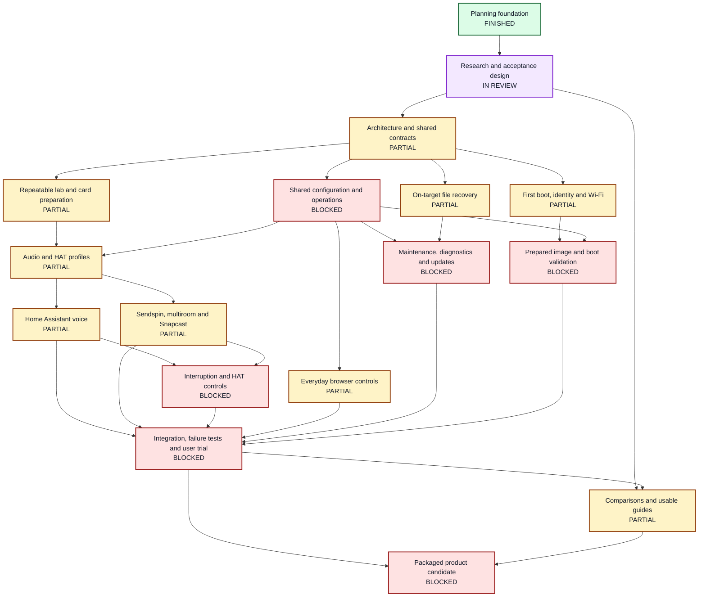

### Parallel and deferred tracks


- **Zero W:** full voice/music support is a first-class goal; it is not
  proven by another board and does not prevent accurately scoped other-board trials.
- **Enclosures:** CAD → physical fit → thermal/acoustic validation, separately
  from software gates. See the linked evidence for current validation limits.
- **Agent permissions:** closed self-selection dispatch is not a blanket
  block on coordinator-assigned development.
- **Rescue/media loss:** deferred; not a prerequisite for browser controls or
  the current on-target file-restore milestone. Later release/failure packets
  still name B05 where applicable.
- Optional sensors/radios/network extras are [unapproved candidates](roadmap.md#optional-extras-unreviewed-candidates-not-approved),
  not required product steps or supported features.

## Recorded active work

- Acceptance review `code-r11` — WEB03.
- Re-review `setup-r8` — N02.

This is what the queue records, not a liveness check. See
[review outcomes, queued work and named blockers](work-queue.md), including
[facts still needed from James](work-queue.md#needs-james).

## Detailed dependency diagrams

**Arrow direction:** prerequisite → dependent. Solid arrows are unqualified
roadmap prerequisites; dotted arrows carry a qualification (for example,
"before writes" or "for final onboarding"). Read the original dependency
text in each table; slashes without a qualification mean all named prerequisites.
External prerequisite nodes are repeated for context; each packet's incoming
edges appear in its own section. All roadmap packets, including WEB01–WEB10,
are included, even though the dispatch catalog excludes the browser lane.
The open-packet column checks packet IDs only; requirements written as prose
(such as named-target recovery) remain in the original wording and are **not**
evaluated by this tool. A dash does not mean those requirements passed.

<details>
<summary>Foundation and coordination (7 packets)</summary>

[Acceptance and evidence](roadmap.md#foundation-and-coordination)

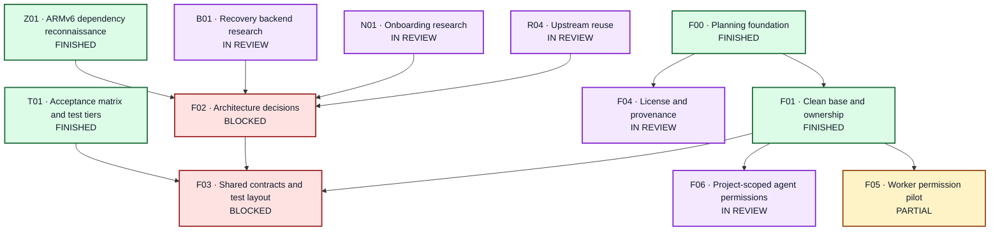

| Packet / step | Progress | Roadmap state | Prerequisites (original wording) | Open packet prerequisites |
| --- | --- | --- | --- | --- |
| F00 · Planning foundation | FINISHED | done | — | — |
| F01 · Clean base and ownership | FINISHED | done | F00 | — |
| F02 · Architecture decisions | BLOCKED | blocked | R04, N01, B01, Z01 | R04, N01, B01 |
| F03 · Shared contracts and test layout | BLOCKED | blocked | F01, F02, T01 | F02 |
| F04 · License and provenance | IN REVIEW | review | F00 | — |
| F06 · Project-scoped agent permissions | IN REVIEW | review | F01 | — |
| F05 · Worker permission pilot | PARTIAL | ready | F01 | — |

</details>

<details>
<summary>Research, inventory, and user documentation (7 packets)</summary>

[Acceptance and evidence](roadmap.md#research-inventory-and-user-documentation)

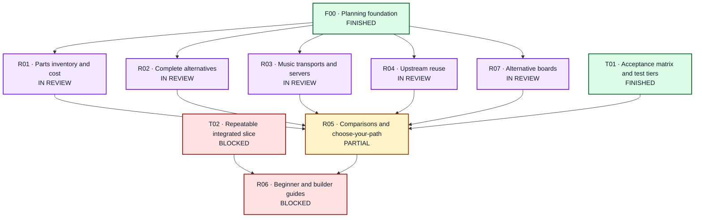

| Packet / step | Progress | Roadmap state | Prerequisites (original wording) | Open packet prerequisites |
| --- | --- | --- | --- | --- |
| R01 · Parts inventory and cost | IN REVIEW | review | F00 | — |
| R02 · Complete alternatives | IN REVIEW | review | F00 | — |
| R03 · Music transports and servers | IN REVIEW | review | F00 | — |
| R04 · Upstream reuse | IN REVIEW | review | F00 | — |
| R05 · Comparisons and choose-your-path | PARTIAL | review | R01, R02, R03, R04, R07, T01 | R01, R02, R03, R04, R07 |
| R06 · Beginner and builder guides | BLOCKED | blocked | T02, R05 | T02, R05 |
| R07 · Alternative boards | IN REVIEW | review | F00 | — |

</details>

<details>
<summary>Lab fleet and access (3 packets)</summary>

[Acceptance and evidence](roadmap.md#lab-fleet-and-access)

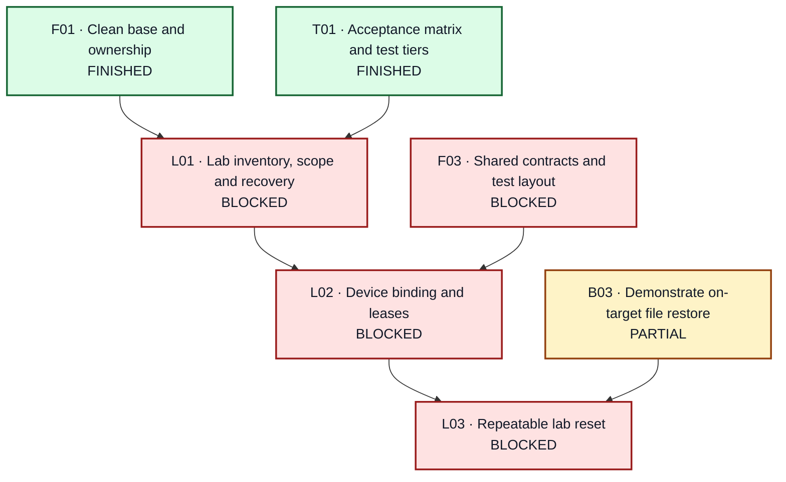

| Packet / step | Progress | Roadmap state | Prerequisites (original wording) | Open packet prerequisites |
| --- | --- | --- | --- | --- |
| L01 · Lab inventory, scope and recovery | BLOCKED | blocked | F01, T01 | — |
| L02 · Device binding and leases | BLOCKED | blocked | L01, F03 | L01, F03 |
| L03 · Repeatable lab reset | BLOCKED | blocked | L02, B03 | L02, B03 |

</details>

<details>
<summary>First boot, identity, and connectivity (6 packets)</summary>

[Acceptance and evidence](roadmap.md#first-boot-identity-and-connectivity)

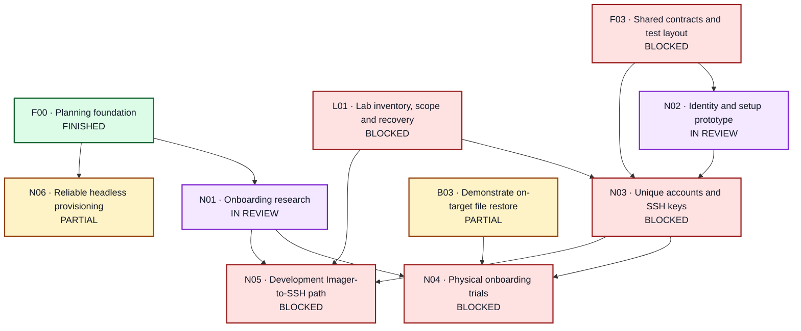

| Packet / step | Progress | Roadmap state | Prerequisites (original wording) | Open packet prerequisites |
| --- | --- | --- | --- | --- |
| N01 · Onboarding research | IN REVIEW | review | F00 | — |
| N02 · Identity and setup prototype | IN REVIEW | review | F03 | F03 |
| N03 · Unique accounts and SSH keys | BLOCKED | blocked | N02, F03, L01 | N02, F03, L01 |
| N04 · Physical onboarding trials | BLOCKED | blocked | N01, N03, B03 | N01, N03, B03 |
| N05 · Development Imager-to-SSH path | BLOCKED | blocked | N03, N01, L01 | N03, N01, L01 |
| N06 · Reliable headless provisioning | PARTIAL | ready | F00 | — |

</details>

<details>
<summary>Shared control core and maintenance UI (5 packets)</summary>

[Acceptance and evidence](roadmap.md#shared-control-core-and-maintenance-ui)

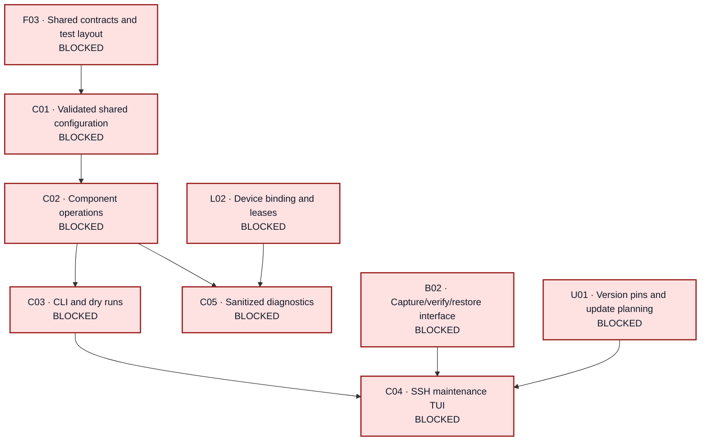

| Packet / step | Progress | Roadmap state | Prerequisites (original wording) | Open packet prerequisites |
| --- | --- | --- | --- | --- |
| C01 · Validated shared configuration | BLOCKED | blocked | F03 | F03 |
| C02 · Component operations | BLOCKED | blocked | C01 | C01 |
| C03 · CLI and dry runs | BLOCKED | blocked | C02 | C02 |
| C04 · SSH maintenance TUI | BLOCKED | blocked | C03, B02, U01 | C03, B02, U01 |
| C05 · Sanitized diagnostics | BLOCKED | blocked | C02, L02 | C02, L02 |

</details>

<details>
<summary>Browser-first device control (10 packets)</summary>

[Acceptance and evidence](roadmap.md#browser-first-device-control)

```mermaid
flowchart LR
    F02["F02 · Architecture decisions<br/>BLOCKED"]:::blocked
    F03["F03 · Shared contracts and test layout<br/>BLOCKED"]:::blocked
    N02["N02 · Identity and setup prototype<br/>IN REVIEW"]:::review
    N04["N04 · Physical onboarding trials<br/>BLOCKED"]:::blocked
    C01["C01 · Validated shared configuration<br/>BLOCKED"]:::blocked
    C02["C02 · Component operations<br/>BLOCKED"]:::blocked
    C05["C05 · Sanitized diagnostics<br/>BLOCKED"]:::blocked
    WEB01["WEB01 · Native volume and mute<br/>PARTIAL"]:::partial
    WEB02["WEB02 · Address and browser enrollment<br/>PARTIAL"]:::partial
    WEB03["WEB03 · Hardware selection and detection<br/>IN REVIEW"]:::review
    WEB04["WEB04 · Component state<br/>PARTIAL"]:::partial
    WEB05["WEB05 · Audio and voice settings<br/>BLOCKED"]:::blocked
    WEB06["WEB06 · LEDs and physical controls<br/>BLOCKED"]:::blocked
    WEB07["WEB07 · Health and resource readings<br/>PARTIAL"]:::partial
    WEB08["WEB08 · Browser updates and restore<br/>BLOCKED"]:::blocked
    WEB09["WEB09 · Accessibility and browser security<br/>PARTIAL"]:::partial
    WEB10["WEB10 · Shared browser/CLI authority<br/>BLOCKED"]:::blocked
    A01["A01 · Exact-board audio baseline<br/>PARTIAL"]:::partial
    A02["A02 · Tested HAT profiles<br/>BLOCKED"]:::blocked
    A03["A03 · Duck or pause, then resume<br/>BLOCKED"]:::blocked
    A04["A04 · HAT LEDs, buttons and mute<br/>BLOCKED"]:::blocked
    V03["V03 · Wake and satellite options<br/>BLOCKED"]:::blocked
    M01["M01 · Pinned Sendspin adapter<br/>PARTIAL"]:::partial
    M03["M03 · Optional Snapcast adapter<br/>BLOCKED"]:::blocked
    M04["M04 · Multi-stack coexistence<br/>BLOCKED"]:::blocked
    B02["B02 · Capture/verify/restore interface<br/>BLOCKED"]:::blocked
    B03["B03 · Demonstrate on-target file restore<br/>PARTIAL"]:::partial
    U01["U01 · Version pins and update planning<br/>BLOCKED"]:::blocked
    U02["U02 · Manual update and rollback<br/>BLOCKED"]:::blocked
    N02 -.-> WEB02
    N04 -.-> WEB02
    A01 -.-> WEB03
    A02 -.-> WEB03
    C02 -.-> WEB04
    A02 -.-> WEB05
    A03 -.-> WEB05
    V03 -.-> WEB05
    M01 -.-> WEB05
    M03 -.-> WEB05
    M04 -.-> WEB05
    A04 --> WEB06
    C05 --> WEB07
    C02 -.-> WEB08
    B02 -.-> WEB08
    B03 -.-> WEB08
    U01 -.-> WEB08
    U02 -.-> WEB08
    WEB01 --> WEB09
    F02 --> WEB10
    F03 --> WEB10
    C01 --> WEB10
    C02 --> WEB10
    classDef finished fill:#dcfce7,stroke:#166534,color:#111827,stroke-width:2px;
    classDef running fill:#dbeafe,stroke:#1e40af,color:#111827,stroke-width:2px;
    classDef review fill:#f3e8ff,stroke:#7e22ce,color:#111827,stroke-width:2px;
    classDef partial fill:#fef3c7,stroke:#92400e,color:#111827,stroke-width:2px;
    classDef blocked fill:#fee2e2,stroke:#991b1b,color:#111827,stroke-width:2px;
    classDef untouched fill:#f1f5f9,stroke:#475569,color:#111827,stroke-width:2px;
```

| Packet / step | Progress | Roadmap state | Prerequisites (original wording) | Open packet prerequisites |
| --- | --- | --- | --- | --- |
| WEB01 · Native volume and mute | PARTIAL | prototype | Named target/recovery before deployment | — |
| WEB02 · Address and browser enrollment | PARTIAL | ready | N02/N04 for final onboarding | N02, N04 |
| WEB03 · Hardware selection and detection | IN REVIEW | ready | A01/A02 evidence before writes | A01, A02 |
| WEB04 · Component state | PARTIAL | ready | Read-only detection independent; C02 for lifecycle writes | C02 |
| WEB05 · Audio and voice settings | BLOCKED | blocked | A02/A03, V03, M01/M03/M04 for respective writes | A02, A03, V03, M01, M03, M04 |
| WEB06 · LEDs and physical controls | BLOCKED | blocked | A04 | A04 |
| WEB07 · Health and resource readings | PARTIAL | ready | Collectors per board; C05 | C05 |
| WEB08 · Browser updates and restore | BLOCKED | blocked | C02, B02/B03, U01/U02 for respective writes | C02, B02, B03, U01, U02 |
| WEB09 · Accessibility and browser security | PARTIAL | ready | WEB01 | WEB01 |
| WEB10 · Shared browser/CLI authority | BLOCKED | blocked | F02/F03/C01/C02 | F02, F03, C01, C02 |

</details>

<details>
<summary>HATs, audio, and interruptions (4 packets)</summary>

[Acceptance and evidence](roadmap.md#hats-audio-and-interruptions)

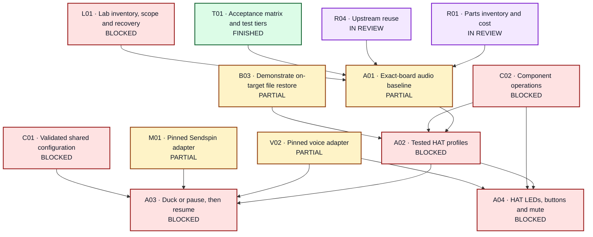

| Packet / step | Progress | Roadmap state | Prerequisites (original wording) | Open packet prerequisites |
| --- | --- | --- | --- | --- |
| A01 · Exact-board audio baseline | PARTIAL | blocked | R01, R04, T01, L01 | R01, R04, L01 |
| A02 · Tested HAT profiles | BLOCKED | blocked | A01, C02, B03 | A01, C02, B03 |
| A03 · Duck or pause, then resume | BLOCKED | blocked | A02, V02, M01, C01 | A02, V02, M01, C01 |
| A04 · HAT LEDs, buttons and mute | BLOCKED | blocked | A02, C02, V02 | A02, C02, V02 |

</details>

<details>
<summary>Voice integration (4 packets)</summary>

[Acceptance and evidence](roadmap.md#voice-integration)

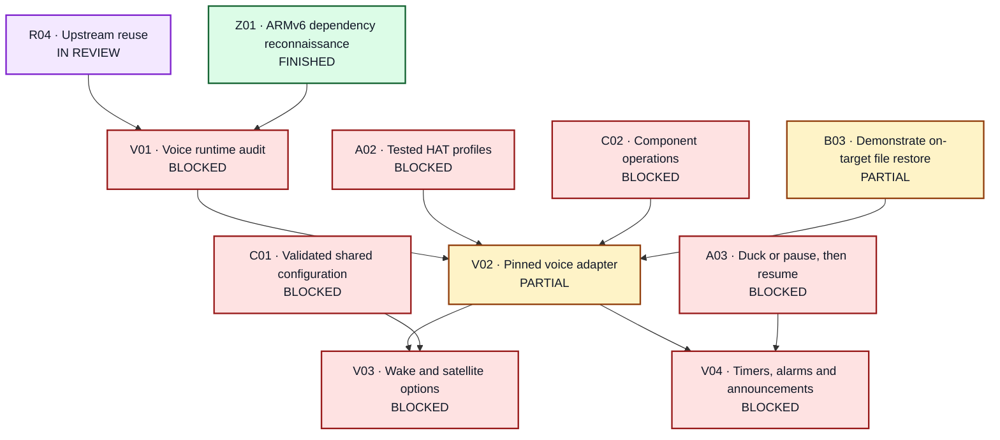

| Packet / step | Progress | Roadmap state | Prerequisites (original wording) | Open packet prerequisites |
| --- | --- | --- | --- | --- |
| V01 · Voice runtime audit | BLOCKED | blocked | R04, Z01 | R04 |
| V02 · Pinned voice adapter | PARTIAL | blocked | V01, A02, C02, B03 | V01, A02, C02, B03 |
| V03 · Wake and satellite options | BLOCKED | blocked | V02, C01 | V02, C01 |
| V04 · Timers, alarms and announcements | BLOCKED | blocked | V02, A03 | V02, A03 |

</details>

<details>
<summary>Music adapters and coexistence (4 packets)</summary>

[Acceptance and evidence](roadmap.md#music-adapters-and-coexistence)

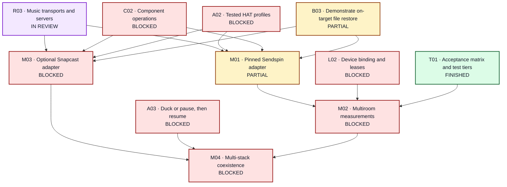

| Packet / step | Progress | Roadmap state | Prerequisites (original wording) | Open packet prerequisites |
| --- | --- | --- | --- | --- |
| M01 · Pinned Sendspin adapter | PARTIAL | blocked | R03, A02, C02, B03 | R03, A02, C02, B03 |
| M02 · Multiroom measurements | BLOCKED | blocked | M01, L02, T01 | M01, L02 |
| M03 · Optional Snapcast adapter | BLOCKED | blocked | R03, C02, A02, B03 | R03, C02, A02, B03 |
| M04 · Multi-stack coexistence | BLOCKED | blocked | M03, A03, M02 | M03, A03, M02 |

</details>

<details>
<summary>Original Pi Zero W / ARMv6 engineering track (5 packets)</summary>

[Acceptance and evidence](roadmap.md#original-pi-zero-w--armv6-engineering-track)

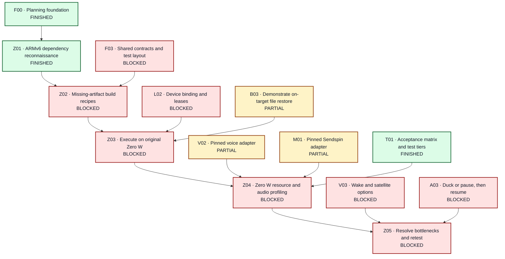

| Packet / step | Progress | Roadmap state | Prerequisites (original wording) | Open packet prerequisites |
| --- | --- | --- | --- | --- |
| Z01 · ARMv6 dependency reconnaissance | FINISHED | done | F00 | — |
| Z02 · Missing-artifact build recipes | BLOCKED | blocked | Z01, F03 | F03 |
| Z03 · Execute on original Zero W | BLOCKED | blocked | Z02, L02, B03 | Z02, L02, B03 |
| Z04 · Zero W resource and audio profiling | BLOCKED | blocked | Z03, V02, M01, T01 | Z03, V02, M01 |
| Z05 · Resolve bottlenecks and retest | BLOCKED | blocked | Z04, V03, A03 | Z04, V03, A03 |

</details>

<details>
<summary>Snapshots, backups, and restore (5 packets)</summary>

[Acceptance and evidence](roadmap.md#snapshots-backups-and-restore)

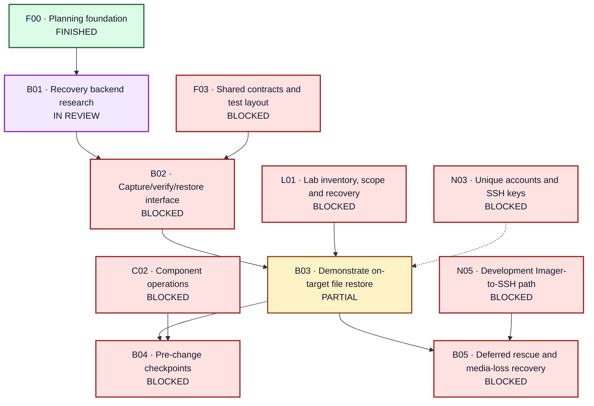

| Packet / step | Progress | Roadmap state | Prerequisites (original wording) | Open packet prerequisites |
| --- | --- | --- | --- | --- |
| B01 · Recovery backend research | IN REVIEW | review | F00 | — |
| B02 · Capture/verify/restore interface | BLOCKED | blocked | B01, F03 | B01, F03 |
| B03 · Demonstrate on-target file restore | PARTIAL | blocked | B02, L01; N03 for first-boot baseline | B02, L01, N03 |
| B04 · Pre-change checkpoints | BLOCKED | blocked | B03, C02 | B03, C02 |
| B05 · Deferred rescue and media-loss recovery | BLOCKED | blocked | B03, N05 | B03, N05 |

</details>

<details>
<summary>Version management and updates (3 packets)</summary>

[Acceptance and evidence](roadmap.md#version-management-and-updates)

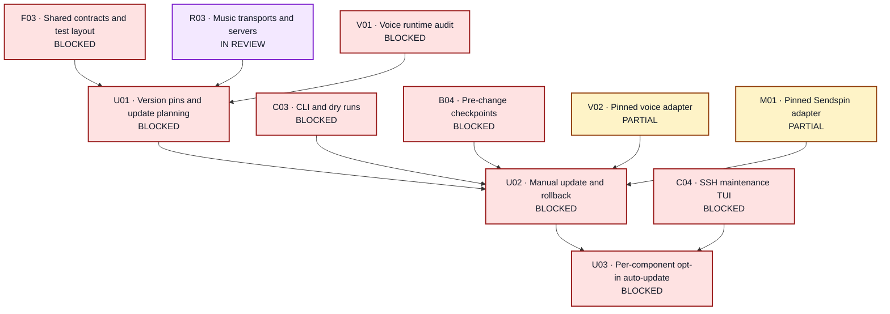

| Packet / step | Progress | Roadmap state | Prerequisites (original wording) | Open packet prerequisites |
| --- | --- | --- | --- | --- |
| U01 · Version pins and update planning | BLOCKED | blocked | F03, R03, V01 | F03, R03, V01 |
| U02 · Manual update and rollback | BLOCKED | blocked | U01, C03, B04, V02, M01 | U01, C03, B04, V02, M01 |
| U03 · Per-component opt-in auto-update | BLOCKED | blocked | U02, C04 | U02, C04 |

</details>

<details>
<summary>Image preparation and delivery (4 packets)</summary>

[Acceptance and evidence](roadmap.md#image-preparation-and-delivery)

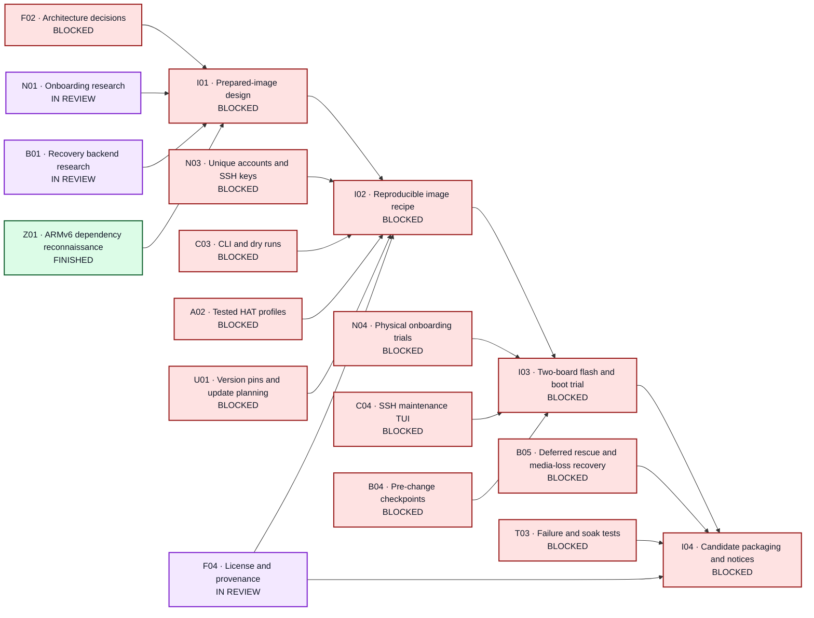

| Packet / step | Progress | Roadmap state | Prerequisites (original wording) | Open packet prerequisites |
| --- | --- | --- | --- | --- |
| I01 · Prepared-image design | BLOCKED | blocked | F02, N01, B01, Z01 | F02, N01, B01 |
| I02 · Reproducible image recipe | BLOCKED | blocked | I01, N03, C03, A02, U01, F04 | I01, N03, C03, A02, U01, F04 |
| I03 · Two-board flash and boot trial | BLOCKED | blocked | I02, N04, C04, B04 | I02, N04, C04, B04 |
| I04 · Candidate packaging and notices | BLOCKED | blocked | I03, B05, T03, F04 | I03, B05, T03, F04 |

</details>

<details>
<summary>Verification and release readiness (5 packets)</summary>

[Acceptance and evidence](roadmap.md#verification-and-release-readiness)

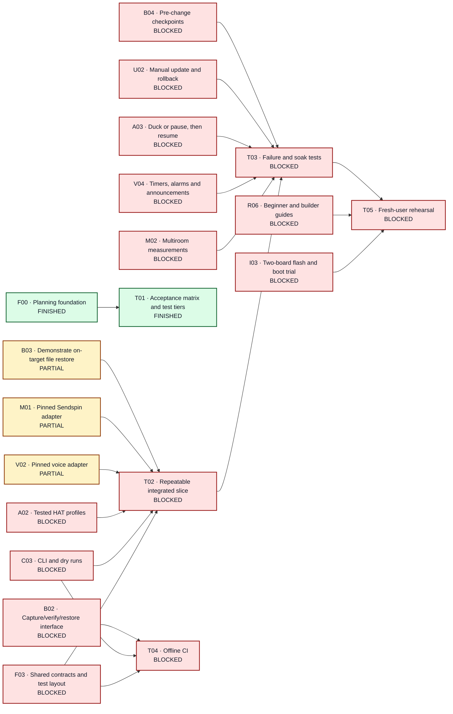

| Packet / step | Progress | Roadmap state | Prerequisites (original wording) | Open packet prerequisites |
| --- | --- | --- | --- | --- |
| T01 · Acceptance matrix and test tiers | FINISHED | done | F00 | — |
| T02 · Repeatable integrated slice | BLOCKED | blocked | F03, C03, A02, V02, M01, B03 | F03, C03, A02, V02, M01, B03 |
| T03 · Failure and soak tests | BLOCKED | blocked | T02, M02, V04, A03, U02, B04 | T02, M02, V04, A03, U02, B04 |
| T04 · Offline CI | BLOCKED | blocked | F03, C03, B02 | F03, C03, B02 |
| T05 · Fresh-user rehearsal | BLOCKED | blocked | I03, R06, T03 | I03, R06, T03 |

</details>

<details>
<summary>Long-term 3D models and enclosures (3 packets)</summary>

[Acceptance and evidence](roadmap.md#long-term-3d-models-and-enclosures)

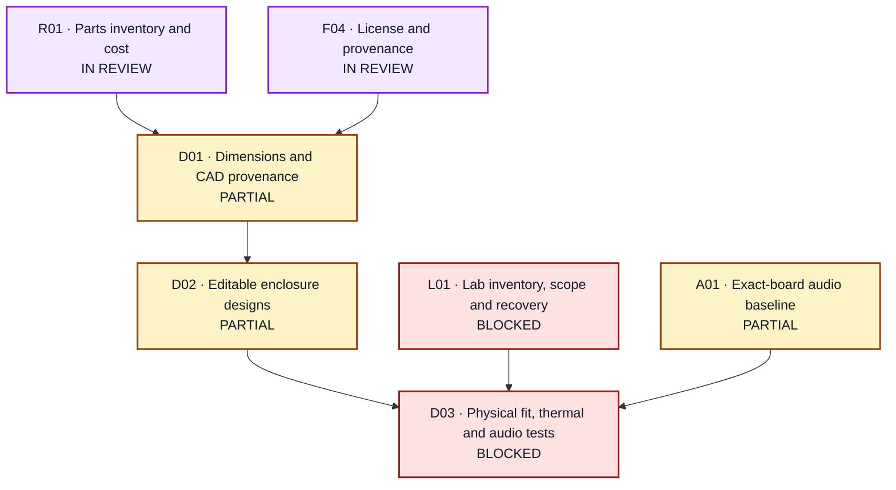

| Packet / step | Progress | Roadmap state | Prerequisites (original wording) | Open packet prerequisites |
| --- | --- | --- | --- | --- |
| D01 · Dimensions and CAD provenance | PARTIAL | blocked | R01, F04 | R01, F04 |
| D02 · Editable enclosure designs | PARTIAL | blocked | D01 | D01 |
| D03 · Physical fit, thermal and audio tests | BLOCKED | blocked | D02, L01, A01 | D02, L01, A01 |

</details>

## Keeping this maintained

1. Update packet acceptance/state/evidence in [roadmap.md](roadmap.md).
   Where limited work exists despite an open acceptance gate, update its
   [visual progress annotation](roadmap.md#visual-progress-annotations) with
   linked evidence/limits. Remove the annotation when the packet is accepted.
2. Update execution/review rows in [work-queue.md](work-queue.md). In the
   Running table, put roadmap IDs in **Item ids** (or start the subject with
   its packet ID). Active review subjects must say **review**; other active
   rows count as implementation. In-review subjects start with the packet ID
   when they refer to a whole packet. Finishing a subtask never finishes its packet.
3. From the repository root:

   ```sh
   python3 tools/progress.py
   python3 tools/progress.py --check
   python3 -B -m unittest discover -s tests -p 'test_progress.py' -v
   ```

The generator reads only those two tracked sources. It does not poll
workers, infer completion from test counts, change claims, run hardware,
or contact services. The offline test suite checks this page for drift.
New packets need short presentation titles/overview placement in
[the generator](../tools/progress.py); missing/unknown packets, dependency
cycles and unsupported states fail rather than silently disappearing.

A coordinator updates the sources and regenerates this view with each
relevant progress/handoff change. Nothing updates unattended unless a
separately configured process actually runs the command.
