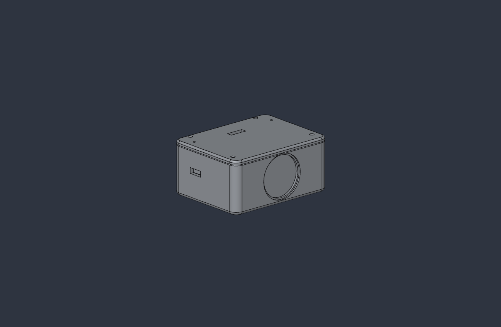
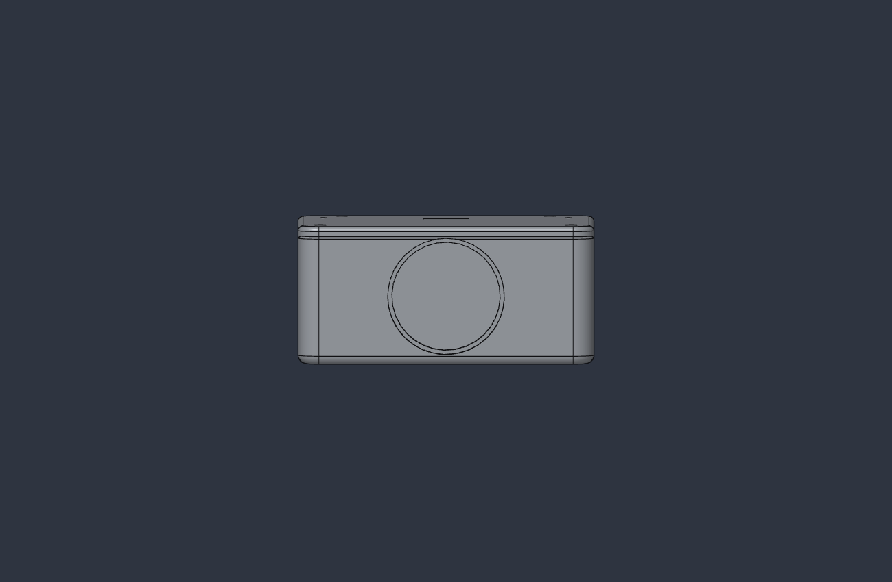
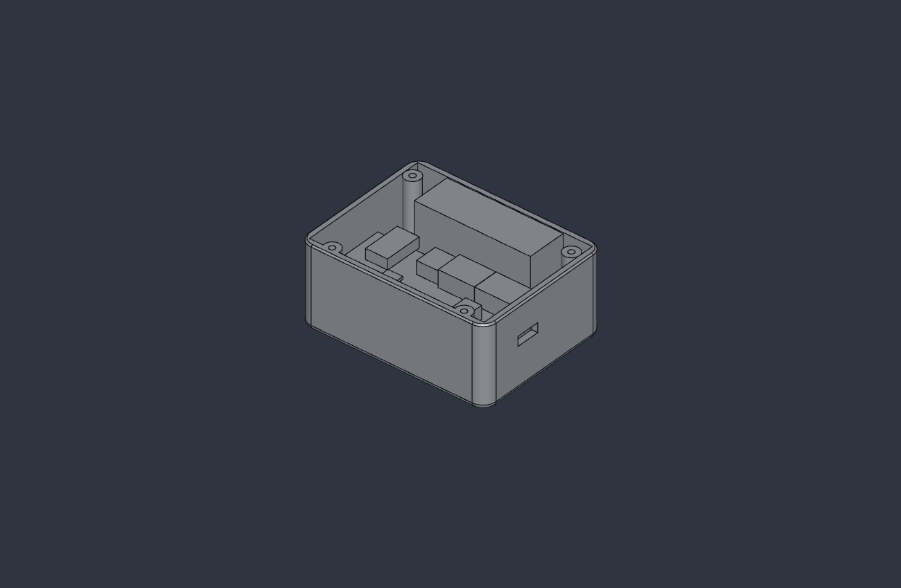
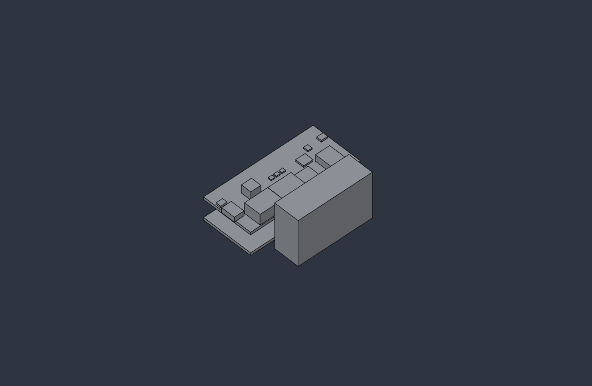
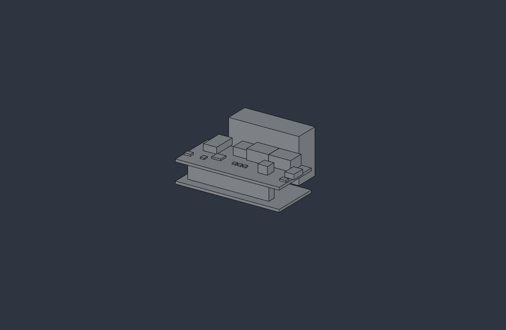

# Debra compact: one earlier concept of the whole device

**A CAD assembly of an earlier concept, not a part and not the selected design.**
The case and the ReSpeaker HAT are *linked* designs; the Pi Zero 2 W and the
speaker module are modelled inline as envelopes. Nothing here is printed or
fit-tested.

Editable SolidCraft source: [`debra-compact.sc`](debra-compact.sc).

This is step 4 of the [enclosure pipeline](../../../docs/design/enclosure-arrangements.md#how-a-case-is-actually-built-from-these-models):
the point where the parts stop being parts and become a device. It is the answer
to "some assembly of those case parts for full products".

| Measure | Value |
| --- | --- |
| Overall | **71.02 × 54.37 × 33.2 mm** |
| Bodies | 20 |
| Total solid volume | 65 384 mm³ (`measure`) |

## What it looks like



*The concept assembly, rendered. The round opening is the speaker, the left slot
is the power inlet, and the two small holes in the lid are the microphone ports.
The rounds on the corners and the shadow line under the lid are the only things
that are purely appearance; see
[the case's note on its shape](../../parts/dweii-671-case/README.md#why-it-looks-like-this).*



*Front. The module is 44 mm wide in a 71 mm case, so a third of the face is blank
baffle. That is deliberate — the screw bosses live in that margin.*

## With the case open



*Lid off, seen from behind. The speaker module is the tall block at the far side,
standing against the front wall; the Pi and HAT lie in front of it, with the HAT's
connectors facing the gap. The four bosses are the lid's screws.*

## Without the case



*Without the case. Front right: the DWEII module, standing on its 15 mm edge, 28 mm
tall. Behind it the Pi's PCB, the 2 × 20 socket, and the HAT on top with its
connectors. The HAT's component side faces up, which is the only orientation its
top-port microphones allow.*



*From the back. The two boards are 11 mm apart, which is the socket; the speaker
module rises well above both.*

## What is linked and what is modelled here

| Body group | Source | Why |
| --- | --- | --- |
| `Tub`, `Lid` | **linked** to [`dweii-671-case.sc`](../../parts/dweii-671-case/README.md) | the case parts, so a change there is one `component.update_links` away |
| `PCB`, `Header_Socket`, `MIC1`…`Oscillator` (15 bodies) | **linked** to [`respeaker-2mic-hat.sc`](../../components/respeaker-2mic-hat/README.md) | every body in that design is wanted here |
| `PiZero2W_PCB`, `PiZero2W_Shield` | modelled inline | see below |
| `DWEII_671_Module` | modelled inline | see below |

The Pi and the module are inline rather than linked for one reason: inserting a
design brings **all** of its bodies, and
[pi-zero-family.sc](../../components/pi-zero-family/README.md) deliberately holds
all three Zero variants side by side, while
[dweii-speakers.sc](../../components/dweii-speakers/README.md) holds two
different modules. Linking either would drag extra bodies into the assembly.
That is a limitation worth fixing at the source rather than duplicating numbers
forever.

## The alignment, checked

The assembly is only useful if the parts actually land on each other. Measured
from the model, not assumed:

| Check | Result |
| --- | --- |
| Microphone bodies | at (±29.85, 40.34), and the lid's Ø1.5 mm ports at (±29.465, 40.34) — a 0.385 mm offset, which is exactly the HAT's own port offset from the package centre |
| HAT board | Z 12.6 … 14.2, i.e. 11 mm above the Pi's top face |
| Pi board | Z 0 … 1.6, sitting on the interior floor |
| Speaker module | Y 0 … 15, Z 0 … 28 — front face against the baffle, top just under the lid |
| HAT micro-USB | at (−30.52, 32.46, 15.7), matching the power slot cut in the left wall |
| LEDs | at Y 37.16, matching the 11 × 3.5 mm slot in the lid |
| 3.5 mm jack | mouth at Y 17.48, so it stops 2.5 mm short of the module — close enough to be unreachable with a plug |

## What it does not show

- **No screws.** Four M2.5s would hold the lid; the holes are there, the screws are not.
- **No speaker lead.** The module's 110 mm lead and JST plug have to reach the
  HAT's JST socket about 10 mm away, and the lead's exit point on the module is
  unknown.
- **No Pi ports.** The Zero 2 W's micro-USB, USB and mini-HDMI bodies are omitted
  because they are enclosed by the case anyway and their positions in the Pi
  envelope are estimates.
- **No header pins.** The socket stands in for the whole mated connection.
- **No board retention, no foam, no grille mesh, no feet.**
- **Not printed, not fit-tested.**

## Regenerate

```
// assembled
screenshot({ source: "model", grid: false, axes: false, width: 1300, height: 850,
             camera: { target: [0,25,15], yaw: 0.72, pitch: 0.33, distance: 235 },
             path: ".../assets/iso.png" })
screenshot({ source: "model", grid: false, axes: false, width: 1300, height: 850,
             camera: { target: [0,24,14], yaw: 0, pitch: 0.05, distance: 175 },
             path: ".../assets/front.png" })
// case open: hide the lid body, shoot, show it again
browser.visibility({ items: ["Lid"], visible: false })
screenshot({ source: "model", grid: false, axes: false, width: 1300, height: 850,
             camera: { target: [0,25,10], yaw: 2.45, pitch: 0.62, distance: 215 },
             path: ".../assets/tub-loaded.png" })
browser.visibility({ items: ["Lid"], visible: true })
// internals: delete the Case component, shoot, then insert it again
component.delete({ component: "Case" })
screenshot({ source: "model", grid: false, axes: false, width: 1300, height: 850,
             camera: { target: [0,25,12], yaw: 0.75, pitch: 0.78, distance: 210 },
             path: ".../assets/inside.png" })
component.insert_design({ path: "models/parts/dweii-671-case/dweii-671-case.sc", name: "Case" })
```

`occurrence.move` will not move the case out of the way: the first part in a
design is grounded, and moving it while grounded is refused.
