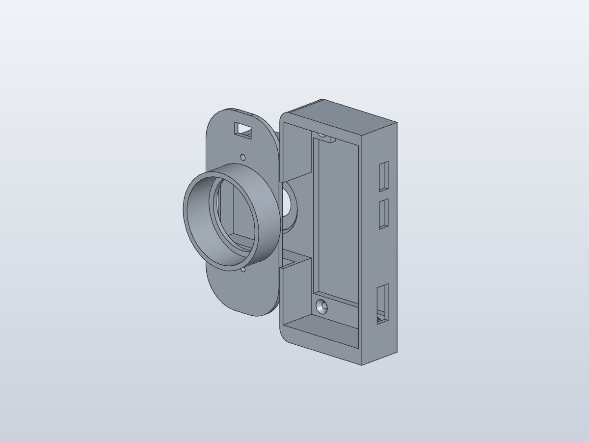
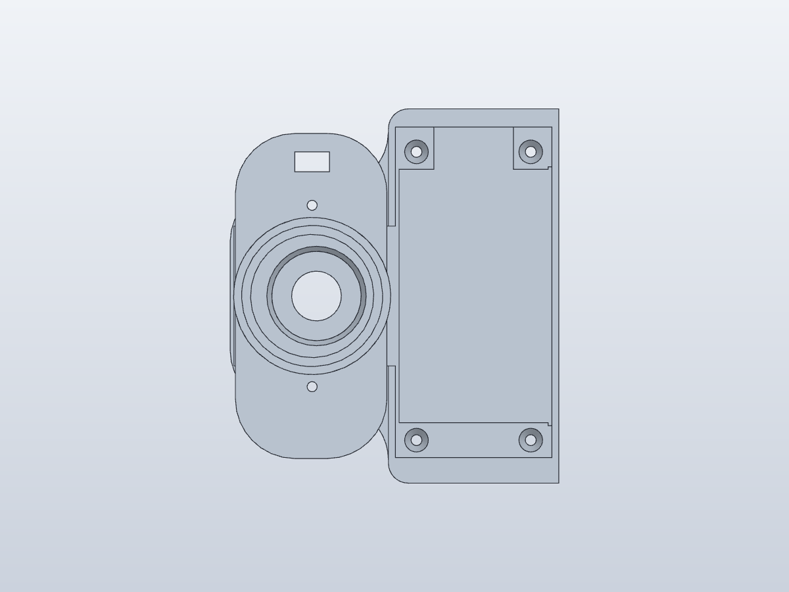

# RPiSpeaker v17 body with its provisional lid

**CAD-only assembly. Nothing has been printed, fitted or measured on a real
part.** It puts two existing designs together to answer one question the parts
could not answer alone: does the
[provisional lid](../../parts/rpispeaker-v17-lid/README.md) sit on the
[reconstructed body](../../parts/rpispeaker-v17-body/README.md) without
colliding with it?

The answer for the reconstruction is **yes — zero overlapping volume**, at the
lid's default parameters. That is a geometric result about two CAD models, not
proof that a printed lid fits the original moulded body.

## What is in the assembly

| Body | Source | Volume |
| --- | --- | ---: |
| `Body` | [rpispeaker-v17-body.sc](../../parts/rpispeaker-v17-body/rpispeaker-v17-body.sc) | 15,915.3915 mm³ |
| `Lid` | [rpispeaker-v17-lid.sc](../../parts/rpispeaker-v17-lid/rpispeaker-v17-lid.sc) | 4,028.8431 mm³ |

Assembly envelope **66.15 × 26.10 × 75.30 mm**: X −17.15–49.00,
Y −0.60–25.50, Z −37.65–37.65. Each body's volume and bounding box are identical
to its own part file after composing, so the assembly adds no geometry.

**[The speaker cover](../../parts/rpispeaker-v17-cover/README.md) is not in this
assembly.** The cover and the lid are two front plates over the same bay and
intersect by 785.08 mm³; see
[the conflict note](../../../docs/notes/2026-11-15-v17-cover-lid-conflict.md).



*Isometric. The lid plate is inset into the speaker-side bay and flush with the
body's front plane at Y 15.50; the Ø31.6 sleeve and the two screw pads stand in
front of it. The plate's visible seam is not a controlled clearance: its end
rounds are the lid's assumed R12 and the bay's Z limits were not re-measured, so
this is not evidence of a sealed or gasketed face. The Pi-side bay is open and
empty — no Pi, HAT, header, speaker, screw or wire is modelled, so nothing here
checks that those fit.*



*Front, from +Y. Left: the lid's Ø28.4 aperture inside its sleeve, the assumed
JST slot at the top and the two Ø2 lid pilots. Right: the open Pi bay showing
the four rear pilot countersinks. The sleeve sits at X 32.50 while the plate is
centred at 32.70, so the Ø31.6 sleeve overhangs the 30.5 mm plate by 0.75 mm on
the low-X side and 0.35 mm on the high-X side; the plate's R12 end round is
assumed.*

## Fit: measured, and the check is sensitive

Composed on 2026-11-15 with `solidcraft-cli 0.42.0`, then an
`inspect.interference` command replayed over the composed design:

| Setting | Overlapping pairs | Unchecked | Result |
| --- | ---: | ---: | --- |
| Lid at defaults (`LD_CLEAR` 0.3) | **0** | 0, not truncated | no body material is inside the lid anywhere |
| Control: `LD_CLEAR` −0.2 (plate 0.5 mm oversize per side) | **1**, 5.5004 mm³ | 0, not truncated | the control is detected, at X 16.95–17.15, Y 13.90–15.50 |

The control matters more than the pass: a 0.5 mm per-side oversize is caught, so
a zero is a real zero and not an idle check. It also confirms what the zero
alone cannot — that there **is** body material at X 17.15 across the plate's
Y band, which the oversized plate cuts by 0.20 mm.

Where the two parts sit:

- The lid plate spans X 17.45–47.95, so its inset from the bay wall at X 17.15
  is **0.30 mm** on that side, set by `LD_CLEAR`.
- The plate's Z span, 65.40 mm, comes from the lid's **assumed** 66 mm bay
  length. The body's front opening was not re-measured in Z here, so the Z
  clearance is unconfirmed; the interference result only says the plate is not
  inside body material.
- The lid's front face and the body's front plane are both at **Y 15.50**, so
  the lid finishes flush rather than proud.
- The two rear screw pads reach back to **Y 8.50** and contact the body's raised
  surfaces at that height. Contact is coincident faces, not overlap, and it is
  not retention: the pads have Ø2 mm pilots and the body's bores are Ø2.1755 mm
  with Ø4.50 mm countersinks, so the screw path is
  [still unresolved](../../parts/rpispeaker-v17-lid/README.md#fastening-remains-conditional-on-fit).
- The sleeve's outer wall spans X 16.70–48.30 and therefore covers the
  Pi-side divider's front edge by **0.45 mm** in X. The lid README flagged that
  overlap as needing a collision check. It is an **adjacency at Y 15.50, not an
  overlap**: the body ends at Y 15.50 and the sleeve begins there, so the sleeve
  rim butts against the divider's front face and stands 10 mm in front of it.
  Nothing of the body is inside the sleeve.

## What this does not establish

- **Not the original body.** The reconstruction is a simplified native model;
  its Pi bay is approximate, its threads are plain cores and some ribs and ports
  are missing. A real lid would still meet its nominal walls, but the R12 lid
  corners are assumed and the cavity corners are unknown, so the 0.30 mm inset
  is unverified against a real part.
- **No contents.** No Pi, HAT, header, speaker, fastener or cable is present.
  Bay depth, component clearance, screw engagement, service access and the
  cable route are all still unchecked — see "Not modelled yet" in the
  [models index](../../README.md#not-modelled-yet).
- **No assembly action.** Nothing was sliced or printed; there is no print
  orientation, tolerance, material or strength claim here.
- **No acoustic claim.** The lid's aperture is open; the sleeve is not a grille,
  a seal or a retainer.

## Reproduce it

There is deliberately **no `.sc` file for this assembly**. A saved copy would
duplicate two parts' geometry and drift away from them; the assembly is rebuilt
from the part sources instead, on a temporary file. Run from the repository
root.

```sh
python3 -B - <<'PY'
import json, os, re, subprocess

BODY = 'models/parts/rpispeaker-v17-body/rpispeaker-v17-body.sc'
OUT = '/tmp/opencode/v17-body-lid.sc'
lid = json.load(open('models/parts/rpispeaker-v17-lid/build-script.json'))
names = [c['params']['name'] for c in lid['commands'] if c['command'] == 'parameters.add']

def rename(value):
    if isinstance(value, str):
        for name in sorted(names, key=len, reverse=True):
            value = re.sub(rf'\b{re.escape(name)}\b', 'LD_' + name, value)
        return value
    if isinstance(value, list):
        return [rename(v) for v in value]
    if isinstance(value, dict):
        return {k: rename(v) for k, v in value.items()}
    return value

def run(extra=(), save=None):
    steps = []
    for command in lid['commands']:
        params = rename(command['params'])
        if command['command'] == 'parameters.add':
            params['name'] = 'LD_' + command['params']['name']
        if 'feature' in params:
            params['feature']['id'] += 100
        steps.append({'command': command['command'], 'params': params})
    steps += list(extra)
    fd = os.memfd_create('v17', 0)
    os.write(fd, json.dumps(steps).encode())
    argv = ['solidcraft-cli', 'run', f'/proc/self/fd/{fd}', '--in', BODY, '--results']
    if save:
        argv += ['--save', save]
    out = subprocess.run(argv, pass_fds=(fd,), check=True,
                         capture_output=True, text=True).stdout
    return json.loads(out)

run(save=OUT)
measured = subprocess.run(['solidcraft-cli', 'eval', '--in', OUT], check=True,
                          capture_output=True, text=True).stdout
for body in json.loads(measured)['bodies']:
    print(f"{body['name']}: {body['volume_mm3']:.4f} mm3, closed={body['closed']}")

for clear in (0.3, -0.2):
    result = run([{'command': 'parameters.change',
                   'params': {'name': 'LD_CLEAR', 'expression': f'{clear} mm'}},
                  {'command': 'inspect.interference',
                   'params': {'bodies': ['Body', 'Lid']}}])[-1]
    print(f'LD_CLEAR {clear}: count={result["count"]} '
          f'unchecked={result["unchecked"]} truncated={result["truncated"]}',
          [(round(i['volume_mm3'], 4), i['bbox']) for i in result['interferences']])
PY
solidcraft-cli snapshot --in /tmp/opencode/v17-body-lid.sc --out models/assemblies/rpispeaker-v17-body-lid/assets/iso.png --camera '{"target":[16,10,0],"yaw":2.4,"pitch":0.35,"distance":170}' --width 1200 --height 900 --no-grid --no-axes
solidcraft-cli snapshot --in /tmp/opencode/v17-body-lid.sc --out models/assemblies/rpispeaker-v17-body-lid/assets/front.png --view back --width 1200 --height 900 --no-grid --no-axes
```

Read `unchecked` and `truncated`, not only the volume: a zero with an unchecked
pair means nothing.

Two details make the replay work, and both are load-bearing:

- The lid's parameter names are prefixed `LD_`. Only `FRONT_Y` is shared with the
  body, and its default value is the same in both, but prefixing keeps the two
  parts independent when either default changes.
- The lid's feature ids are offset by 100. The body already uses ids 1–35, and
  the CLI refuses a duplicate id (`feature id 1 is already used`) rather than
  renumbering silently.
