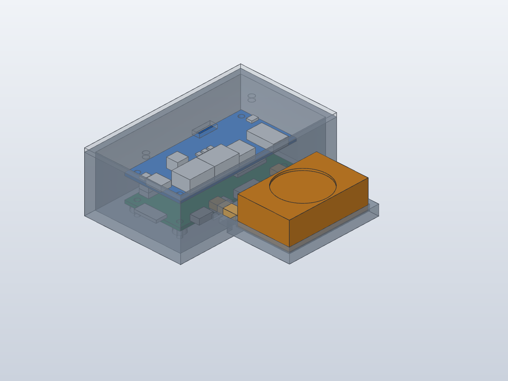
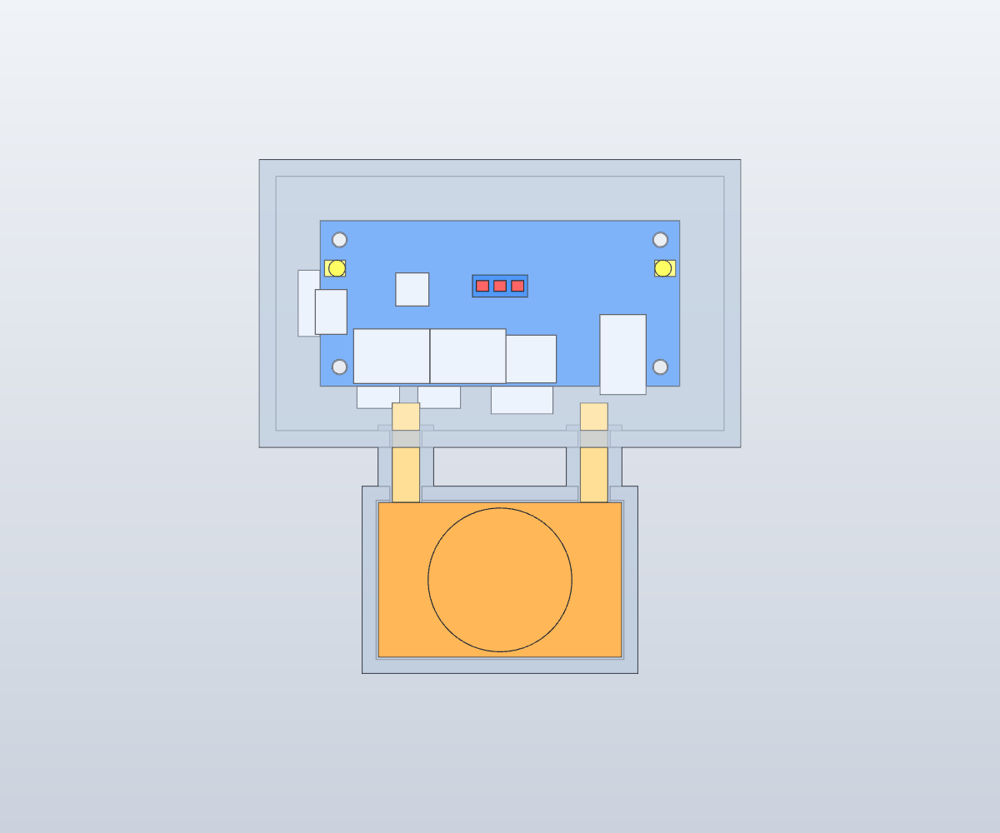

# Pi Zero + DWEII 671 + HAT: early demonstration assembly

**Unreviewed CAD-only layout; not printed, assembled, fit-tested, or an
accepted product.** This is a new parametric demo rather than the original v17.
The chosen DWEII 701715519671 is a housed module represented by an unmeasured
seller-claimed envelope; the two arms and their attachment are guesses. The
[case and lid](../../parts/zero-square-demo/README.md) document every bay,
clearance, opening and assumption.



*Headless SolidCraft CLI render of [zero-square-demo.sc](zero-square-demo.sc).
Case and lid are translucent for visibility; the speaker is a solid rectangular
envelope with an illustrative Ø26 × 1 mm grille recess, not a model of a
measured opening, cone or magnet. No cables or fasteners.*



*Top view: yellow microphone bodies sit beneath the Ø3 openings; red LEDs are
beneath the 10 × 4 window. The speaker envelope follows a seller claim; the
arms are guesses. The lid covers the electronics only, not the speaker.*

## Components placed

| Item | Model representation and provenance |
| --- | --- |
| Case and lid | Two separate bodies; features copied into this self-contained [build script](build-script.json) from the [part](../../parts/zero-square-demo/build-script.json). They are not live-linked: edit/rebuild both scripts together. |
| Pi Zero 2 W | PCB outline and 58 × 23 hole pattern from [Pi reference](../../components/pi-zero-family/README.md); 1.6 mm thickness, connectors, header height and shield are approximate. The Pi header is aligned with the HAT socket at Y 26.5 rather than the Pi envelope's approximate 23.96-centred block. Other Pi Zero-family boards need their real fitted components checked. |
| ReSpeaker 2-Mics Pi HAT | 65.02 × 29.97 board, port and LED positions and nominal component placements from the [HAT reference](../../components/respeaker-2mic-hat/README.md); thickness, stack gap and component heights assumed. The HAT PCB is centred at (32.5, 15) in the assembly, so its simplified outer lower-left is (−0.01, 0.015); component positions follow the source table's nominal origin. This 0.01/0.015 mm framing approximation is not physical precision. |
| DWEII 701715519671 | The [DWEII source](../../components/dweii-speakers/README.md) gives conflicting seller claims of 44 × 28 × 15 and 31 × 28 × 15 mm; this model uses the larger envelope. Neither is a physical measurement. The Ø26 × 1 grille recess is illustrative, not a known opening; terminals, vents, gasket and actual tab geometry are not modeled. The three DWEII modules are not interchangeable, and the larger 100 × 45 × 21 mm 462 needs a separate carrier. |
| Concept arms ×2 | 5 × 21 × 3 **guesses**; modeled as separate blocks overlapping the speaker envelope by 3 mm to indicate a possible connection, not as established real tabs or parts. |
| Other necessary parts | Power cable, microSD, speaker wiring/connector, fasteners, speaker restraint and lid retention are not modeled or sized. The companion manifest worker owns the wider inventory. |

## Measurements and checks

On 2026-11-15, CLI 0.42.0 `inspect.measure` measured **25 closed bodies**,
 sum **78,021.85696420781 mm³**, overall bounding box **(−11, −51.9, 0) →
(76, 41, 31)** mm. It sums bodies separately and double-counts the overlaps
below, so it is not a union volume or real material amount. [Full measured
body output, interference and variants](inspection.json). Evaluations of the
[build script](eval-script.json) and [saved source](eval-sc.json) are verbatim
CLI JSON; both report the same volume, body count and no timeline errors.

| Body | Measured volume mm³ | Bounding box min → max mm |
| --- | ---: | --- |
| Case | 36,078.695758826245 | (−11, −51.9, 0) → (76, 41, 29) |
| Lid | 8,939.725666112252 | (−11, −11, 29) → (76, 41, 31) |
| Pi PCB | 3,081.9867288674495 | (0, 0, 5.5) → (65, 30, 7.1) |
| HAT PCB | 3,079.8257688674166 | (−0.01, 0.015, 18.1) → (65.01, 29.985, 19.7) |
| `DWEII_671_Envelope` | 17,949.07084153445 | (10.5, −49, 12) → (54.5, −21, 27) |
| `Concept_Arm_Left` / `Concept_Arm_Right` | 315 each | (13, −24, 12) → (18, −3, 15) / (47, −24, 12) → (52, −3, 15) |

The carrier locates the assumed 44 × 28 mm footprint with a 44.8 × 28.8 mm
low bay, 0.4 mm clearance on each XY side, and an open 38 × 22 mm rear. Its
3 mm bearing strip and low rim may still obstruct unknown vents or terminals.
The front remains exposed and the lid does not cover it. **Carry, do not seal**
is a working assumption: real opening locations and whether the housed modules
are sealed chambers are unconfirmed. A 31 mm-long 671 would have 13.8 mm total
spare X and would not be securely located by this bay. No retention is modeled.

The `.sc.bak` files in both demo folders are retained automatic backups of the
earlier guessed square-speaker design. They are **superseded**, not the DWEII
deliverables; use the `.sc` files and build scripts linked above.

The all-body interference check reported **five overlaps, none involving
Case or Lid**, no unchecked pairs and no truncation. The Pi header and HAT
socket overlap by 1,548.384 mm³ because both are simplified solid mated
blocks; the two Grove envelopes overlap by 5.1376 mm³ and Grove2/JST by
3.0205 mm³ because rectangular envelope approximations overlap slightly. Each
arm overlaps the speaker box by 45 mm³ intentionally. These are not proof that
the real parts mate or fit.

For openings, five Ø0.3 vertical solid probes start at the assumed mic/LED tops
and extend through the lid, while a sixth positive-control probe is at
(20, 23) where lid material exists. [The probe result](opening-probes.json)
reports **only** the control/Lid overlap (0.1413716694294116 mm³), no unchecked
pairs, not truncated. This checks the model's direct vertical paths only, not
acoustic transparency, dust ingress or real-world alignment. An earlier
[`against`-filtered attempt](opening-probes-against-attempt.json) had zero
candidate pairs including its control; it is **not** a valid passing test. The
reported check instead supplies Case, Lid and all probes in `bodies`.

Two non-saving parameter variants rebuild without diagnostics: the alternative
seller length `SP_X=31` gives 71,983.35696421505 mm³, and arm width 6 /
thickness 2.5 gives 78,036.99696420779 mm³. This shows those feature updates rebuilt, not that
their fit, bridge strength, retention or all parameter combinations are valid.

## Reproduction and verification

From the repository root, no app/MCP session:

```sh
solidcraft-cli run models/assemblies/zero-square-demo/build-script.json --save models/assemblies/zero-square-demo/zero-square-demo.sc --param-check strict --quiet
solidcraft-cli eval models/assemblies/zero-square-demo/build-script.json --json-out models/assemblies/zero-square-demo/eval-script.json
solidcraft-cli eval --in models/assemblies/zero-square-demo/zero-square-demo.sc --json-out models/assemblies/zero-square-demo/eval-sc.json
solidcraft-cli snapshot --in models/assemblies/zero-square-demo/zero-square-demo.sc --out models/assemblies/zero-square-demo/assets/iso.png --camera '{"target":[32,-9,14],"yaw":0.8,"pitch":0.55,"distance":185}' --width 1200 --height 900 --no-grid --no-axes --body 'Case:opacity=0.50,color=#8796a8' --body 'Lid:opacity=0.18,color=#d0d8df' --body 'Pi_PCB:color=#188a56' --body 'HAT_PCB:color=#2166c1' --body 'DWEII_671_Envelope:color=#cf8427' --body 'Concept_Arm_Left:color=#d5aa63' --body 'Concept_Arm_Right:color=#d5aa63'
solidcraft-cli snapshot --in models/assemblies/zero-square-demo/zero-square-demo.sc --out models/assemblies/zero-square-demo/assets/top.png --view top --width 1200 --height 1000 --no-grid --no-axes --body 'Case:opacity=0.45,color=#8796a8' --body 'Lid:opacity=0.14,color=#d0d8df' --body 'Pi_PCB:color=#188a56' --body 'HAT_PCB:color=#2166c1' --body 'HAT_MIC1:color=#f4cb34' --body 'HAT_MIC2:color=#f4cb34' --body 'HAT_LED1:color=#ee3535' --body 'HAT_LED2:color=#ee3535' --body 'HAT_LED3:color=#ee3535' --body 'DWEII_671_Envelope:color=#cf8427' --body 'Concept_Arm_Left:color=#d5aa63' --body 'Concept_Arm_Right:color=#d5aa63'
```

The assembly inspection file records `inspect.measure`, `inspect.interference`
and `inspect.parameter_variants`; the probe file records added probe cylinders
and their interference result. These were run through `solidcraft-cli run`
using Linux anonymous `memfd` command arrays without modifying the saved source.
To reproduce both checks without saving a modified design:

```sh
python3 -B - <<'PY'
import json, os, subprocess
p = 'models/assemblies/zero-square-demo/zero-square-demo.sc'
def run(steps):
    fd = os.memfd_create('cad-check', 0)
    os.write(fd, json.dumps(steps).encode())
    subprocess.run(['solidcraft-cli', 'run', '/proc/self/fd/' + str(fd),
                    '--in', p, '--results'], pass_fds=(fd,), check=True)
    os.close(fd)
run([{'command':'inspect.measure', 'params':{}},
     {'command':'inspect.interference', 'params':{}},
     {'command':'inspect.parameter_variants', 'params':{'variants':[
         {'name':'alternate seller width', 'set':{'SP_X':31}},
         {'name':'wider arms', 'set':{'ARM_W':6,'ARM_T':2.5}}]}}])
points = [('MIC1',3.05,21.34,20.8), ('MIC2',61.98,21.34,20.8),
          ('LED1',29.34,18.16,20.4), ('LED2',32.51,18.16,20.4),
          ('LED3',35.69,18.16,20.4), ('Control',20,23,20.8)]
steps = [{'command':'solid.cylinder', 'params':{'name':'Probe_'+n,
          'body_name':'Probe_'+n,'operation':'new','base':[x,y,z],
          'diameter':0.3,'height':31.1-z}} for n,x,y,z in points]
steps.append({'command':'inspect.interference', 'params':{
    'bodies':['Case','Lid']+['Probe_'+v[0] for v in points],
    'min_volume':0.0001}})
run(steps)
PY
```

See the JSON for exact values. Verbatim documentation test and whitespace-check
output is in [verification-docs.txt](verification-docs.txt) and
[verification-diff-check.txt](verification-diff-check.txt), respectively. The
[first documentation test](verification-docs-first-attempt.txt) failed only
because the linked whitespace-output file had not yet been created; it passed
after that file existed. `git diff --check` does not inspect untracked files;
the [supplementary no-index whitespace check](verification-untracked.txt)
checked the new text files separately.

## Handoff

For the separately owned enclosure guidance and parts manifest: list this as a
**provisional, CAD-only DWEII 671 concept**, based on an unmeasured seller
envelope and guessed arms; retain the need for real measurements and the
microphone/LED sources.
Do not imply that missing cabling, fasteners, port access, a four-screw mount or
the mechanical/acoustic validation is complete. No device operation, slicing,
printing, assembly, commit or push was performed.
