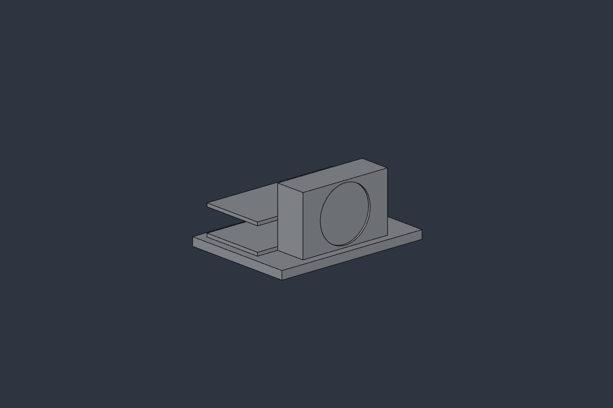
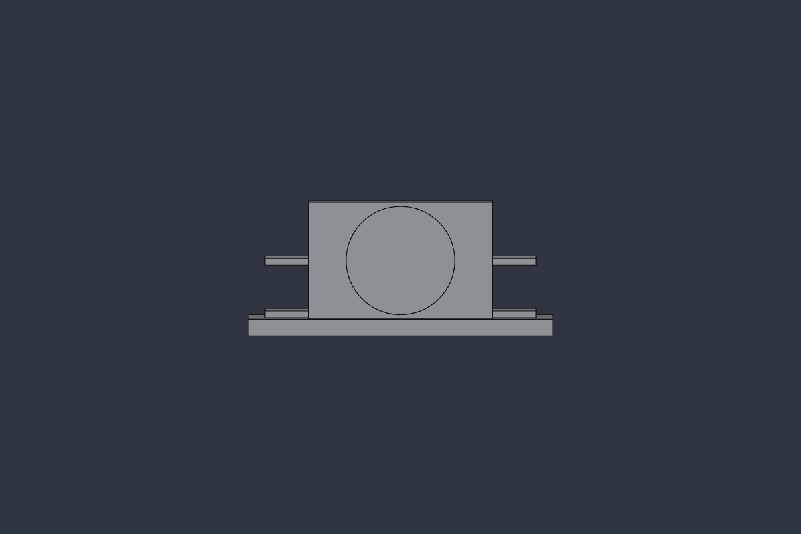
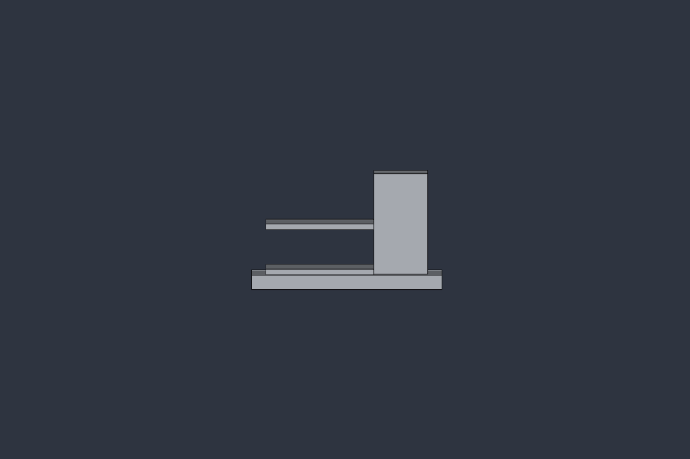

# Pi Zero 2 W + ReSpeaker + DWEII 671, compact horizontal

**A layout study, not a case.** Four bodies in space: a base plate, two boards, and
the speaker module James actually selected. No walls, no lid, no fastening, no
lead routing, and the header between the boards is not modelled.

Editable SolidCraft source:
[`zero2w-dweii-compact.sc`](zero2w-dweii-compact.sc).

This is the arrangement the
[enclosure reasoning](../../../docs/design/enclosure-arrangements.md) arrived at
once two corrections landed: the chosen speakers are **housed modules**, which a
case is expected to carry rather than seal (their chamber status is unconfirmed,
so an open-frame module would change that), and the HAT's microphones are
**top-port**, so its component side has to face open air.

## What it looks like



*Isometric. Front: the DWEII 701715519671 module standing on its 44 × 15 footprint,
facing forward, with the Ø26 grille recess. Behind it: the HAT over the Pi, 11 mm
apart. The boards appear to float because the 40-pin header between them is not
modelled — that gap is the header, not a design choice.*



*Front. The speaker is the tall element at 32 mm; the board stack behind it is
only 18 mm. The module sets the height of any case built around this.*



*Side. The two acoustic paths leave in different directions — sound out of the
front, microphone ports out of the top. That is the whole mechanical problem of
this arrangement.*

## Measured envelope

| Measure | Value |
| --- | --- |
| Overall | **73 × 53 × 32 mm** |
| Base plate | 73 × 53 × 4 mm — a concept plate, not a printed part |
| Board stack | 65 × 30, 18.2 mm tall (1.6 + 11 gap + 1.6, on the plate) |
| Speaker module | 44 × 15 × 28 mm, standing, grille facing −Y |
| Total volume | 40 196 mm³ (`measure`, all four bodies) |

## Why this arrangement

- **The speaker faces forward, not up.** A module laid flat would fire into the
  ceiling; standing it on its 15 mm edge is what makes it a shelf device.
- **The boards go behind it, not beside it.** Beside is the "straight line" James
  called ugly. Behind keeps the footprint at 73 × 53 instead of 140 × 40.
- **The HAT is on top, component side up.** Its microphones are top-port, so
  facing up is the only orientation that puts them in open air — and it is also
  how the board already works lying on a Pi.
- **The 44 mm module is 21 mm narrower than the boards**, which leaves about
  10 mm each side. That is where the module's 110 mm lead and its JST plug can
  go, and it is the reason the case does not need to be wider than the boards.

## What this does not solve

- **Two acoustic directions in one box.** Sound leaves the front; sound enters the
  top. A case therefore needs a baffle opening in front **and** an acoustic area
  in the lid. Neither is modelled here.
- **There is no lid to cut.** The HAT's two microphone ports are 58.93 mm apart
  and 8.66 mm inboard of the header edge, sourced from Seeed's Eagle board file
  and carried in [the HAT envelope](../../components/respeaker-2mic-hat/README.md);
  this study has no lid to put the holes in. See
  [the microphone note](../../../docs/research/2026-11-15-respeaker-microphone.md).
- **The module's real size is unresolved** — sellers give 31 or 44 mm for its
  width. This model uses 44, the larger, so a pocket cut from it accepts either.
- **Nothing is fastened to anything.** The plate has no screw bosses, the boards
  have no standoffs, and the module has no clip or screw.
- **The 110 mm lead, the JST plug, the USB ports, the microSD slot and the HAT's
  3.5 mm jack are all unmodelled.** Each one needs a hole or a channel, and the
  port positions are what usually decide the final layout.
- **Not printed, not fit-tested.**

## Next step

Turn this into case parts: a tub with walls and a baffle opening around the
module, and a lid with an acoustic area over the HAT. That is step 3 of the
[pipeline](../../../docs/design/enclosure-arrangements.md#how-a-case-is-actually-built-from-these-models);
the [DWEII carrier](../../parts/dweii-671-carrier/README.md) is step 2 and is the
part the tub should reuse rather than re-derive.

## Regenerate

```
screenshot({ source: "model", grid: false, axes: false, width: 1200, height: 800,
             camera: { target: [0,8,16], yaw: 0.72, pitch: 0.34, distance: 200 },
             path: ".../assets/iso.png" })
screenshot({ source: "model", grid: false, axes: false, width: 1200, height: 800,
             camera: { target: [0,8,16], yaw: 0, pitch: 0.02, distance: 160 },
             path: ".../assets/front.png" })
screenshot({ source: "model", grid: false, axes: false, width: 1200, height: 800,
             camera: { target: [0,8,16], yaw: 1.5708, pitch: 0.02, distance: 160 },
             path: ".../assets/side.png" })
```
