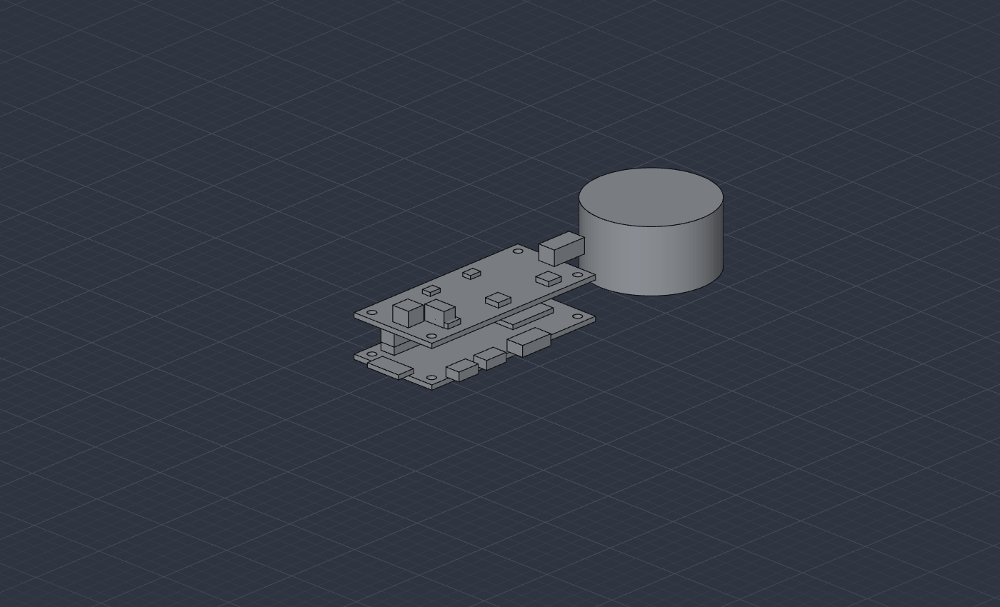
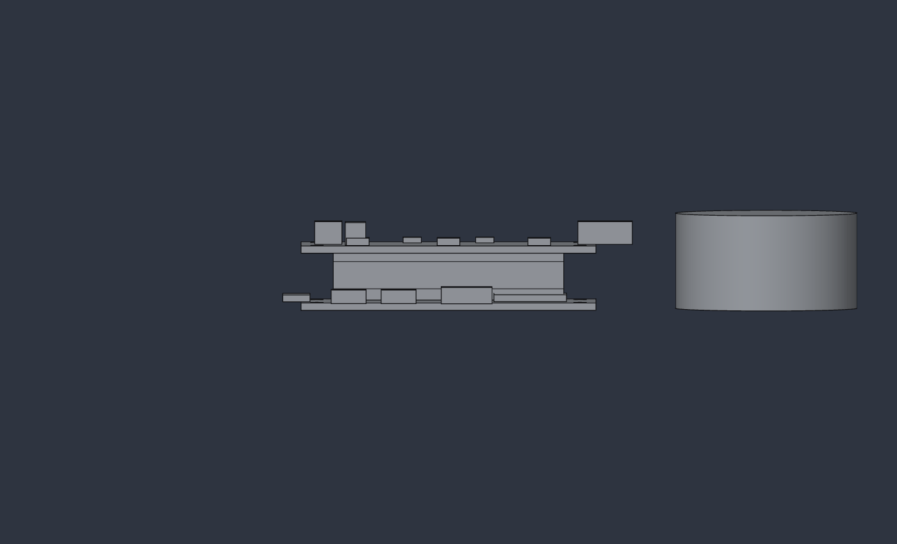

# Pi Zero 2 W + ReSpeaker HAT reference stack (flat layout)

**Reference assembly, not a case. It shows how the three parts sit relative to
each other and how tall the stack is. The board-to-board gap is assumed, the
connector positions are estimates, and no printed part exists yet.**

> **This is the flat layout, kept as the height reference.** James called it
> ugly on 2026-11-15 — boards at one end and the driver bolted on the side make a
> 105 mm plank — and it is not the arrangement to build. The replacement is
> [the upright assembly](../zero2w-respeaker-upright/README.md); the reasoning is
> [enclosure arrangements](../../../docs/design/enclosure-arrangements.md). The
> numbers here still matter, because they are what a standing version has to
> contain.

Editable SolidCraft source:
[`zero2w-respeaker-stack.sc`](zero2w-respeaker-stack.sc).

This is the assembly a tray has to hold: Pi Zero 2 W at the bottom, the
ReSpeaker 2-Mics HAT floating above it on a 2 × 20 pin/socket pair, and the
smallest candidate driver beside them for scale.

## What the stack looks like



*Isometric. Bottom board: Pi Zero 2 W with its two micro-USB sockets, mini-HDMI,
microSD and the metal can. Above it, on the header, the HAT with its socket
underneath, the jack on the right edge, microphones along the far edge and three
LEDs on the near edge. The cylinder is the Adafruit 3968 40 mm driver.*



*Front, edge-on. This is the height budget. The Pi PCB is at Z = 0–1.6 mm, the
HAT PCB sits at 12.6–14.2 mm, and the tallest HAT parts reach 21 mm. A lid has to
clear 21 mm and must not sit on the microphones or the button.*

## Measured envelope

| Measure | Value | Where it comes from |
| --- | --- | --- |
| Board footprint | 65 × 30 mm | Pi HAT form factor, both boards |
| Pi PCB | Z 0 – 1.6 mm | thickness assumed |
| HAT PCB | Z 12.6 – 14.2 mm | `PCB_T + STACK_GAP` with `STACK_GAP = 11 mm` |
| Top of stack | **Z 21 mm** | HAT jack and button, 5 mm above the HAT board |
| Speaker beside the boards | Ø40 × 21 mm | Adafruit 3968 envelope |

`STACK_GAP` is the weakest number here. A 2 × 20 male header plus female socket
gives roughly 11 mm between the top of one PCB and the bottom of the other, but
the real figure depends on the exact parts: a low-profile socket or a
press-fit arrangement changes it by several millimetres.

## Parameters

| Parameter | Value | Status |
| --- | --- | --- |
| `PCB_L`, `PCB_W`, `PCB_T` | 65 × 30 × 1.6 mm | outline sourced, thickness assumed |
| `HOLE_D`, `HOLE_SPAN_X`, `HOLE_SPAN_Y` | 2.75 mm, 58 × 23 mm | dimension-sourced |
| `HDR_L`, `HDR_W`, `HDR_H` | 50.8 × 5.08 × 8.5 mm | header and socket |
| `STACK_GAP` | 11 mm | **assumed**, see above |
| `SPK_D`, `SPK_DEPTH` | 40 × 21 mm | Adafruit 3968 |
| `SPK_X`, `SPK_Y` | 70, 0 mm | layout only — where the speaker sits in this reference |

## What this proves, and what it does not

Proves: the two boards stack without their parts colliding, the HAT's socket
clears the Pi's header, and the total height is about 21 mm.

Does not prove: that a printed tray holds them, that the speaker fits anywhere,
that the microphone ports are unobstructed, that the jack lines up with a hole,
or that the assembly survives being picked up. Those need a tray design and a
print.

## Known gaps

- No tray, no standoffs, no case. This is three parts in space.
- The speaker is placed beside the boards for scale; nothing says where it
  should actually go.
- Connector positions and heights inherit the estimates from the two component
  files.
- Cable routing — the JST speaker lead, the USB power lead — is not modelled at
  all, and it is the thing that usually decides a case layout.

## Regenerate

```
screenshot({ source: "model", grid: true, axes: false, width: 1400, height: 850,
             camera: { target: [10,0,8], yaw: 0.8, pitch: 0.42, distance: 210 },
             path: ".../assets/iso.png" })
screenshot({ source: "model", grid: false, axes: false, width: 1400, height: 850,
             camera: { target: [0,0,8], yaw: 0, pitch: 0.03, distance: 150 },
             path: ".../assets/front.png" })
```
