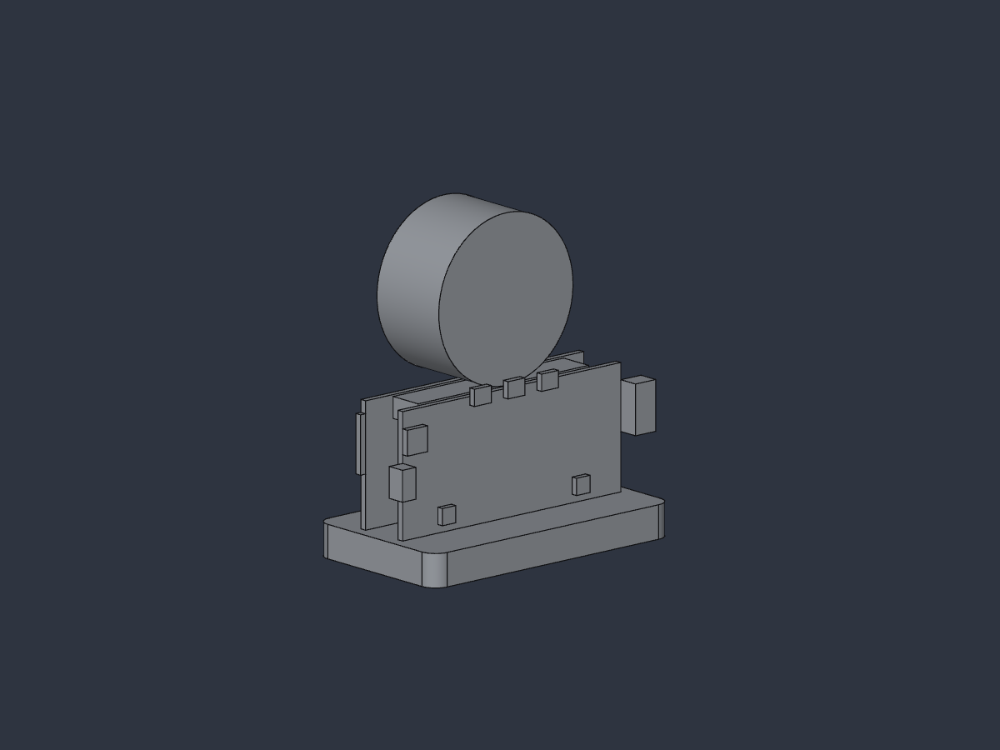
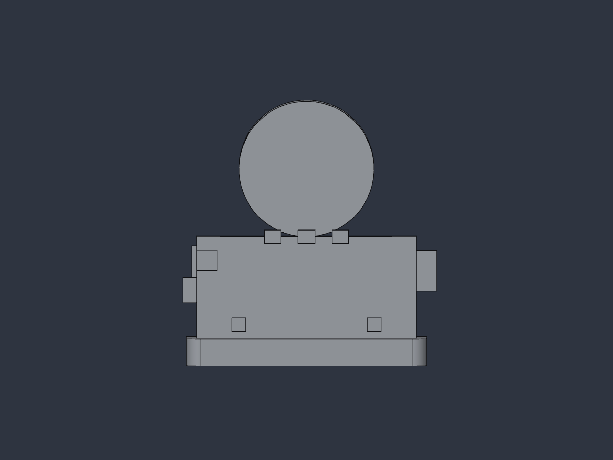
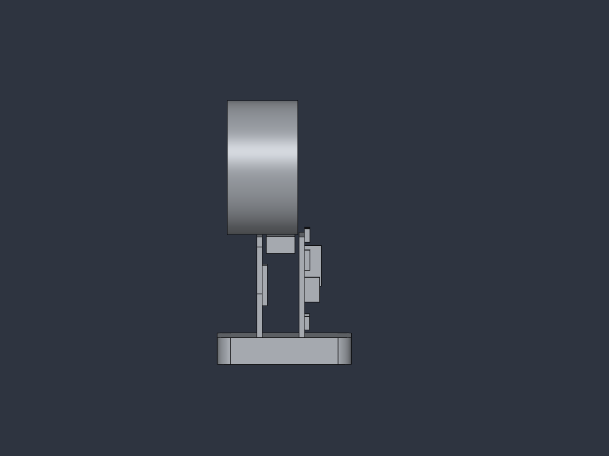

# Pi Zero 2 W + ReSpeaker HAT, standing up

**Reference assembly, not a case.** It shows one arrangement of the three parts
and what that arrangement costs. The board-to-board gap is assumed, the Pi's
component positions are estimates (the HAT's come from Seeed's Eagle board file),
and nothing here is print-ready or fit-tested.

> **The driver in this model is a stand-in.** It is the Adafruit 3968 Ø40 × 21 mm
> envelope, which is not the speaker James selected. The current target is a
> reconstruction of the original `RPiSpeaker_v17` enclosure, not this layout. If a
> DWEII housed module —
> [44 × 28 × 15 or 100 × 45 × 21](../../components/dweii-speakers/README.md) —
> were used instead, the 44 × 28 × 15 module is a different shape rather than a
> smaller one, the 100 × 45 × 21 module is far larger than a Ø40 driver in every
> direction and fits no case in this repository, and neither is confirmed to need
> a sealed chamber, so **this arrangement would probably not suit them**. This
> model is kept as the study of the inverted-T idea and as the height reference
> for a bare-driver build.

Editable SolidCraft source:
[`zero2w-respeaker-upright.sc`](zero2w-respeaker-upright.sc).

This exists because James looked at the
[flat reference stack](../zero2w-respeaker-stack/README.md) on 2026-11-15 and
said it was ugly: the boards at one end and the driver bolted onto the side
make a 126.5 mm overall arrangement. His suggestion — stand the Pi up and put
the speaker on top, so the elevation is an inverted T rather than a straight line — is the
arrangement modelled here. The reasoning, the alternatives and the constraint
that decides between them are in
[enclosure arrangements](../../../docs/design/enclosure-arrangements.md).

## What it looks like



*Isometric. The base is the wide bar of the inverted T; the two standing boards
are the stem; the driver is the head. Front board is the HAT, with the Pi 11 mm
behind it on the header. The two small squares low on the front are the
microphones, the three blocks at the top are the LEDs, the block on the right
edge is the 3.5 mm jack, and the driver is the Adafruit 3968 40 mm envelope.*



*Front, square on. The silhouette that the flat layout could not produce: 71 mm
base, 65 mm body, 40 mm head. The driver is narrower than the boards, which is
the whole reason this reads as an object rather than a plank.*



*Side, edge-on, and the least flattering view. The boards are only 14 mm deep,
so the stem is thin and the driver overhangs it front and back. **This is the
number the arrangement has to live with**: a Ø40 × 21 mm driver is deeper than
the two boards put together, so it cannot sit between them and it cannot sit on
them without a neck. The case has to provide that neck, and it is also the
driver's back volume.*

## Measured envelope

| Measure | Value | Where it comes from |
| --- | --- | --- |
| Overall | **75 × 40 × 78 mm** | X × Y × Z, including the jack and the JST on the edges |
| Base plate | 71 × 40 × 8 mm, 4 mm corner radius | design choice, not from a part |
| Boards | 65 wide × 30 tall, standing on the base | Pi HAT form factor |
| Board gap | 11 mm between the Pi and the HAT | `STACK_GAP`, **assumed** |
| Driver | Ø40 × 21 mm, centred over the boards | Adafruit 3968 envelope |
| Top of stack | Z 78 mm | base 8 + boards 30 + driver 40 |
| Total solid volume | 58 601 mm³ | `measure`, all 18 bodies |

The 78 mm height is not a target. It is what falls out of a 40 mm driver on a
30 mm board: change the driver and the whole thing changes.

## Why the boards are flipped this way up

The obvious way to stand the boards up puts the header edge at the bottom,
which leaves the HAT's microphone edge at the top — directly under the driver,
inside its back volume. That is where the first version of this model had them,
and it is not a small error: the microphones are the product.

So the boards stand with the **header at the top**:

| Edge | Ends up | Consequence |
| --- | --- | --- |
| Microphones | bottom front | clear air, below the driver's shadow, above the base |
| 3.5 mm jack | right side, upper | needs a hole, not a slot |
| JST speaker lead | left side | the driver's lead has a short run to the top |
| LEDs | top front | **under the driver** — needs a light pipe or a window, or they are invisible |
| Pi USB / HDMI / microSD | bottom | cables exit at the base, which is where they should |

That is a trade: the LEDs lose to the microphones. Status lights can be routed
with a light pipe; a microphone cannot be routed.

## What this proves, and what it does not

Proves: the arrangement has a shape and an overall size of 75 × 40 × 78 mm.

It does **not** prove that the parts do not collide. The USB, HDMI and microSD
envelopes sit inside the Pi PCB's own 1.6 mm Y band instead of protruding past
its edge, so this model understates the depth those connectors need and cannot
be used as clearance evidence. No interference check has been run.

Does not prove: that the driver can be mounted (nothing in this model holds it
up), that the microphones work in this position, that the enclosure has enough
volume behind the driver, or that any of the inherited component positions are
right.

## Known gaps

- **The driver is unsupported.** Its bottom touches the 1.6 mm top edge of two
  PCBs and nothing else. A real design needs a neck, a bracket or a shell.
- **No enclosure.** No walls, no grille, no back volume, no openings.
- **No fastener anywhere.** The base has no holes and the boards are not fixed
  to it.
- **The microphone direction is now sourced, and it agrees with this layout.**
  The HAT uses MSM321A3729H9BP microphones, which are **top-port**: sound enters
  through the top of the package, out of the HAT's component side. That is the
  side facing forward here, and it is why the HAT is the front board and the
  microphones sit low and clear rather than under the driver. See
  [the research note](../../../docs/research/2026-11-15-respeaker-microphone.md).
  The ports are located too — 58.93 mm apart, 8.66 mm inboard of the header edge
  — because the same Eagle board file gives their coordinates; see
  [the HAT envelope](../../components/respeaker-2mic-hat/README.md). What this
  model still lacks is a lid to cut them in.
- **Component positions are inherited** from the two component files: sourced for
  the HAT, approximate for the Pi's connectors and can.
- Cable routing is not modelled.

## Regenerate

```
screenshot({ source: "model", grid: false, axes: false, width: 1200, height: 900,
             camera: { target: [0,4,40], yaw: 0.72, pitch: 0.26, distance: 210 },
             path: ".../assets/iso.png" })
screenshot({ source: "model", grid: false, axes: false, width: 1200, height: 900,
             camera: { target: [0,0,40], yaw: 0, pitch: 0.02, distance: 170 },
             path: ".../assets/front.png" })
screenshot({ source: "model", grid: false, axes: false, width: 1200, height: 900,
             camera: { target: [0,0,40], yaw: 1.5708, pitch: 0.02, distance: 170 },
             path: ".../assets/side.png" })
```
