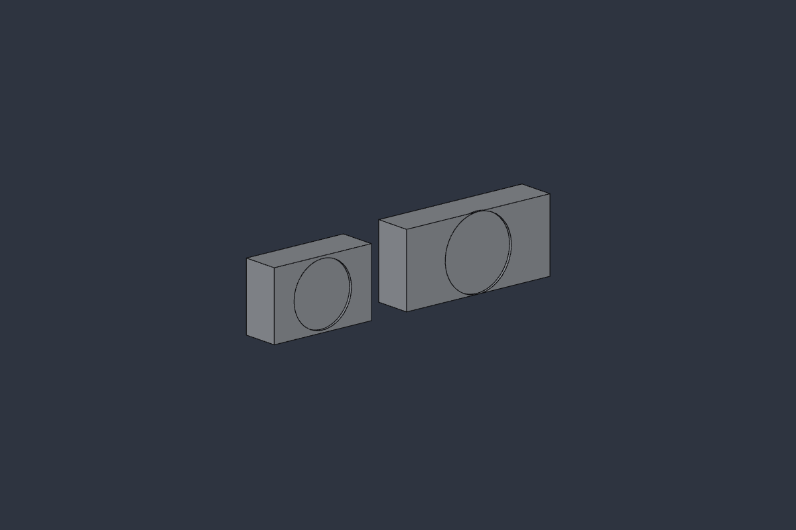
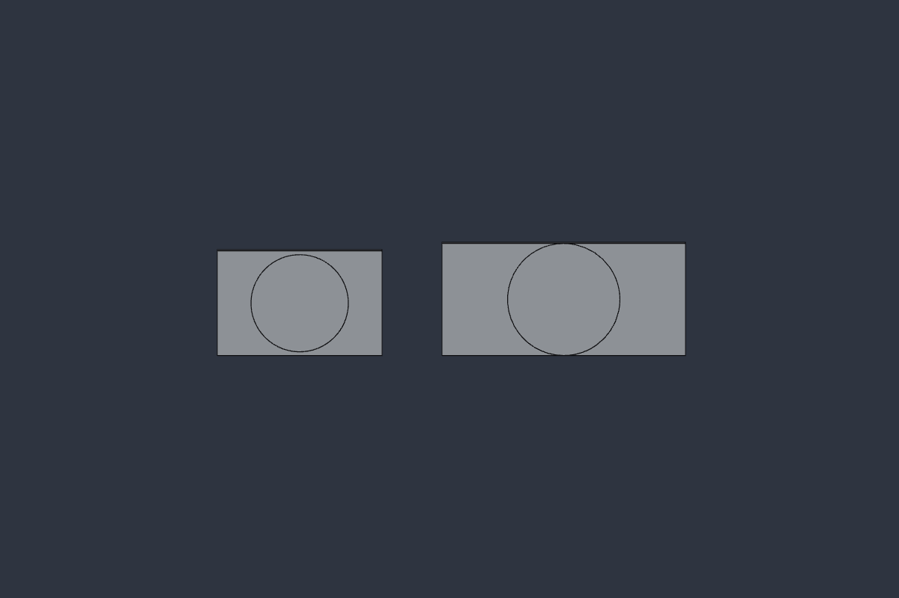

# DWEII speaker modules (the ones in the main README)

**Component envelope only. Two of the three modules are modelled; the third has
no usable dimensions and is not modelled at all. Nothing here is measured.**

Editable SolidCraft source: [`dweii-speakers.sc`](dweii-speakers.sc).

These are the three speakers James selected in the repository
[README](../../../README.md#speakers), and they are the parts a case should be
designed around. They are **enclosed cavity modules**, not bare drivers: each
one has its own plastic housing, its own internal chamber and its own acoustic
openings. That is the single most important fact for enclosure work here,
because it means a case must **carry** the module, not **seal** it. A pocket cut
tight around a module that has rear vents can silence it.

## What the envelopes look like



*Isometric. Left: the 701715519671 envelope, 44 × 28 × 15 mm. Right: the
701715519664 envelope, 65 × 30 × 15 mm. Both are drawn as the housing a pocket
has to accept, with the round recess marking the cone/grille opening — not as
the cone itself.*



*Front. The rectangles are the housings; the circles are where sound leaves. A
case needs a rectangular pocket for the first and a round opening in its baffle
for the second.*

## What is actually known, per module

| Module | Electrical | Mechanical | Modelled? |
| --- | --- | --- | --- |
| **701715519671**<br/>[B0B4D1BN4F](https://www.amazon.com/dp/B0B4D1BN4F) | 8 Ω, 3 W, JST-PH 2.0, 110 mm lead | Sellers give **31 × 28 × 15** and **44 × 28 × 15**. Mounting, rear vents and opening size unknown | **Yes**, at the larger 44 × 28 × 15 |
| **701715519664**<br/>[B0B4D2Z35P](https://www.amazon.com/dp/B0B4D2Z35P) | 8 Ω, 3 W, JST-PH 2.0 | No dimensions recovered. "Effectively the same size as the Pi Zero" is a historical description, not a measurement | **Yes**, at 65 × 30 × 15, with depth **assumed** from its sibling |
| **701715520462**<br/>[B0BHST51PQ](https://www.amazon.com/dp/B0BHST51PQ) | Unverified | No usable primary specification recovered | **No.** A guessed envelope is worse than an absent one |

The sourcing behind this table is
[ENC-PREP-B](../../../.local/delegation/20261114-parallel-research/ENC-PREP-B-submitted.md)
(local, not committed). It is the reason the third module is missing rather than
approximate.

## Parameters

| Parameter | Value | Status |
| --- | --- | --- |
| `S671_L`, `S671_W`, `S671_D` | 44 × 28 × 15 mm | **the larger of two conflicting seller sizes**, chosen so a pocket that fits it fits either |
| `S671_GRILLE` | 26 mm | **invented** — no published opening size |
| `S664_L`, `S664_W`, `S664_D` | 65 × 30 × 15 mm | length and width from a historical description, depth assumed |
| `S664_GRILLE` | 30 mm | **invented** |

## Why this folder exists next to `speaker-candidates`

[speaker-candidates](../speaker-candidates/README.md) holds ten vendor catalogue
drivers modelled as **cylinders**. That is the wrong shape for enclosure work:
almost every small speaker is a rectangular module, and the housing — not the
cone — is what a case has to fit around. James pointed this out on 2026-11-15.

The catalogue envelopes are still useful for comparing cone sizes and depth. They
are not useful for cutting a pocket. Use these.

## Known gaps

- **No module has been measured.** Every dimension is a seller claim or a
  description.
- **The acoustic openings are unknown**, so the grille recesses are placeholders.
- **Whether each module already has its own sealed chamber** is unconfirmed for
  all three. If one is an open-frame module, a case pocket must be sealed and
  that changes the part entirely.
- The 110 mm lead and its JST plug are not modelled; the lead has to go
  somewhere, and that usually decides the layout.
- No mounting holes are modelled, because none are documented.

## Regenerate

```
screenshot({ source: "model", grid: false, axes: false, width: 1200, height: 800,
             camera: { target: [62,7,15], yaw: 0.7, pitch: 0.3, distance: 230 },
             path: ".../assets/iso.png" })
screenshot({ source: "model", grid: false, axes: false, width: 1200, height: 800,
             camera: { target: [62,7,15], yaw: 0, pitch: 0.02, distance: 200 },
             path: ".../assets/front.png" })
```
