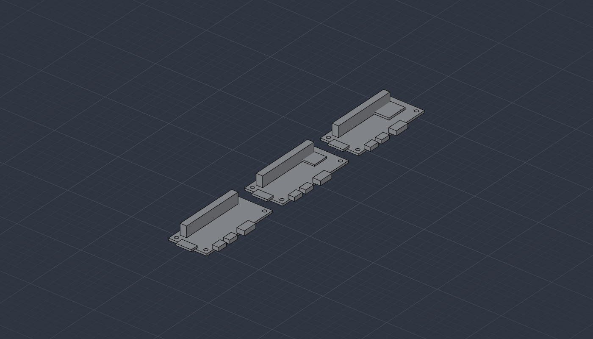
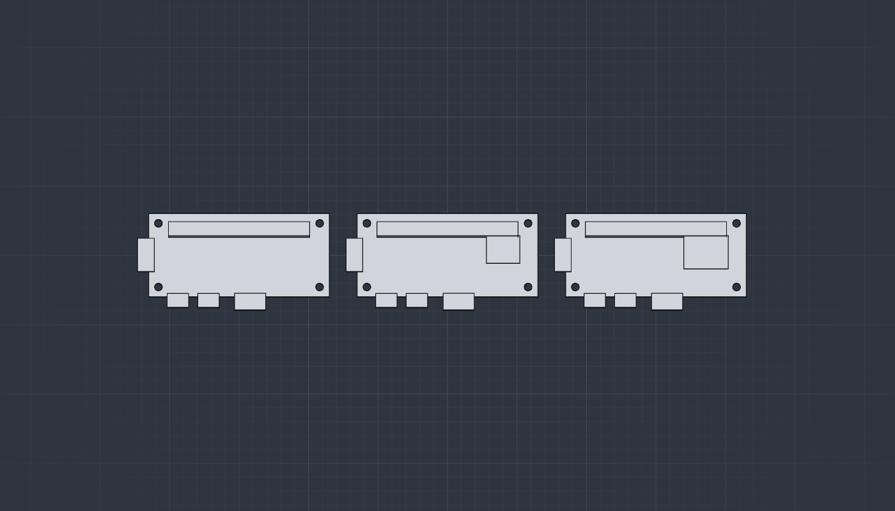

# Pi Zero family reference envelope

**Component envelope only. The board outline, mounting holes and the 40-pin
position are dimension-sourced; connector bodies, can heights and board
thickness are approximate. Not print-ready, not fit-tested.**

Editable SolidCraft source: [`pi-zero-family.sc`](pi-zero-family.sc).

One design holds all three boards side by side, because they share the same PCB
and differ only in what sits on top of it:

| Body prefix | Board | Difference that matters for a case |
| --- | --- | --- |
| `Zero13_*` | Pi Zero v1.3 | bare board, no shield: the lowest profile of the three |
| `ZeroW_*` | Pi Zero W | 12 × 10 mm wireless can, about 1.2 mm high |
| `Zero2W_*` | Pi Zero 2 W | 16 × 12 mm can over the SoC and radio, about 1.5 mm high |

The Zero 2 W is the leading candidate for Debra, so its extra 0.3 mm is the one
that actually constrains a lid.

## What the envelope looks like



*Isometric. Left to right: Zero v1.3, Zero W, Zero 2 W. The long block along the
far edge is the 40-pin header **as fitted**; a bare Zero has holes only. The
three blocks on the near edge are the two micro-USB sockets and the mini-HDMI;
the block on the left edge is the microSD. The square on the middle and right
boards is the metal can.*



*Top. 65 × 30 mm; four Ø2.75 mm holes on a 58 × 23 mm pattern, 3.5 mm in from the
edges. Compare this against the Raspberry Pi mechanical drawing: the hole
pattern is the part that must be right, and it is the part taken from the
drawing.*

## Parameters

| Parameter | Value | Status | Note |
| --- | --- | --- | --- |
| `PCB_L`, `PCB_W` | 65 × 30 mm | dimension-sourced | Pi Zero family outline |
| `PCB_T` | 1.6 mm | **assumed** | not printed on the drawing |
| `HOLE_D` | 2.75 mm | dimension-sourced | |
| `HOLE_SPAN_X`, `HOLE_SPAN_Y` | 58 × 23 mm | dimension-sourced | 3.5 mm inset on all sides |
| `HDR_L`, `HDR_W` | 50.8 × 5.08 mm | dimension-sourced | 2 × 20 at 2.54 mm |
| `HDR_H` | 8.5 mm | **assumed** | a soldered male header, shown fitted |
| `HDR_INSET` | 3.5 mm | **approximate** | header inset from the long edge |
| `USB_W`, `USB_D`, `USB_H` | 7.7 × 5 × 3 mm | **approximate** | micro-USB receptacle bodies |
| `HDMI_W`, `HDMI_D`, `HDMI_H` | 11.2 × 6 × 3.6 mm | **approximate** | mini-HDMI receptacle body |
| `SD_W`, `SD_D`, `SD_H` | 12 × 6 × 1.5 mm | **approximate** | microSD socket block |
| `SHIELD_ZW_*` | 12 × 10 × 1.2 mm | **approximate** | Zero W wireless can |
| `SHIELD_Z2_*` | 16 × 12 × 1.5 mm | **approximate** | Zero 2 W can |
| `B1_X`, `B2_X`, `B3_X` | −75, 0, 75 mm | layout only | board positions in this design |

## Geometry check

| Body | Volume | Analytic | Note |
| --- | --- | --- | --- |
| each `*_PCB` | 3082 mm³ | 65 × 30 × 1.6 − 4·π·1.375²·1.6 = 3082.0 | four holes cut |
| each `*_Header` | 2194 mm³ | 50.8 × 5.08 × 8.5 = 2193.5 | block, not pins |
| each `*_USB_*` | 116 mm³ | 7.7 × 5 × 3 = 115.5 | |
| each `*_HDMI` | 242 mm³ | 11.2 × 6 × 3.6 = 241.9 | |

## Known gaps

- **Connector positions are estimates.** The three ports sit at plausible
  spacings along one edge, not at measured offsets. A case that needs a port to
  line up exactly must not use these numbers yet: measure the board, or read the
  port positions off the official drawing, then change the four `center` values
  in the timeline.
- The 40-pin header is a solid block. A bare board has holes; a board with a
  soldered header has pins, and a case that clears 8.5 mm of block may still
  clash with a taller pin stack.
- The microSD body is modelled as a block that protrudes 4 mm past the edge. The
  card itself sticks out further and needs a finger path.
- No components are modelled below the board, and the SoC, USB and HDMI shells
  are not modelled in detail.
- Nothing here is measured against a real Zero with calipers.

## Regenerate

```
screenshot({ source: "model", grid: true, axes: false, width: 1400, height: 800,
             camera: { target: [0,0,5], yaw: 0.9, pitch: 0.55, distance: 260 },
             path: ".../assets/iso.png" })
screenshot({ source: "model", grid: true, axes: false, width: 1400, height: 800,
             camera: { target: [0,0,0], yaw: 0, pitch: 1.5, distance: 230 },
             path: ".../assets/top.png" })
```
