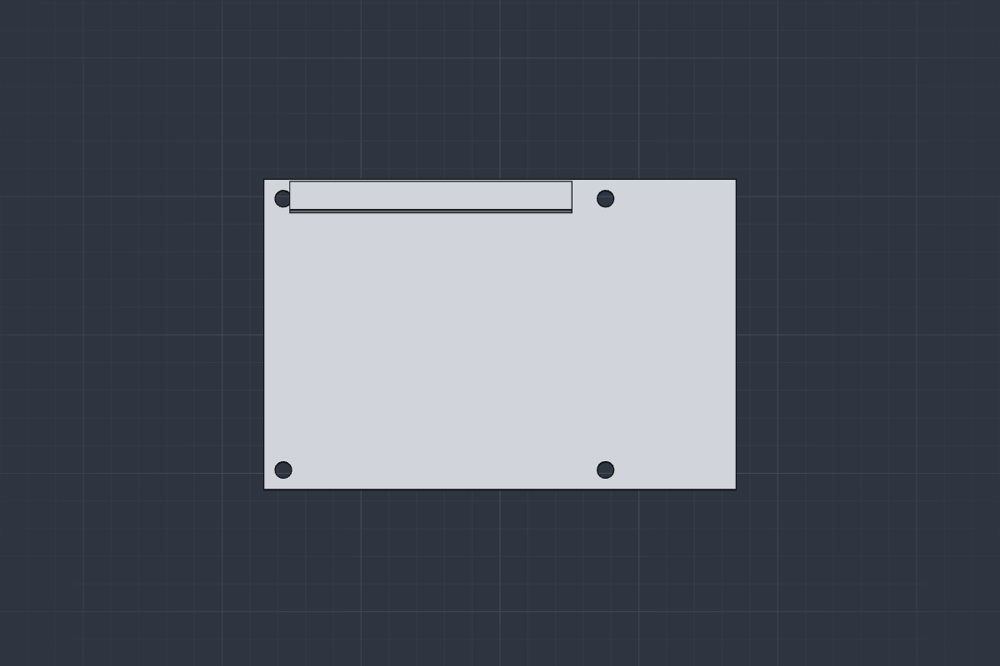
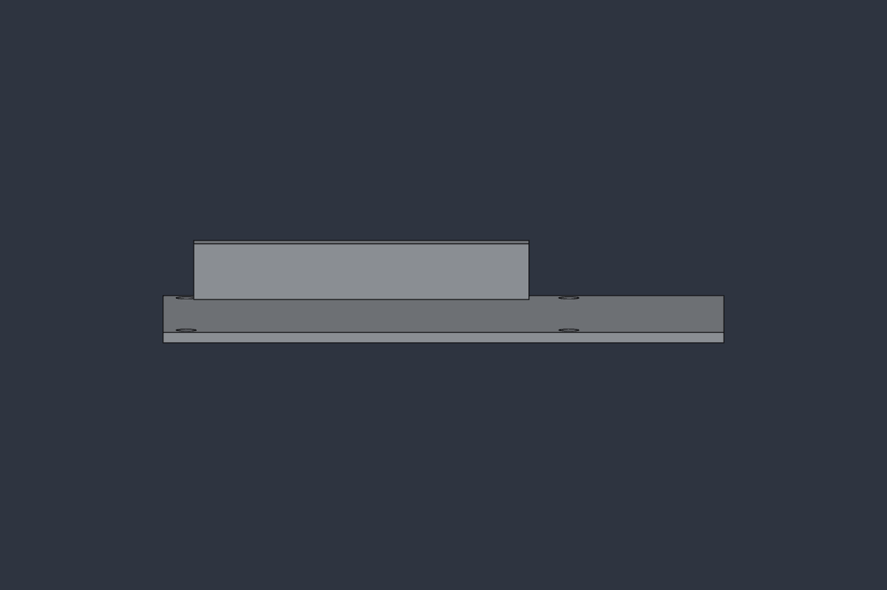

# Pi 5 Model B reference envelope

**Component envelope only: dimension-sourced outline and holes, provisional
thickness and header height. Not a case, not print-ready, not fit-tested.**

Editable SolidCraft source: [`pi5-reference.sc`](pi5-reference.sc).

## What the envelope looks like

Rendered from `pi5-reference.sc` on 2026-11-15, no grid and no axes, so the
images show the geometry and nothing else. They are what the model *is*: a
1.6 mm board with four mounting holes and one 8.5 mm header block. The ports,
the chips and everything under the board are absent because they are not
modelled yet (see [Known gaps](#known-gaps)).


*Isometric. The long block is the 2×20 header socket, 50.8 × 5.08 × 8.5 mm,
straddling the far mounting-hole line. Everything else on a real board —
USB-C, micro-HDMI, USB-A, Ethernet, the SoC and its shield — is missing.*



*Top. Board 85 × 56 mm; holes Ø3 mm, 3.5 mm in from the edges, 58 mm apart
across and 49 mm down. This view is the one to compare against the mechanical
drawing.*



*Front, edge-on. The board is 1.6 mm (assumed — the drawing does not print it)
and the header stands 8.5 mm above it (also assumed, a typical socket). This is
the height budget a tray or case has to clear, and it is the least trustworthy
number here.*

Regenerate with the SolidCraft MCP tools while the model is open:

```
screenshot({ source: "model", grid: true,  axes: false, width: 1200, height: 800,
             camera: { target: [0,0,5], yaw: 0.785, pitch: 0.45, distance: 165 },
             path: ".../assets/pi5-iso.png" })
screenshot({ source: "model", grid: true,  axes: false, width: 1200, height: 800,
             camera: { target: [0,0,5], yaw: 0,     pitch: 1.5,  distance: 150 },
             path: ".../assets/pi5-top.png" })
screenshot({ source: "model", grid: false, axes: false, width: 1200, height: 800,
             camera: { target: [0,0,4.5], yaw: 0,   pitch: 0.10, distance: 112 },
             path: ".../assets/pi5-front.png" })
```

## Parameters

| Parameter | Value | Status | Source |
| --- | --- | --- | --- |
| `PCB_L` | 85 mm | dimension-sourced | Raspberry Pi 5 mechanical drawing, `raspberrypi.com/documentation`/datasheets copy fetched 2026-11-15 |
| `PCB_W` | 56 mm | dimension-sourced | same drawing |
| `PCB_T` | 1.6 mm | **assumed** | not printed on the drawing |
| `HOLE_INSET` | 3.5 mm | dimension-sourced | drawing; holes 3.5 mm from the three outer edges |
| `HOLE_SPAN_X` | 58 mm | dimension-sourced | drawing |
| `HOLE_SPAN_Y` | 49 mm | dimension-sourced | drawing |
| `HOLE_D` | 3 mm | dimension-sourced | drawing (`Ø3`) |
| `HDR_L` | 50.8 mm | dimension-sourced | 20 positions at 2.54 mm measured on the drawing |
| `HDR_W` | 5.08 mm | dimension-sourced | two rows at 2.54 mm |
| `HDR_H` | 8.5 mm | **assumed** | typical 2×20 socket above the PCB |
| `HDR_X` | `-PCB_L/2 + 4.66 + HDR_L/2` | measured | body left edge 4.66 mm from the board edge on the drawing |
| `HDR_Y` | `PCB_W/2 - HOLE_INSET` | dimension-sourced | header body straddles the top mounting-hole line |

## Geometry check

The first build measured exactly the analytic value:

| Body | Volume | Analytic | Bounding box |
| --- | --- | --- | --- |
| `Pi5_PCB` | 7570.761 mm³ | 85×56×1.6 − 4·π·1.5²·1.6 = 7570.76 | 85 × 56 × 1.6 |
| `Pi5_Header` | 2193.544 mm³ | 50.8 × 5.08 × 8.5 = 2193.54 | 50.8 × 5.08 × 8.5 |

A rendered top view ([`assets/pi5-top.png`](assets/pi5-top.png)) matches the
drawing's layout: four holes, header along the far edge starting near the left
hole and ending well short of the right edge.

## Known gaps

- Port envelopes (USB-C power, 2× micro-HDMI, 2× USB-A, gigabit Ethernet,
  microSD) are **not modelled**. The drawing gives 6, 10.2, 11.2, 25.8, 29.1,
  39.2, 47 and 56 mm as connector positions, but the feature-to-value mapping
  was not verified, and a wrong guess would silently misplace a cut-out.
- Component heights above the board and the components below it are not
  modelled; the drawing's side view prints 3.2, 3.4, 4.1, 4.4 mm for small
  parts and 3 mm below the board, again without a verified mapping.
- The POE/PCIe, UART, and RTC footprints are not modelled.
- Nothing here is verified against a real board with calipers. Measuring the
  actual specimen is cheaper than guessing, and it resolves several unknowns at
  once.

## Provenance

Drawings: `raspberry-pi-5-mechanical-drawing.pdf` (Raspberry Pi Ltd, single A4
sheet, "all dimensions are approximate and for reference purposes only ... not
be used for producing production data"). The header position was measured from
the 150 dpi render by pin-circle pitch, not read from a dimension.
