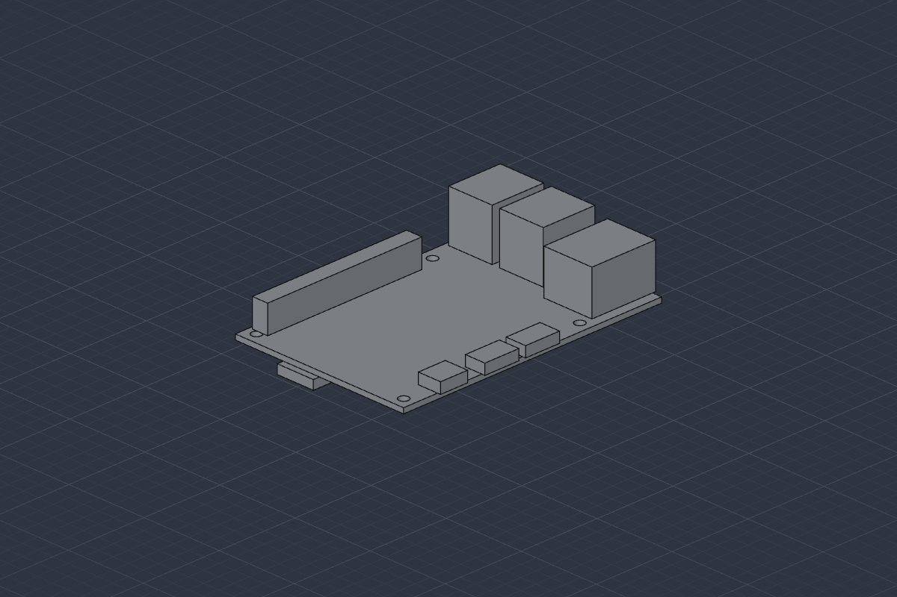

# Pi 5 Model B reference envelope

**Component envelope only: board, mounting holes and port positions from the
official mechanical drawing, thickness and connector heights assumed. Not a
case, not print-ready, not fit-tested.**

Editable SolidCraft source: [`pi5-reference.sc`](pi5-reference.sc).

## What the envelope looks like



*Isometric. The long low block is the 2 × 20 header, 50.8 × 5.08 × 8.5 mm. The
three tall blocks on the right edge are the two USB-A double stacks and the
Ethernet jack; the three small blocks on the near edge are the USB-C power
connector and the two micro-HDMI ports. The chips, the shield, the fan connector
and everything else on a real board are absent.*


*Top. This is the layout the drawing shows and the one to compare against it:
header along one long edge, USB-C + micro-HDMI ×2 on the opposite long edge,
Ethernet + USB-A ×2 on one short edge, microSD on the other short edge. The four
Ø3 mm mounting holes are **not** symmetric — see the parameter table.*


*Front, edge-on. The board is 1.6 mm (assumed; the drawing does not print it),
the header stands 8.5 mm above it, and the USB-A stacks reach 17.1 mm. That
17.1 mm is the height a lid has to clear, and it is the least trustworthy number
here.*

Regenerate with the SolidCraft MCP tools while the model is open:

```
screenshot({ source: "model", grid: true,  axes: false, width: 1200, height: 800,
             camera: { target: [0,0,6], yaw: 0.78, pitch: 0.45, distance: 175 },
             path: ".../assets/pi5-iso.png" })
screenshot({ source: "model", grid: true,  axes: false, width: 1200, height: 800,
             camera: { target: [0,0,0], yaw: 0,    pitch: 1.5,  distance: 150 },
             path: ".../assets/pi5-top.png" })
screenshot({ source: "model", grid: false, axes: false, width: 1200, height: 800,
             camera: { target: [0,0,5], yaw: 0,    pitch: 0.08, distance: 130 },
             path: ".../assets/pi5-front.png" })
```

## Parameters

| Parameter | Value | Status | Source |
| --- | --- | --- | --- |
| `PCB_L` | 85 mm | dimension-sourced | Raspberry Pi 5 mechanical drawing, 2026-11-15 |
| `PCB_W` | 56 mm | dimension-sourced | same drawing |
| `PCB_T` | 1.6 mm | **assumed** | not printed on the drawing |
| `HOLE_D` | 3 mm | dimension-sourced | drawing (`Ø3`) |
| `HOLE_INSET_X` | 3.5 mm | dimension-sourced | left holes 3.5 mm from the **left** edge only |
| `HOLE_SPAN_X` | 58 mm | dimension-sourced | hole spacing along the length |
| `HOLE_SPAN_Y` | 49 mm | dimension-sourced | hole spacing across the width, centred (3.5 mm each side) |
| `HDR_L`, `HDR_W` | 50.8 × 5.08 mm | dimension-sourced | 2 × 20 at 2.54 mm |
| `HDR_H` | 8.5 mm | **assumed** | typical 2 × 20 socket above the PCB |
| `HDR_X` | `-PCB_L/2 + 4.66 + HDR_L/2` | **measured from the render** | header body 4.66 mm from the left edge |
| `HDR_Y` | `HOLE_SPAN_Y/2` | dimension-sourced | header body straddles the top mounting-hole line |
| `USBC_W/D/H` | 8.9 × 7.4 × 3.3 mm | **typical**, not sourced | USB-C receptacle |
| `MHDMI_W/D/H` | 11.2 × 6.5 × 3.2 mm | width sourced, rest typical | the drawing gives 11.2 as a port width |
| `USBA_W/D/H` | 14.5 × 17 × 15.5 mm | **typical**, not sourced | USB-A double stack |
| `ETH_W/D/H` | 16 × 21 × 13.5 mm | **typical**, not sourced | RJ45 jack |
| `SD_W/D/H` | 12 × 14 × 2.8 mm | **typical**, not sourced | microSD socket, under the board |
| `PORT_PROUD` | 1 mm | **assumed** | how far a connector shell stands past the board edge |
| `SD_PROUD` | 2 mm | **assumed** | how far the SD socket stands past the edge |

### The holes are asymmetric

The drawing dimensions the left mounting holes 3.5 mm from the left edge and
then 58 mm between hole centres, on an 85 mm board. So the right pair sits
23.5 mm from the right edge, not 13.5 mm. The vertical pair is 49 mm apart on a
56 mm board, which is 3.5 mm from each long edge and therefore centred. A case
built on a symmetric assumption will put two standoffs in the wrong place.

## Geometry check

| Body | Volume | Analytic | Bounding box |
| --- | --- | --- | --- |
| `Pi5_PCB` | 7571 mm³ | 85 × 56 × 1.6 − 4·π·1.5²·1.6 = 7570.76 | 85 × 56 × 1.6 |
| `Pi5_Header` | 2194 mm³ | 50.8 × 5.08 × 8.5 = 2193.54 | 50.8 × 5.08 × 8.5 |
| `Pi5_USBC` | 217 mm³ | 8.9 × 7.4 × 3.3 = 217.3 | |
| `Pi5_HDMI0`, `Pi5_HDMI1` | 233 mm³ each | 11.2 × 6.5 × 3.2 = 233.0 | |
| `Pi5_USBA_3`, `Pi5_USBA_2` | 3821 mm³ each | 14.5 × 17 × 15.5 = 3820.8 | |
| `Pi5_Ethernet` | 4536 mm³ | 16 × 21 × 13.5 = 4536.0 | |
| `Pi5_microSD` | 470 mm³ | 12 × 14 × 2.8 = 470.4 | below Z = 0 |

Total envelope: X −44.5 … 43.5 mm, Y −29 … 28 mm, Z −2.8 … 17.1 mm.

## Known gaps

- **Only the hole pattern and the edge each port is on come from the drawing.**
  The USB-C and micro-HDMI offsets use the drawing's 11.2, 25.8 and 39.2 mm
  figures read as distances from the left board edge to each port's left edge;
  that reading is not verified. The USB-A and Ethernet offsets along the right
  edge are evenly spread to look right, not measured.
- Connector heights, depths and widths are typical values for the connector
  families, not datasheet numbers. `PORT_PROUD` is a guess.
- The drawing's own dimension set includes 6, 10.2, 18.4, 13.3, 29.1, 47 and 56
  mm whose feature-to-value mapping was **not** established; those numbers are
  not used here rather than being guessed into the model.
- The SoC, the shield, the fan connector, the PCIe, UART and RTC footprints and
  the 3 mm of underside components are not modelled.
- Nothing here is verified against a real board with calipers. Measuring the
  specimen resolves several unknowns at once and is cheaper than guessing.

## Provenance

Drawing: `raspberry-pi-5-mechanical-drawing.pdf` (Raspberry Pi Ltd, one A4 sheet,
"all dimensions are approximate and for reference purposes only ... not be used
for producing production data"). Header position and port edges were read from a
400 dpi render of that sheet, not from a datasheet.
