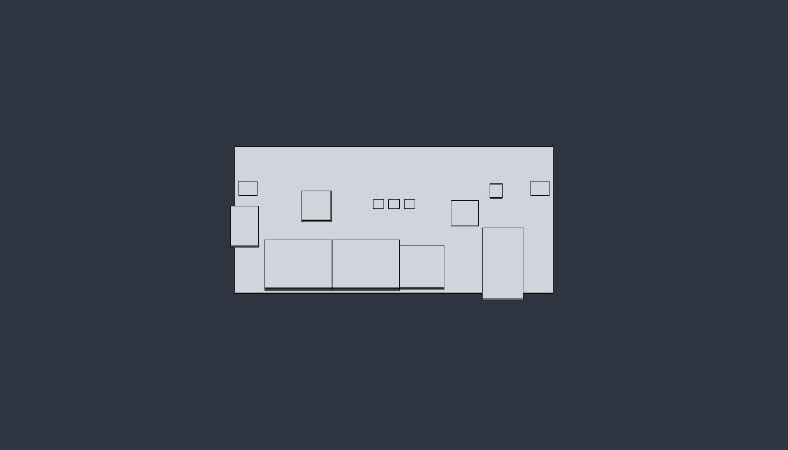
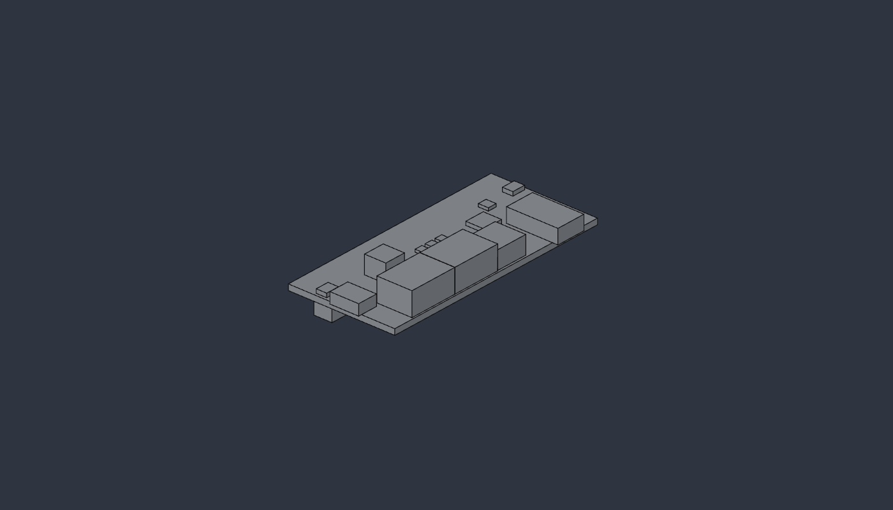
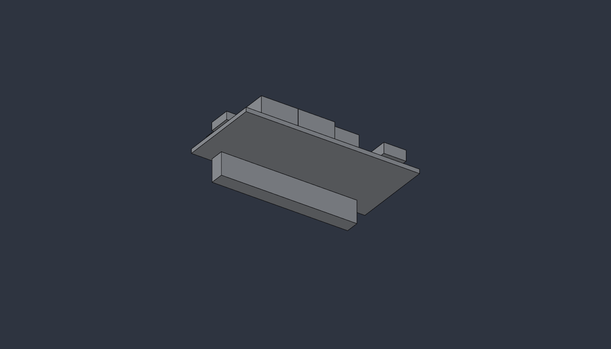

# ReSpeaker 2-Mics Pi HAT v2.0: component envelope from the real board layout

**Positions are sourced, not invented.** Every X/Y on this page comes from Seeed's
published Eagle board file, so the two microphone ports are now known to about
0.1 mm. Heights are still typical values, not measurements, and the board's
corner chamfers are not modelled.

Editable SolidCraft source: [`respeaker-2mic-hat.sc`](respeaker-2mic-hat.sc).

This is the HAT on the lab Pi. Until 2026-11-15 its component positions were
guessed; they are not any more. Seeed publishes the V1.0 `.brd`, and their own
hardware-revision page says **"The PCB layout of v1 and v2 remains basically the
same, but additional circuits are added"** — which makes the V1 file a usable
source for the V2 board. The evidence and the caveats are in
[the research note](../../../docs/research/2026-11-15-respeaker-microphone.md).

## What the envelope looks like



*Top. **+Y is the 40-pin header edge** (top of the image); the socket is
underneath and hidden. The two small boxes at the upper corners are the
microphones, each 8.66 mm inboard of the header edge and 3.0 mm from a short
edge. The three tiny boxes in a row are the APA102 LEDs. Along the lower edge:
two Grove connectors, the JST speaker out, and at the lower right the 3.5 mm
jack, whose mouth points off that edge.*



*Isometric from the component side. The Grove connectors are the tallest parts
on the board at about 6.5 mm; the socket is underneath.*



*Underside. The 50.8 × 5.08 × 8.5 mm socket is the only thing below the board,
and it is why the HAT floats above the Pi.*

## The numbers a case needs

Board frame: origin at the board's lower-left corner, X along the 65 mm length,
Y across the 30 mm width, **+Y is the 40-pin header edge**.

| Feature | Position | Size | Source |
| --- | --- | --- | --- |
| Board | 65.02 × 29.97 | 1.6 mm thick, ~3 mm corner chamfers | Eagle dimension layer |
| Mounting holes | (3.5, 3.5), (61.5, 3.5), (3.5, 26.5), (61.5, 26.5) | Ø2.75 | Eagle, same 58 × 23 pattern as the Pi |
| 40-pin header | rows at y = 25.23 and 27.77, x 8.37…56.63 | 2 × 20, 2.54 pitch | Eagle pads |
| **MIC1 port** | **(3.05, 21.34)** | Ø0.325, top-port | Eagle element + package port marker |
| **MIC2 port** | **(61.98, 21.34)** | Ø0.325, top-port | Eagle element + package port marker |
| Mic bodies | (2.67, 21.34) and (62.36, 21.34) | 3.78 × 2.95 × 1.1 | Eagle, MEMSensing datasheet |
| LEDs ×3 | (29.34, 18.16), (32.51, 18.16), (35.69, 18.16) | 2.2 × 1.9 × 0.7 | Eagle |
| Button | (16.64, 17.53) | 6 × 6 × 5 | Eagle |
| Micro-USB power | (1.98, 13.46) | 5.74 × 8.10 × 3, mouth −X | Eagle |
| Grove I2C / GP12 | (12.95, 5.45), (26.67, 5.45) | 13.8 × 9.88 × 6.5, mouths −Y | Eagle |
| JST speaker out | (38.10, 4.95) | 9.2 × 8.6 × 5, mouth +Y | Eagle |
| 3.5 mm jack | mouth at (54.74, −1.52) | 8.35 × 14.5 × 4, mouth −Y | Eagle |
| Codec TLV320AIC3104 | (46.99, 16.26) | 5.6 × 5.15 × 1.0 | Eagle |
| Oscillator | (53.34, 20.83) | 2.5 × 2.85 × 0.8 | Eagle |

The mic port spacing is **58.93 mm**, and the two ports are symmetric about the
board centre to within 0.03 mm — which is the kind of number that only comes out
of a real layout.

## What this settles, and what it does not

**Settled.** The microphones are at the two ends of the header edge, so a case can
have two Ø1 mm openings, or one slot, over known points. The jack, both Grove
connectors and the micro-USB power port all exit known edges. The board is the
same size as a Pi Zero, with the same mounting-hole pattern, so one standoff
pattern holds both.

**Not settled.**

- **The V1-versus-V2 gap.** Seeed's statement that the layout "remains basically
  the same" is a statement about the layout, not a guarantee about a specific
  component. The extra circuits added in V2 could have moved something. The
  microphones are at the extreme corners and the outline is unchanged, so they
  are the safest of the positions; the codec and its passives are the least safe.
  **One ruler check on the real board would confirm the port positions.**
- **Heights are typical, not measured.** The 6.5 mm Grove height, 5 mm button and
  3 mm micro-USB are engineering norms for those connectors.
- **The corner chamfers are not modelled**, so the board is drawn square.
- **Three of the four edges have something on them.** The only clean edge is the
  one the microphones sit near — which is also the edge a case most wants to
  leave open for them.
- **Nothing here is measured against the physical HAT.**

## Parameters

| Parameter | Value | Meaning |
| --- | --- | --- |
| `PCB_L`, `PCB_W`, `PCB_T` | 65.02 × 29.97 × 1.6 mm | board |
| `MIC_X` | 29.85 mm | half the microphone spacing |
| `MIC_Y` | 6.34 mm | 8.66 mm inboard of the header edge |
| `MIC_PORT_DX` | 0.381 mm | port offset from each package centre, inboard |
| `SOCK_L`, `SOCK_W`, `SOCK_H` | 50.8 × 5.08 × 8.5 mm | the 2 × 20 socket underneath |

## Regenerate

```
screenshot({ source: "model", grid: false, axes: false, width: 1400, height: 800,
             camera: { target: [0,-1,0], yaw: 0, pitch: 1.5, distance: 115 },
             path: ".../assets/top.png" })
screenshot({ source: "model", grid: false, axes: false, width: 1400, height: 800,
             camera: { target: [0,-1,1], yaw: 0.85, pitch: 0.5, distance: 135 },
             path: ".../assets/iso.png" })
screenshot({ source: "model", grid: false, axes: false, width: 1400, height: 800,
             camera: { target: [0,0,-4], yaw: 0.6, pitch: -0.55, distance: 135 },
             path: ".../assets/under.png" })
```
