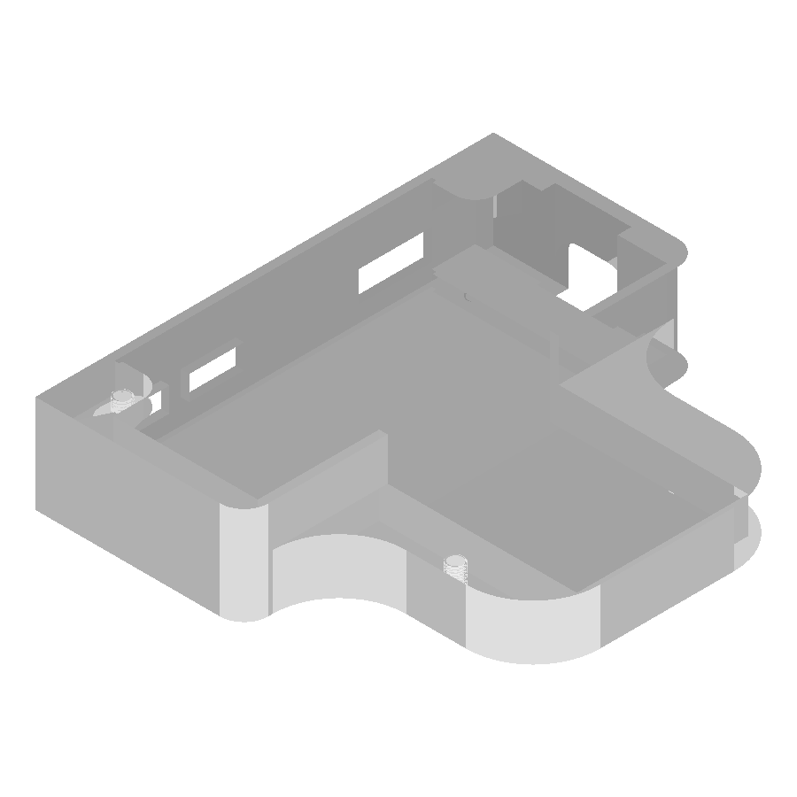
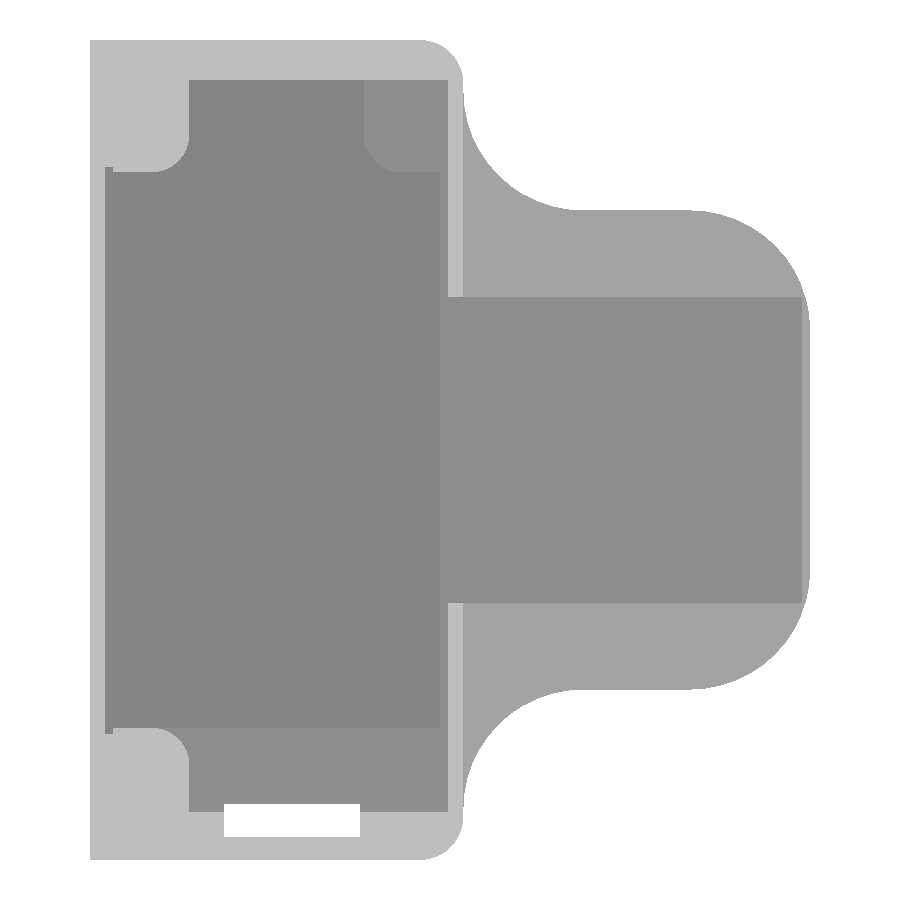

# RPiSpeaker v17 extraction reference

This is a **read-only reconstruction reference**, not a printable part or a
validated design. It documents an already-completed extraction from James's
original `RPiSpeaker_v17.step`. The STEP and companion Fusion file remain at
`/home/james/onedrive/Projects/Voice_Assistant/RPiSpeaker/models/Fusion360/`;
they are not included here. The measurements below are reported from that
extraction, not independently rechecked for this write-up. See the
[learning note](../../../docs/notes/2026-11-15-rpispeaker-v17-extraction.md)
for provenance and limitations.

**The v17 body has no four-screw square speaker mount.** The only fastener
patterns in the solid are four M2.5 pilots at 23 × 58 mm (the Pi Zero footprint)
and two M2.5 pilots 36.5 mm apart in the second bay. A remembered square
four-screw mount is therefore either a separate part that was never exported or
a different revision; it must not be assumed present in this STEP body. The
second bay has a 31.10 × 28.125 mm lower footprint, two through pilots and a
central stepped Ø10/Ø18/Ø20 opening. The [bay inventory](../../../docs/notes/2026-11-15-rpispeaker-v17-bay-inventory.md)
supersedes the conflicting second-bay claims in the historical table below; see
also the [editable reconstruction](../../parts/rpispeaker-v17-body/README.md).

## Coordinates and envelope

Coordinates are in millimetres in the STEP frame. X runs across the bays. Y
is the depth, and is up in the isometric rendering. Z runs along the long
dimension, shown vertically in the tool's top view. Calling Z the height is a
description of that plan orientation, not proof of how the finished device
stood or was mounted.

| Axis | Minimum | Maximum | Envelope |
| --- | ---: | ---: | ---: |
| X | -17.15 | 49.00 | 66.15 mm |
| Y | -0.60 | 15.50 | 16.10 mm |
| Z | -37.65 | 37.65 | 75.30 mm |

## Extracted features

Positions below are in the same STEP frame. Hole coordinates are `(X, Z)`.

| Feature | Reported measurement from the STEP extraction |
| --- | --- |
| Pi Zero bay | Inner 31.50 × 66.50 mm; X -15.75 to 15.75, Z -32.50 to 34.00 |
| Pi Zero bay holes | Four Ø2.18 mm holes described as M2.5 pilots at `(±11.5, ±29.0)`, with 23 × 58 mm spacing, on Ø4.76 mm bosses |
| Second bay | X 17.15 to 48.25, Z -33 to 33; floor at Y 8.50, so the bay is a 31.10 × 66 mm pocket 7 mm deep, open toward +Y |
| Second bay holes | Two Ø2.18 mm holes at `(32.5, ±18.25)`, 36.5 mm apart, on Ø4.50 mm bosses, drilled from the back face to Y 7.29 |
| Second bay centre | One Ø10 mm through hole with a Ø18 mm counterbore, both opening toward +Y, at `(31.625, 0)` |
| Rounds, wall and recess | R11 corner rounds; outer wall at X -17.15 is 1.40 mm thick; base recess is 0.60 mm |
| Openings | Port window in the Z = -37.65 wall, 12.5 mm wide and centred at Y 4.5. Three rectangular cut-outs in the X = -17.15 wall: two 4 × 9 mm at Z 4.75–13.75 and 17.00–26.00, and one 5 × 12 mm at Z -26.10 to -14.10. Their sizes and spacing match a Pi Zero's two micro-USB and one mini-HDMI connectors, so they read as connector exits rather than a speaker grille |
| Reported solid properties | Volume 15,282 mm³; estimated mass 19.71 g at an assumed density of 1.29 g/cm³; 143 faces, including 76 planar, 35 cylindrical and 9 conical; 419 edges; one shell |

The M2.5 label describes the reported intended pilot-hole use, not a tested
fastener fit. The estimated mass is not a physical weighing.

The two face counts are not in conflict. The STEP file contains 262
`ADVANCED_FACE` entities, of which 76 are planes, 154 are cylindrical surface
patches and 9 are cones. The CAD kernel reports 143 faces because it sews the
154 cylindrical patches into 35 faces; its plane and cone counts match the STEP
exactly. Read the STEP count when asking "how many patches did the exporter
write" and the kernel count when asking "how many faces does the solid have".

## Views

These are rasterised views of the original STEP, made with
[`tools/cad/step_inspect.py`](../../../tools/cad/step_inspect.py), not
photographs or a new reconstruction. They show only the STEP body, not its
speaker or a validated assembly. Face shading and curved surfaces are
approximations and can obscure details.



*Isometric view. Y projects upward; X and Z contribute to the horizontal and
vertical directions.*



*Plan view (the tool calls it `top`): X horizontal, Z vertical, viewed along Y.
This is the readable view of this part, because the large faces are the XZ
planes. The left bay is the Pi Zero pocket; the right is the second bay with its
R11 corners.*


*Side view: Z horizontal, Y vertical, viewed along X. This is the 16 mm depth
profile.*


*The tool's `front` view is X horizontal and Y vertical, viewed along Z. For
this part that is the 66 × 16 mm edge, so it shows only a thin strip. It is
included for completeness, not as a useful drawing.*

## Inspecting the source again

From the repository root, with the original STEP available at its local path:

```bash
python3 tools/cad/step_inspect.py summary /home/james/onedrive/Projects/Voice_Assistant/RPiSpeaker/models/Fusion360/RPiSpeaker_v17.step
python3 tools/cad/step_inspect.py features /home/james/onedrive/Projects/Voice_Assistant/RPiSpeaker/models/Fusion360/RPiSpeaker_v17.step
python3 tools/cad/step_inspect.py render /home/james/onedrive/Projects/Voice_Assistant/RPiSpeaker/models/Fusion360/RPiSpeaker_v17.step --out /tmp/opencode/rpispeaker-v17
```

`summary` reports parsed entity counts, solids and vertex bounds; `features`
reports circle diameters, axes and centres, and plane offsets. The parser uses
Python's standard library; `render` additionally requires Pillow. It writes
four PNGs with `_top`, `_front`, `_side` and `_iso` suffixes. The original
render command and options were not supplied, so these commands are a way to
inspect and render again, not a claim of byte-identical reproduction. A circle
can be a boundary or a round rather than a hole, and the tool does not compute
volume.

## Unknown

- Which bay or face the original speaker attached to, and where its remembered
  four-screw square mount exists, if elsewhere.
- Wall thicknesses away from the specified outer wall, and design tolerances.
- Whether this version was ever printed or physically fit-tested.
- The method behind the reported solid-property counts and volume, and the
  reason the face counts differ from the earlier note.
