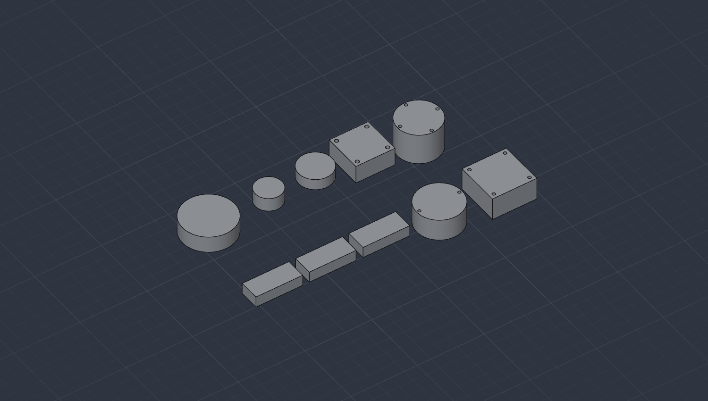
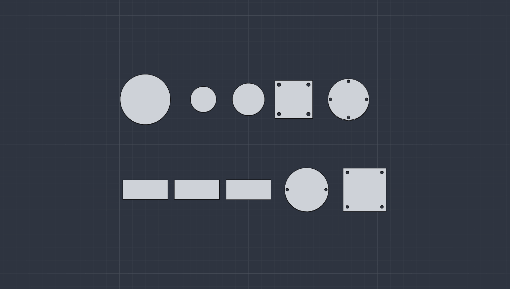

# Speaker candidates: dimensioned envelopes

**Ten drivers as envelopes, from vendor-published dimensions, read 2026-11-15.
None is measured, none is modelled in detail, and two of them have no way to be
fastened at all.**

> **These are catalogue drivers, and they are all modelled as cylinders. That is
> wrong for enclosure work.** James pointed out on 2026-11-15 that almost every
> small speaker is a rectangular housing, and the housing — not the cone — is what
> a case has to fit around. Use this folder to compare cone size and depth; use
> [dweii-speakers](../dweii-speakers/README.md) to cut a pocket, because those are
> the modules actually selected in the
> [archived research notes](../../../docs/archive/readme-research-before-2026-11-15.md#speakers).

Editable SolidCraft source: [`speaker-candidates.sc`](speaker-candidates.sc).

Every body is the driver's **maximum envelope**: front face at Z = 0, body
extending downwards by the published depth, with mounting holes where the vendor
gives a bolt circle. The magnet is inside that depth, not below it. That is what
a case designer needs — the volume to keep clear — and it is deliberately not a
model of a cone, a surround or a basket.

## The family



*Isometric. Top row, left to right: Adafruit 1314 (3"), Adafruit 3968 (40 mm),
Visaton K 50-4, Visaton FR 58-8 (square), Dayton ND65-4. Bottom row: the three
Adafruit enclosed modules (3351, 1669, 4445), Visaton FRS 5 X and Visaton FRS 7
W (square).*



*Top. This is the view that answers "will it fit on the baffle". Footprint, not
depth, is what a lid and a grille have to clear.*

## The bodies

| Body | Driver | Footprint | Depth | Mounting | Source status |
| --- | --- | --- | --- | --- | --- |
| `Spk_ada1314` | Adafruit 1314, 3" | Ø78 | 25.5 mm | **no holes modelled** — the bolt circle is Ø84, larger than the frame, so the ears are outside the disc | vendor drawing + page disagree by 0.5 mm |
| `Spk_ada3968` | Adafruit 3968, 40 mm | Ø40 | 21 mm | **none on the part** | needs a clamp or printed retainer |
| `Spk_vis_k50` | Visaton K 50-4 | Ø50 | 17 mm | **none on the part** | IP65 front, needs snap or clamp retention |
| `Spk_vis_fr58` | Visaton FR 58-8 | 58.5 mm square | 28 mm | 4 × Ø5.5 on a Ø64.5 bolt circle (on the diagonals) | cut-out 57 (data) vs 56 (drawing) |
| `Spk_dayton_nd65` | Dayton ND65-4 | Ø64 | 48 mm | 4 × Ø4.5 on a **56 mm circle assumed** | hole size and spacing unknown; page data only |
| `Spk_ada3351` | Adafruit 3351 mono enclosed | 70 × 30 | 17 mm | 4 × Ø3.4 at 24 × 63 | page only, hole dia ±20 % |
| `Spk_ada1669` | Adafruit 1669 stereo enclosed | 70 × 30 | 17 mm | 4 × Ø3.1 at 24 × 64 | no datasheet |
| `Spk_ada4445` | Adafruit 4445 enclosed | 70 × 31 | 17 mm | 4 × Ø3.1 at 31 × 64 | footprint conflicts with the other two |
| `Spk_vis_frs5x` | Visaton FRS 5 X-8 | Ø68 | 33.5 mm | 2 × Ø4.2, centres 60 mm apart | also needs a Ø50 recess |
| `Spk_vis_frs7w` | Visaton FRS 7 W-8 | 66.5 mm square | 34.8 mm | 4 × Ø4.6 on a Ø75.6 bolt circle | cut-out 61 (data) vs Ø60 (drawing) |

The Seeed reSpeaker Sound Base (5 W, 4 Ω) is **not modelled**: no dimensions are
published.

## Choosing between them

| If the goal is | Then | Because |
| --- | --- | --- |
| smallest box that still makes voice audible | Adafruit 3968, 40 mm | Ø40 × 21 mm, the smallest envelope here; but it has no fastener holes, so it needs a printed clamp |
| a module with no acoustic work at all | Adafruit 3351 or 1669 | sealed back chamber, JST connector, screw holes; 70 × 30 × 17 mm |
| music in a desktop case | Visaton FR 58-8 or FRS 5 X | larger cone, real bass, but 28–33.5 mm deep and needs a baffle with a recess |
| maximum sound in a small footprint | Dayton ND65-4 | 15 W RMS, but 48 mm deep — it will not fit a slim case |

The 2-Mics HAT publishes **no amplifier power rating** and ships no speaker, so
"how loud" is unknown for every row until one is tried. A 3 W module is the
safest first experiment; a 10 W driver may be under-driven.

## Known gaps

- Every dimension is vendor-published, not measured. Two vendors contradict
  their own drawings (Adafruit 1314 depth, Visaton cut-outs).
- Bolt circles for `Spk_ada1314` (Ø84, outside the frame) and
  `Spk_dayton_nd65` (assumed) are not usable for drilling.
- Cut-out and recess diameters are **not modelled**; only the outer envelope is.
- No rear-vent, magnet clearance or cone excursion data is modelled. The depth
  figures are the drawn rear-most point.
- Thickness of the mounting flange is not modelled, so the screw length a baffle
  needs is unknown.

## Regenerate

```
screenshot({ source: "model", grid: true, axes: false, width: 1500, height: 850,
             camera: { target: [10,0,-10], yaw: 0.6, pitch: 0.75, distance: 620 },
             path: ".../assets/iso.png" })
screenshot({ source: "model", grid: true, axes: false, width: 1500, height: 850,
             camera: { target: [10,0,0], yaw: 0, pitch: 1.55, distance: 560 },
             path: ".../assets/top.png" })
```
