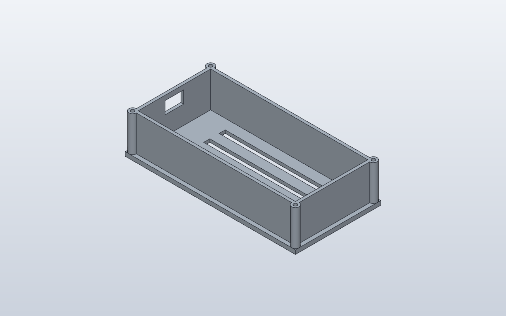
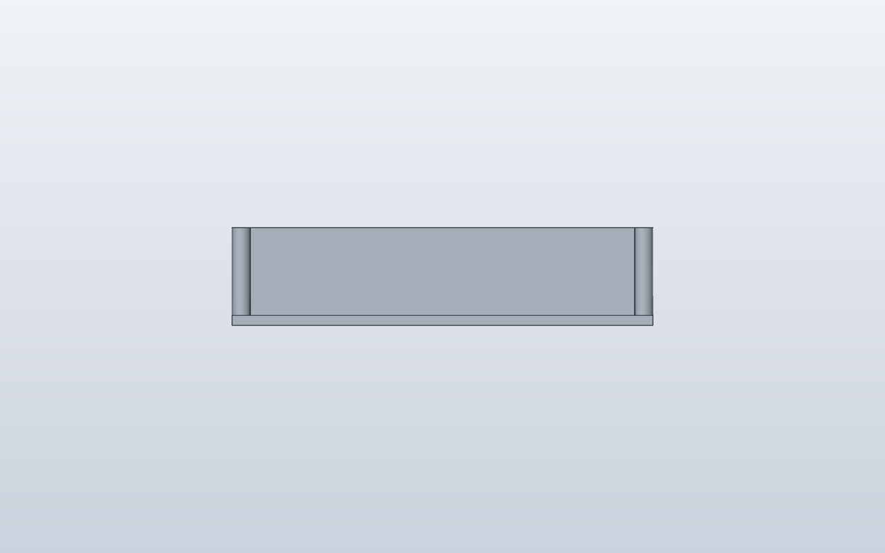

# DWEII 462 open carrier — first-pass CAD

**CAD only. Not sliced, printed, fit-tested, strength-tested or acoustically
tested.** This is a provisional carrier for the seller's 100 × 45 × 21 mm
701715520462 5 W housed module, **not** a full Pi/HAT device case. The open face
and rear vents avoid designing a second sealed chamber, but the module's actual
openings are unknown: the unobstructed acoustic path cannot yet be confirmed.

The editable part is [`dweii-462-case.sc`](dweii-462-case.sc); the
reproducible command list is [`build-script.json`](build-script.json). No speaker,
lead, plug, Pi, HAT, retention hardware or grille is modelled.



*CLI render of the part only. The cavity, cable exit and vents use the assumed
dimensions below; the actual acoustic openings and mounting are not known.*



*CLI `front` view: this is the outside of a long side wall, not a view looking
into the open speaker face.*

## Layout and limitations

- X is the 100 mm module length, Y the 45 mm width, Z the 21 mm depth. The
  **empty** cavity is 102 × 47 × 23 mm and opens toward +Z. A centred nominal
  envelope at X = −50…50, Y = −22.5…22.5, Z = 3.6…24.6 has 1 mm clearance
  to the cavity side walls, inner back and open rim plane. The corner bosses
  do not intrude into the rectangular cavity: their centres are (±52.8, ±25.3),
  and the distance to the nearest cavity corner is √(1.8² + 1.8²) = 2.546 mm,
  greater than their 2.4 mm radius. This is an analytic CAD-envelope check, not
  a collision test of an actual module or physical fit proof.
- **The part does not positively secure or space the module yet.** If it simply
  rests on the back its rear clearance becomes zero, potentially covering the
  vents. A separate, unmodelled, removable retainer and spacers are needed; use
  the four pilots as possible attachment points only after the module's safe
  contact and opening locations are measured. Do not clamp the driver, cover a
  vent, or assume any particular support or adhesive location is safe.
- There are four 70 × 4 mm through-slots in the back. The flat outer perimeter
  surrounds a 90 × 36 × 0.6 mm underside recess. On a flat desk this recess
  provides only 0.6 mm underneath; actual airflow is **not verified**. There
  is no lid or acoustic seal. The 1.8 mm perimeter walls could still cover a
  side opening on the real module; those opening locations need measurement.
- The side opening is **12 × 8 mm assumed**, not a checked plug specification.
  The task describes a JST-PH 2.5 connector with a 480 mm lead; the connector
  family/pitch and plug's actual envelope, orientation, exit point, bend radius
  and service clearance have not been confirmed. `PH` normally denotes 2.0 mm
  pitch, so the 2.5 mm description needs checking rather than treating it as a
  verified standard. The 480 mm lead is not coiled or stored in this model.
- Desktop flat-back use is chosen; **no keyholes or wall mounting** are provided.
  Suitable wall hardware and positions are unknown, and a wall would reduce the
  already limited clearance behind the vents. As drawn it lies flat with the
  open speaker face upward; no forward-facing desktop stand is included.
- Unlike the [671 case](../dweii-671-case/README.md) this is a speaker-only
  carrier, not a proven replacement in the
  [compact Pi/HAT assembly](../../assemblies/debra-compact/README.md).

## Parameters

All lengths are mm. **ASSUMED** values are starting choices, not measured
component specifications. Task values are prescribed requirements; the seller
dimensions are claims, not measurements. Derived dimensions follow their input
parameters. Parameter comments in the build script preserve this provenance.

| Parameter | Value | Source / status |
| --- | ---: | --- |
| `MOD_L` | 100 | Seller, larger of 99/100; [component record](../../components/dweii-speakers/README.md) |
| `MOD_W` | 45 | Seller, component record |
| `MOD_D` | 21 | Seller, component record |
| `CLEAR` | 1 | **ASSUMED** nominal clearance; task minimum |
| `WALL` | 1.8 | **ASSUMED**; task minimum 1.6 |
| `BASE` | 2 | Task minimum thickness under recess, excluding through-holes |
| `RECESS` | 0.6 | Task recess depth |
| `RECESS_L` | 90 | **ASSUMED** underside recess length |
| `RECESS_W` | 36 | **ASSUMED** underside recess width |
| `BOSS_D` | 4.8 | Task diameter |
| `PILOT_D` | 2.2 | Task M2.5 self-tapping pilot diameter |
| `PILOT_DEPTH` | 7 | **ASSUMED** blind depth; task minimum 6 |
| `VENT_L` | 70 | **ASSUMED** vent length |
| `VENT_W` | 4 | **ASSUMED** vent width |
| `VENT_PITCH` | 10 | **ASSUMED** vent-centre spacing |
| `CABLE_W` | 12 | **ASSUMED** plug passage width, not verified |
| `CABLE_H` | 8 | **ASSUMED** plug passage height, not verified |
| `CABLE_Z` | 12 | **ASSUMED** opening bottom above inner back |
| `IN_L` | 102 | Derived `MOD_L + 2*CLEAR` |
| `IN_W` | 47 | Derived `MOD_W + 2*CLEAR` |
| `IN_H` | 23 | Derived `MOD_D + 2*CLEAR` |
| `BOSS_H` | 23 | Derived `IN_H`; pilots open at rim |
| `RIM_L`, `RIM_W` | 105.6, 50.6 | Derived cavity + twice `WALL` |
| `BASE_L`, `BASE_W` | 110.4, 55.4 | Derived rim dimensions + `BOSS_D` |
| `BASE_H` | 2.6 | Derived `BASE + RECESS` |

## Verification

SolidCraft CLI 0.42.0, 2026-11-15, using the commands below:

| Check | Result |
| --- | --- |
| Bodies | 1 closed body; `eval` reports no open bodies skipped and no timeline errors |
| Bounding box | (−55.2, −27.7, 0) to (55.2, 27.7, 25.6) mm; computed identical, within 0.1 mm |
| Volume | Measured **25,322.653427 mm³**; computed **25,322.653425 mm³**, within 2% |
| Empty nominal cavity | 102 × 47 × 23 mm: 1 mm each side of the centred 100 × 45 × 21 envelope, before support/retention |
| Pilots | Modelled Ø2.2 × 7 mm blind in four Ø4.8, 23 mm-high corner bosses; centres outside nominal speaker footprint |
| Solid thickness | 1.8 mm straight walls, 2.0 mm under the recess and 2.6 mm elsewhere in the base, except intentional openings |

The parameter expressions are present, but a changed-size rebuild has **not**
been demonstrated. One optional attempt to feed a modified script to `eval`
through shell process substitution failed because this CLI requires a regular
file, not `/dev/fd/63`. It was not retried: this assignment permits only the
listed deliverable files. Changing parameters can also invalidate relationships
such as the boss-to-cavity corner clearance; recheck them for each variation.

The independently calculated volume in mm³ is base `110.4*55.4*2.6` + wall
ring `(105.6*50.6 - 102*47)*23` + exposed boss portions
`4*(3/4)*π*(4.8/2)^2*23` − pilot holes `4*π*(2.2/2)^2*7` − recess
`90*36*0.6` − four vents `4*70*4*2` − side opening `1.8*12*8`.
The vents are entirely inside the already recessed portion, so their removed
base thickness is 2 mm, not 2.6 mm.

## Print and fasteners

- Intended FDM orientation: back at Z = 0 on the bed, open face up. The underside
  recess and the 12 mm side opening may need support or suitable bridging;
  slicing, bed adhesion, wall count, material and settings remain unverified.
- Four M2.5 self-tapping screws are anticipated for a **separately designed**
  retainer, with at most 7 mm penetration into each pilot; screw length depends
  on the retainer thickness and is not selected. Check pilot fit for the actual
  material, printer and screws. The retainer, spacers, screws and strain relief
  are not included in the CAD. No fastener or mounting strength has been tested.
- Measure the module, connector and all its openings first; then design an
  appropriate removable retention method and a plug/lead route. Do not present
  this as a ready-to-use enclosure until fit, airflow, acoustics and retention
  have been tested.

## Rebuild and render

Run from the repository root. These exact commands succeeded; `snapshot` is a
headless CLI render, not a screenshot of James's open SolidCraft session:

```sh
solidcraft-cli run models/parts/dweii-462-case/build-script.json --save models/parts/dweii-462-case/dweii-462-case.sc --results
solidcraft-cli eval --in models/parts/dweii-462-case/dweii-462-case.sc
solidcraft-cli snapshot --in models/parts/dweii-462-case/dweii-462-case.sc --out models/parts/dweii-462-case/assets/iso.png --view iso --no-grid --no-axes
solidcraft-cli snapshot --in models/parts/dweii-462-case/dweii-462-case.sc --out models/parts/dweii-462-case/assets/front.png --view front --no-grid --no-axes
```

The requested `dweii-671-case/build-script.json` was not present at base
`efcad08`; `solidcraft-cli script models/parts/dweii-671-case/dweii-671-case.sc`
was used to read the existing 671 feature conventions instead.
