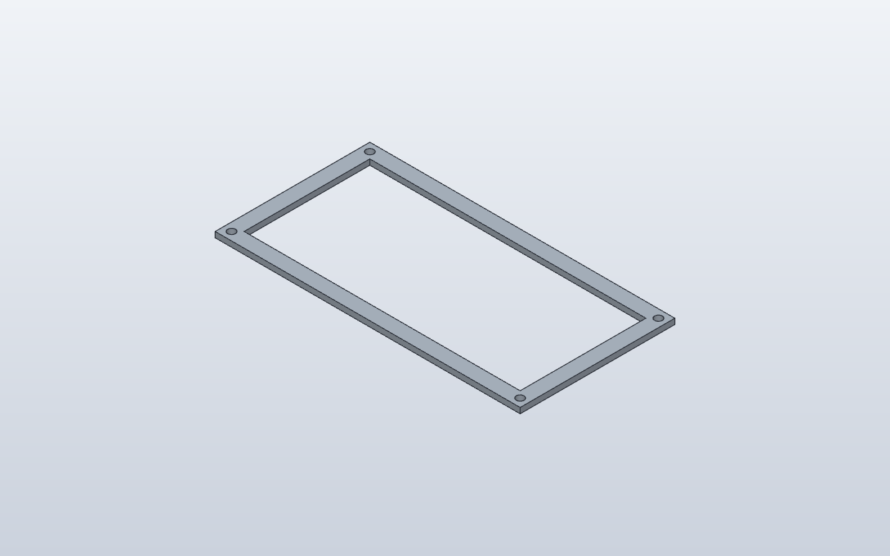

# DWEII 462 open-frame retainer — provisional CAD

**CAD only: the frame alone does not retain the speaker.** The proposed assembly
also needs four separately made rigid tabs, eight foam pads and four rear spacers;
none is modelled or tested. The actual module's openings, housing contact areas
and tolerances are unknown. Consequently neither secure retention nor unobstructed
acoustics is established; **do not use this as a finished mount**. Measure the
actual module before choosing contact areas or making a fit coupon.

The printable frame is [`dweii-462-retainer.sc`](dweii-462-retainer.sc), rebuilt
from [`build-script.json`](build-script.json). It uses the four existing pilots
in the [462 carrier](../dweii-462-case/README.md); no holes are added to the
carrier. The nominal [module envelope](../../components/dweii-speakers/README.md)
is a seller claim, not an actual measurement.



*SolidCraft CLI render of the frame only. Opening and hole clearances are assumed;
the speaker, carrier, fasteners, tabs, pads and spacers are not modelled.*


*CLI `front` is edge-on; it is not a view down into the opening. Only the frame
is shown and its thickness is assumed.*

## Proposed restraint and assembly

The frame's **101 × 46 mm** opening clears a centred nominal 100 × 45 mm module
by 0.5 mm per side. This clearance is for the *printed frame alone*. A frame that
clears the entire module cannot also act as its rigid face stop: the separate
tabs and foam deliberately extend into the opening at four assumed housing-edge
contact locations. They may cover real acoustic openings, which are unknown.
Their adhesive bonds, pad stiffness and resistance to movement are unverified.
The side pads are intended to resist sliding; the front tabs and rear spacers
are intended to restrain lift and support the module, not a proven clamp.

Coordinates below are **carrier** coordinates, not the frame file's local Z:
carrier inner floor Z = 2.6, rim Z = 25.6; X is length and Y is width. The
frame bottom rests on the rim, so its top is Z = 27.6. The following is a
conditional assembly concept, **not a verified assembly procedure**:

1. First measure the specimen's front, rear and side openings, housing edges,
   cable exit and safe pressure points. If any proposed contact is over an
   opening or unsupported housing, **stop and redesign**; do not apply adhesive
   to the module or assume the placeholder grille is the real opening.
2. On the carrier floor, attach four separately cut rigid 4 × 4 × 1 mm sheet
   spacers centred at `(±47, ±20)`. They are outside the carrier vent slots;
   whether they cover the module's own openings is unknown. These thin sheet
   spacers are not printed walls. Their upper faces are Z = 3.6.
3. Attach four 6 × 6 × 1.5 mm uncompressed soft foam side pads to the inner
   cavity walls: centres `(±51, 0, 8)` on the X-end walls, and `(0, ±23.5, 8)`
   on the Y-side walls. The coordinates are the wall-contact plane; the pad
   thickness projects inward. On the nominal centred module they compress by
   0.5 mm and are intended to keep it from sliding. The X-end pad is below the
   case's modelled cable exit, but the real lead route is not verified.
4. Make four rigid 6 × 4 × 1.6 mm tabs from suitable sheet and bond them to the
   **top** of the frame, centred at `(±52, ±19.5)` in X/Y. Each tab spans
   `|X| = 49…55`; its `|X| = 50.5…55` section bonds to the frame, and the
   `|X| = 49…50.5` portion cantilevers over the opening. Keep adhesive out of
   the opening and screw holes. The strength of this small bond is unknown.
5. Under each overhanging tab, bond a 1.5 × 4 × 3.5 mm uncompressed soft foam
   pad occupying `|X| = 49…50.5` and `|Y| = 17.5…21.5`. It is **inside** the
   frame opening, not under the frame's seating surface; it therefore does not
   sit between the frame and the carrier rim. With the frame seated, its nominal
   uncompressed bottom is Z = 24.1. On the centred nominal module it contacts
   the outermost 1 mm at each X end and compresses by 0.5 mm. This arithmetic
   assumes zero adhesive thickness, exact parts and a rigid 1 mm rear spacer.
6. Route the lead without pinching it; lower the module from the open side onto
   the rear spacers and between the side pads. A centred nominal module extends
   Z = 3.6…24.6. Lower the prepared frame over it and gently fit all four
   screws. The nominal frame bottom is above the speaker face; the foam is the
   only intended module contact. Check all openings and avoid over-tightening.
7. The frame with tabs and foam can be removed or reinstalled with the module
   still in place by undoing its four screws and lifting it. The module itself
   comes out after the frame; do not pull it by its lead.

Without the separate tabs and pads the module can pass through the frame opening;
without the rear spacers it can drop onto the vented back. There is no evidence
that foam friction prevents all sliding, that the adhesive will hold the tabs,
or that the contact pressure is safe. The tabs/pads encroach over assumed housing
edges, so **preservation of actual open area cannot be confirmed** until the real
openings are measured. The carrier's back airflow is also not demonstrated.

## Parameters

All values are mm; each parameter and its source or assumption is also in
`parameters.add`. The non-modelled hardware and pad parameters are **reference
dimensions**, not extra CAD bodies. Change the carrier consistently if its
interface changes; there is no live link between the files.

| Parameter | Value | Source / status |
| --- | ---: | --- |
| `MOD_L` | 100 | Seller 462, larger 99/100 claim; component record |
| `MOD_W` | 45 | Seller 462; component record |
| `MOD_D` | 21 | Seller 462; component record; reference |
| `CASE_CLEAR` | 1 | **ASSUMED** in carrier, its `CLEAR` |
| `CASE_WALL` | 1.8 | **ASSUMED** in carrier, its `WALL` |
| `OPEN_CLEAR` | 0.5 | **ASSUMED** opening clearance, task minimum |
| `FRAME_T` | 2 | **ASSUMED** frame thickness, above task minimum |
| `HOLE_D` | 2.8 | **ASSUMED** screw clearance hole; check actual print and screw |
| `EDGE` | 1.6 | Task minimum material beyond hole to outer edge |
| `PILOT_D` | 2.2 | Carrier pilot diameter, reference |
| `PILOT_DEPTH` | 7 | **ASSUMED** carrier blind pilot depth, reference |
| `SCREW_D` | 2.5 | **ASSUMED** self-tapping screw nominal diameter |
| `SCREW_L` | 8 | **ASSUMED** screw length under head |
| `HEAD_D_MAX` | 6 | Derived `HOLE_D + 2*EDGE`; centred head maximum to stay on frame |
| `CASE_BASE_H` | 2.6 | Derived carrier base `BASE + RECESS`, reference |
| `CASE_IN_H` | 23 | Derived `MOD_D + 2*CASE_CLEAR`, carrier cavity height |
| `OPEN_L` | 101 | Derived `MOD_L + 2*OPEN_CLEAR` |
| `OPEN_W` | 46 | Derived `MOD_W + 2*OPEN_CLEAR` |
| `PITCH_L` | 105.6 | Derived carrier pilot pitch `MOD_L + 2*CASE_CLEAR + 2*CASE_WALL` |
| `PITCH_W` | 50.6 | Derived carrier pilot pitch `MOD_W + 2*CASE_CLEAR + 2*CASE_WALL` |
| `FRAME_L` | 111.6 | Derived `PITCH_L + HOLE_D + 2*EDGE` |
| `FRAME_W` | 56.6 | Derived `PITCH_W + HOLE_D + 2*EDGE` |
| `BACK_SPACER_T` | 1 | **ASSUMED** rigid rear sheet spacer thickness |
| `BACK_PAD_SIZE` | 4 | **ASSUMED** square rear spacer side |
| `BACK_X` | 47 | **ASSUMED** absolute rear spacer centre X, derived from envelope |
| `BACK_Y` | 20 | **ASSUMED** absolute rear spacer centre Y, derived from envelope |
| `TAB_L` | 6 | **ASSUMED** rigid top tab length X |
| `TAB_W` | 4 | **ASSUMED** rigid top tab width Y |
| `TAB_T` | 1.6 | **ASSUMED** rigid top tab thickness; task minimum |
| `TAB_X` | 52 | **ASSUMED** absolute tab centre X, derived from envelope |
| `FACE_PAD_L` | 1.5 | **ASSUMED** foam pad length X inside opening |
| `FACE_PAD_W` | 4 | **ASSUMED** foam pad width Y |
| `FACE_X` | 49.75 | **ASSUMED** absolute front pad centre X, derived from opening |
| `FACE_Y` | 19.5 | **ASSUMED** absolute front pad and tab centre Y, derived from envelope |
| `FACE_PAD_T` | 3.5 | **ASSUMED** uncompressed front foam thickness |
| `SIDE_PAD_SIZE` | 6 | **ASSUMED** square side foam pad size |
| `SIDE_PAD_T` | 1.5 | **ASSUMED** uncompressed side foam thickness |
| `SIDE_PAD_Z` | 8 | **ASSUMED** side pad centre height in carrier coordinates |

## CAD checks and limits

SolidCraft CLI 0.42.0, 2026-11-15; the frame alone was evaluated:

| Check | Result |
| --- | --- |
| Solid | 1 closed body, no skipped open bodies and no feature errors |
| Bounding box | Measured `(−55.8, −28.3, 0)` to `(55.8, 28.3, 2)` mm; computed identical, within 0.1 mm |
| Volume | Measured **3291.859827151 mm³**; hand calculation **3291.859827192 mm³**, within 2% |
| Opening | 101 × 46 mm; nominal 100 × 45 envelope clears the *frame* by 0.5 mm per side |
| Screws | Four Ø2.8 through-holes at `(±52.8, ±25.3)`, matching the carrier's four Ø2.2 × 7 blind pilots analytically |
| Material | 2 mm frame thickness; at least 1.6 mm hole-to-outer-edge and approximately 1.853 mm hole-to-opening-corner |

Calculation: `2 * (111.6 * 56.6 − 101 * 46 − 4 * π * (2.8/2)^2)`.
The inner-corner ligament is `sqrt(2.3² + 2.3²) − 1.4 = 1.853 mm`.
The frame is 0.6 mm wider than the carrier base on each outer side; verify any
adjacent hardware clearance. These are analytic nominal checks, not a CAD
assembly collision test or a physical fit check.

A separate scratch script changed `MOD_L` to 102 and `MOD_W` to 46 mm. CLI eval
returned one closed body, 3355.459827 mm³, bounding box `(−56.8, −28.8, 0)` to
`(56.8, 28.8, 2)`, opening parameters 103 × 47 and pitch 107.6 × 51.6 mm. This
exercises expressions only: **the variant does not fit the original carrier's
pilots**, and the separate carrier and pad geometry were not rebuilt or checked.

## Print and hardware

- Print the frame flat, local Z = 0 on the bed, no supports expected for this
  simple shape; slicing, wall count, adhesion, accuracy and strength are not
  tested. The 1.6 mm minimum applies to the frame and proposed rigid top tabs;
  the separately cut 1 mm spacers and compressible pads are not printed walls.
- Four **assumed M2.5 × 8 mm self-tapping pan-head screws**, length measured
  under the head, with a centred head no larger than Ø6 mm. Nominal penetration
  is `8 − 2 = 6 mm` into the carrier's 7 mm blind pilots, leaving 1 mm before
  the bottom. Actual screw tip, thread, printed pilot depth and hole diameter
  need checking; do not force or bottom the screws. No screw fit or pullout test
  has been performed.
- Four rigid top tabs, four rigid back spacers, four front foam pads, four side
  foam pads and suitable adhesive are separate materials. Foam hardness,
  adhesive type, bond area and load capability are unspecified and untested.

## Rebuild and render

From repository root, these exact headless CLI commands succeeded; they do not
connect to or alter the open SolidCraft GUI session:

```sh
solidcraft-cli run models/parts/dweii-462-retainer/build-script.json --save models/parts/dweii-462-retainer/dweii-462-retainer.sc --results
solidcraft-cli eval --in models/parts/dweii-462-retainer/dweii-462-retainer.sc
solidcraft-cli snapshot --in models/parts/dweii-462-retainer/dweii-462-retainer.sc --out models/parts/dweii-462-retainer/assets/iso.png --view iso --no-grid --no-axes
solidcraft-cli snapshot --in models/parts/dweii-462-retainer/dweii-462-retainer.sc --out models/parts/dweii-462-retainer/assets/front.png --view front --no-grid --no-axes
```

For the parameter exercise, a temporary copy was created under `/tmp/opencode`
with only those two expressions changed, then evaluated with
`solidcraft-cli eval /tmp/opencode/debra-retainer-variant-_4tug4_l.json`.
The saved nominal design was not modified by that test.
