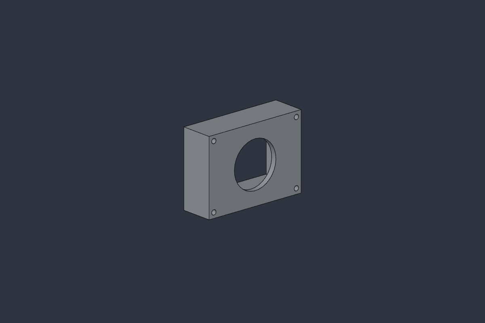
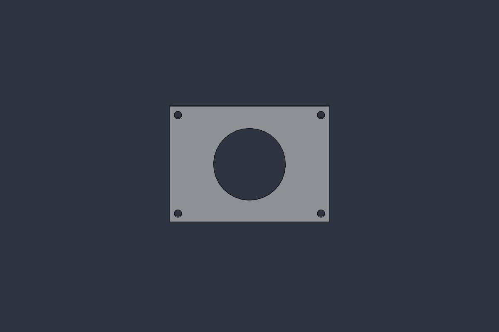
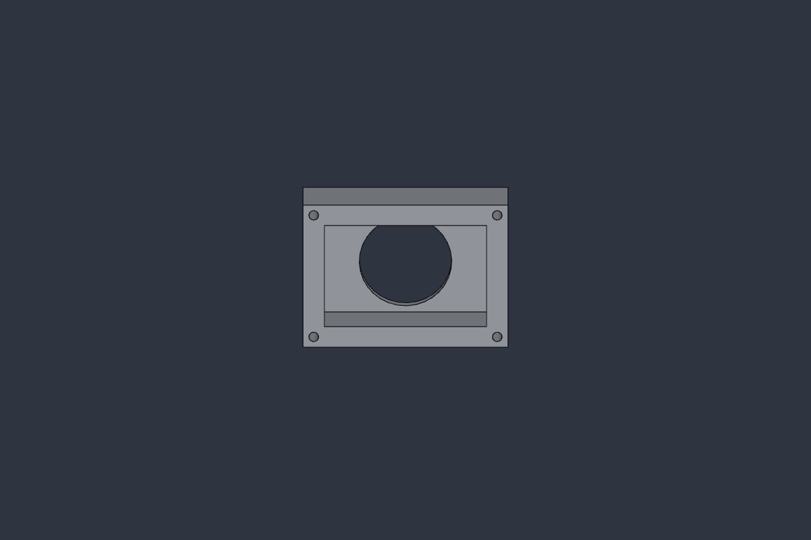

# DWEII 701715519671 carrier

**A printable carrier for the smallest of James's three speaker choices. Not
printed, not fit-tested, and its dimensions come from a seller listing that
contradicts itself.**

Editable SolidCraft source:
[`dweii-671-carrier.sc`](dweii-671-carrier.sc).

This is the first part built the way the enclosure lane should work: the
[module envelope](../../components/dweii-speakers/README.md) defines the pocket,
and the part is designed around it rather than around a guess. The pocket is
45.6 × 29.6 × 15 mm — the 44 × 28 × 15 envelope plus 0.8 mm clearance per side,
sized to the *larger* of the two published module sizes so it accepts either.

## What it looks like



*Isometric, front face. The plate is 57.6 × 41.6 × 18 mm. The Ø26 mm opening is
where sound leaves; the four corner holes take M2.5 screws.*



*Front. The baffle is 3 mm thick. This is the face a listener sees.*



*Back. The module drops into the rectangular pocket from behind and is trapped
between the baffle and whatever closes the case. **The pocket is open at the
rear on purpose**: the module has its own chamber and possibly its own vents, so
this part locates it and must not seal it.*

## Measured envelope

| Measure | Value |
| --- | --- |
| Plate | 57.6 × 41.6 mm, 18 mm deep |
| Baffle thickness | 3 mm |
| Pocket | 45.6 × 29.6 × 15 mm, open at the back |
| Grille opening | Ø26 mm through the baffle |
| Screw holes | 4 × Ø2.7 mm, 3 mm in from each edge |
| Solid volume | **20 879 mm³** (`measure`, checked by hand to within 1 mm³) |

## Parameters

| Parameter | Value | Where it comes from |
| --- | --- | --- |
| `MOD_L`, `MOD_W`, `MOD_D` | 44 × 28 × 15 mm | the module envelope, larger published size |
| `CLEAR` | 0.8 mm | drop-in clearance per side; a print test may want more |
| `BAFFLE` | 3 mm | design choice |
| `EAR` | 6 mm | margin for the screw holes |
| `GRILLE` | 26 mm | **assumed**; the module's real opening is unpublished |
| `SCREW_D` | 2.7 mm | M2.5 clearance |
| `SCREW_INSET` | 3 mm | leaves 1.65 mm of material at the hole edge |

## What this proves, and what it does not

Proves: a pocket can be derived directly from the module envelope, and the
result is a single printable body with a real opening and real fastening.

Does not prove: that the module fits (its size is a seller claim), that Ø26 mm is
the right opening, that the module's rear vents are not blocked by the case
behind it, or that 0.8 mm clearance is enough for a printed part.

## Known gaps

- **The module's real size is unresolved.** Sellers say 31 or 44 mm wide. The
  pocket is cut for 44, so a 31 mm module will rattle in it — deliberately, since
  a pocket cut for 31 cannot accept 44.
- **The rear is open, and something has to close it.** This part is a carrier,
  not a case wall. Whatever closes the back must not seal a vent.
- No gasket, no grille mesh, no retention for the 110 mm lead.
- The screw holes go into nothing yet; there is no mating part.
- **Not printed, not fit-tested.**

## Regenerate

```
screenshot({ source: "model", grid: false, axes: false, width: 1200, height: 800,
             camera: { target: [0,9,20], yaw: 0.72, pitch: 0.34, distance: 190 },
             path: ".../assets/iso.png" })
screenshot({ source: "model", grid: false, axes: false, width: 1200, height: 800,
             camera: { target: [0,9,20], yaw: 0, pitch: 0.02, distance: 150 },
             path: ".../assets/front.png" })
screenshot({ source: "model", grid: false, axes: false, width: 1200, height: 800,
             camera: { target: [0,9,20], yaw: 3.14159, pitch: 0.28, distance: 190 },
             path: ".../assets/back.png" })
```
