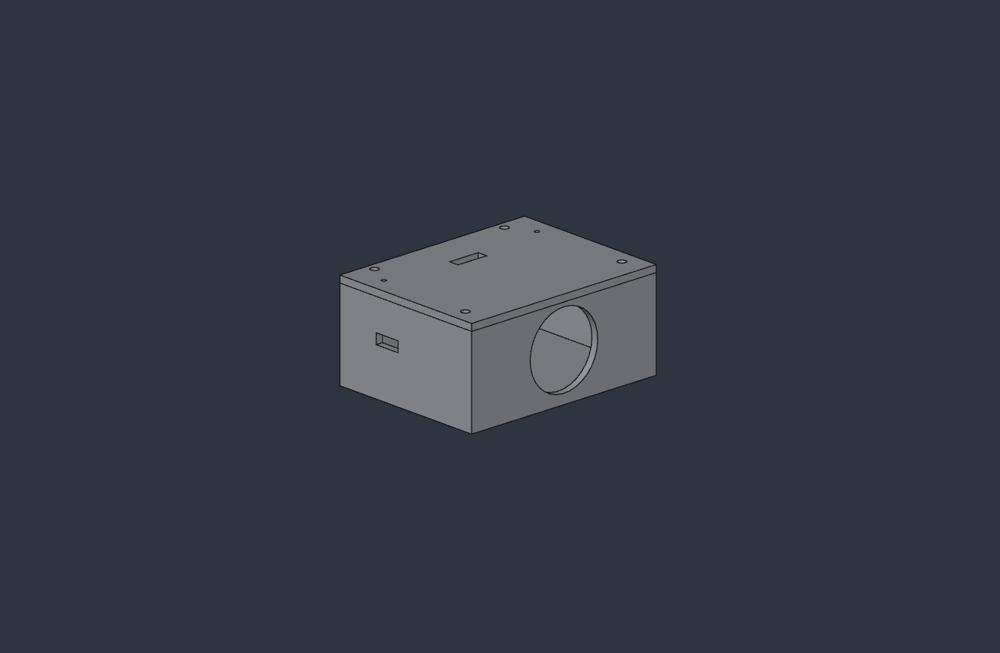
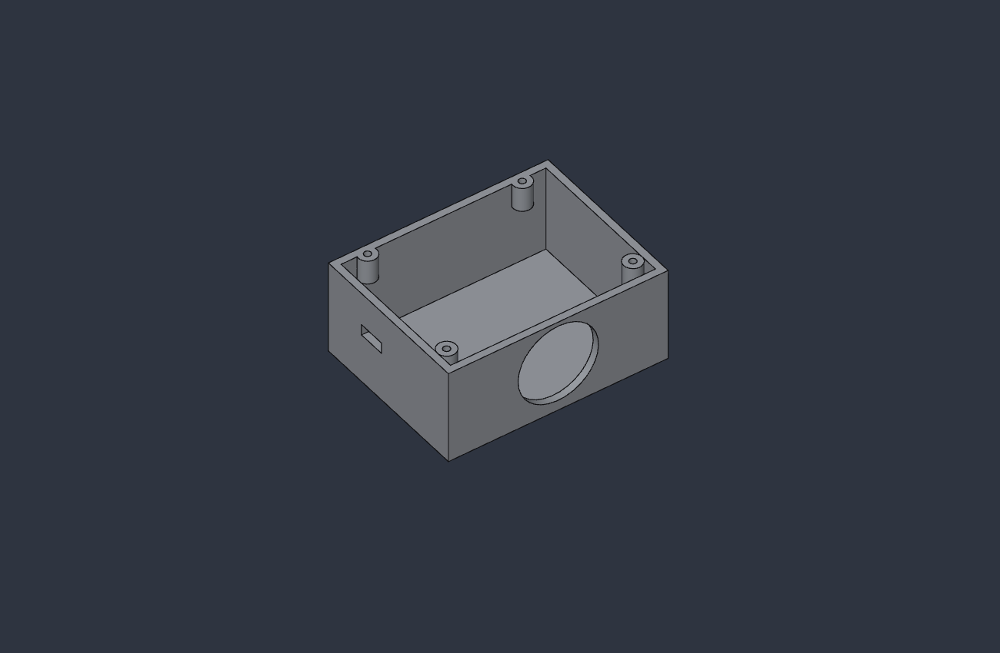

# DWEII 671 case: tub and lid

**Two printable parts, modelled from the components rather than around a guess.
Not printed, not fit-tested, and two of its dimensions come from a seller
listing that contradicts itself.**

Editable SolidCraft source: [`dweii-671-case.sc`](dweii-671-case.sc).

This is step 3 of the [enclosure pipeline](../../../docs/design/enclosure-arrangements.md#how-a-case-is-actually-built-from-these-models):
the first complete case, built to hold the parts James actually selected — the
[DWEII 701715519671 module](../../components/dweii-speakers/README.md), a Pi Zero
2 W and the [ReSpeaker HAT](../../components/respeaker-2mic-hat/README.md).

| Measure | Value |
| --- | --- |
| Overall | **71.02 × 54.37 × 33.2 mm** |
| Interior | 66.22 × 49.57 × 28.4 mm |
| Tub | **26 122 mm³** (`measure`) |
| Lid | **9 111 mm³** (`measure`) |
| Walls, floor, lid | 2.4 mm |
| Screws | 4 × M2.5, Ø2.2 pilots, Ø2.7 lid clearance |

## What it looks like



*Isometric. The Ø26 mm grille is the speaker opening, centred on the module. The
slot in the left wall is the power inlet. On the lid: four screw holes, two
Ø1.5 mm microphone ports near the back, and an 11 × 3.5 mm slot over the three
status LEDs.*


*Front. 71 mm wide, 33 mm tall, one centred Ø26 mm opening. The module is 44 mm
wide, so there is about 11 mm of blank baffle each side — the same space the
screw bosses use.*


*Side. The front face is on the right. The power slot sits at 15.7 mm above the
interior floor, which is the height of the HAT's micro-USB socket.*



*Interior. Two full-height bosses at the front, two short ones thickened into the
back wall. The front pair sit in the free space beside the module because the
boards are 65 mm wide in a 66.2 mm cavity, leaving no room for a boss at the back
corners.*

## The layout it holds

Front to back, in the case's own frame (Y = 0 at the module's front face):

| Y | What |
| --- | --- |
| 0 … 15 | the DWEII module, standing on its 15 mm edge, grille against the front wall |
| 15 … 19 | 4 mm gap; the HAT's 3.5 mm jack pokes into it and is therefore **unusable** |
| 19 … 49 | the Pi Zero 2 W with the HAT on top, HAT's header edge at the back |
| 40.34 | the two microphone ports, 8.66 mm inboard of the boards' back edge |

The stack is 20.7 mm tall at its highest point (the HAT's Grove connectors), so
the 28.4 mm interior is set by the **module**, not the electronics.

## Why the boards face this way

This is the one real design decision in the file, and it is a trade:

- **The HAT's header edge goes to the back**, which puts its two microphone
  ports at the back of the lid. If it went the other way, the ports would sit
  8.66 mm behind a 28 mm tall speaker and would be shadowed by it — a source at
  conversational height 1 m away would be below the module's top edge as seen
  from the port.
- **The cost:** the Pi's own micro-USB, USB and mini-HDMI ports are on the long
  edge *opposite* its 40-pin header, so they end up facing the speaker and are
  enclosed. So are the HAT's 3.5 mm jack and both Grove connectors.

**The device is therefore expected to be powered through the HAT's micro-USB
socket**, which is on a short edge and gets the 9 × 3.6 mm slot in the left wall.
Seeed document that socket as the way to supply the amplifier's current, and it
feeds the 5 V pins of the header — but **whether it back-feeds the Pi has not
been tested**, and if it does not, this layout needs rework. That test needs a
cable and two hands.

## What is real and what is assumed

| Input | Status |
| --- | --- |
| Board outline 65.02 × 29.97, mounting holes, header position | **sourced** from the Pi and HAT published layouts |
| Microphone port positions (±29.465, 8.66 mm from the header edge) | **sourced** from the HAT's Eagle board file |
| HAT connector positions (jack, Grove, JST, micro-USB) | **sourced**, same file |
| Pi Zero 2 W outline | dimension-sourced |
| Module 44 × 15 × 28 | **a seller claim**, and the same listing also says 31 mm wide |
| Ø26 mm grille | **invented** — the module's real opening is unpublished |
| Interior height 28.4 | the module's claimed height + 0.4 mm for a foam pad |
| All component heights (Grove 6.5, button 5, jack 4) | typical values, not measured |

## What is missing

- **Nothing holds the module back.** It is trapped forward by the front wall and
  down by the lid, but it can slide 4 mm backwards. A rib or a foam pad behind it
  would fix that; neither is modelled.
- **No speaker-lead routing.** The module's 110 mm lead and its JST plug have to
  get to the HAT's JST socket at Y ≈ 20–28. The lead's exit point on the module
  is unknown.
- **No board retention.** The Pi sits on the floor with 0.6 mm clearance and no
  standoffs; nothing locates it horizontally.
- **No ventilation.** Fine for a Zero 2 W; not fine for a Pi 5.
- **No feet, no cable strain relief, no grille mesh or fabric.**
- **The lid is shown assembled, not in print orientation.** It prints flat.
- **The [DWEII carrier](../dweii-671-carrier/README.md) is not used here.** It is
  41.6 mm tall and this interior is 28.4 mm, so it cannot be a wall of this case.
  It remains useful as a fit-test coupon for the module alone. The pocket is
  built into the tub instead.
- **Not printed, not fit-tested.** Every number above could still be wrong, and
  the module's width is the most likely to be.

## Parameters worth changing first

| Parameter | Change it when |
| --- | --- |
| `MOD_L` | the module arrives and is 31 mm wide, not 44 |
| `MOD_D`, `MOD_H` | the module's depth or height is measured |
| `GRILLE` | the module's real opening is measured |
| `GAP_M2B` | the jack is to be made usable, or the speaker lead needs room |
| `MIC_X`, `MIC_Y` | a ruler check on the HAT moves the ports |

## Regenerate

```
screenshot({ source: "model", grid: false, axes: false, width: 1300, height: 850,
             camera: { target: [0,24,14], yaw: 0.75, pitch: 0.35, distance: 230 },
             path: ".../assets/iso.png" })
screenshot({ source: "model", grid: false, axes: false, width: 1300, height: 850,
             camera: { target: [0,24,14], yaw: 0, pitch: 0.05, distance: 175 },
             path: ".../assets/front.png" })
screenshot({ source: "model", grid: false, axes: false, width: 1300, height: 850,
             camera: { target: [0,24,14], yaw: 1.5708, pitch: 0.12, distance: 200 },
             path: ".../assets/side.png" })
// interior: move the lid (feature 13) away, shoot, move it back
timeline.edit({ feature: 13, set: { corner: ["300 mm", "INT_D/2", "INT_H + LID_T/2"] } })
screenshot({ source: "model", grid: false, axes: false, width: 1300, height: 850,
             camera: { target: [0,24,8], yaw: 0.62, pitch: 0.72, distance: 215 },
             path: ".../assets/open.png" })
timeline.edit({ feature: 13, set: { corner: [0, "INT_D/2", "INT_H + LID_T/2"] } })
```
