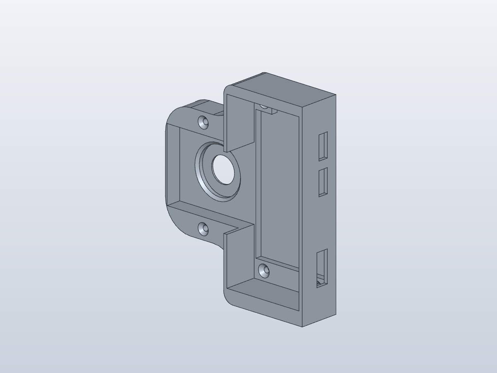
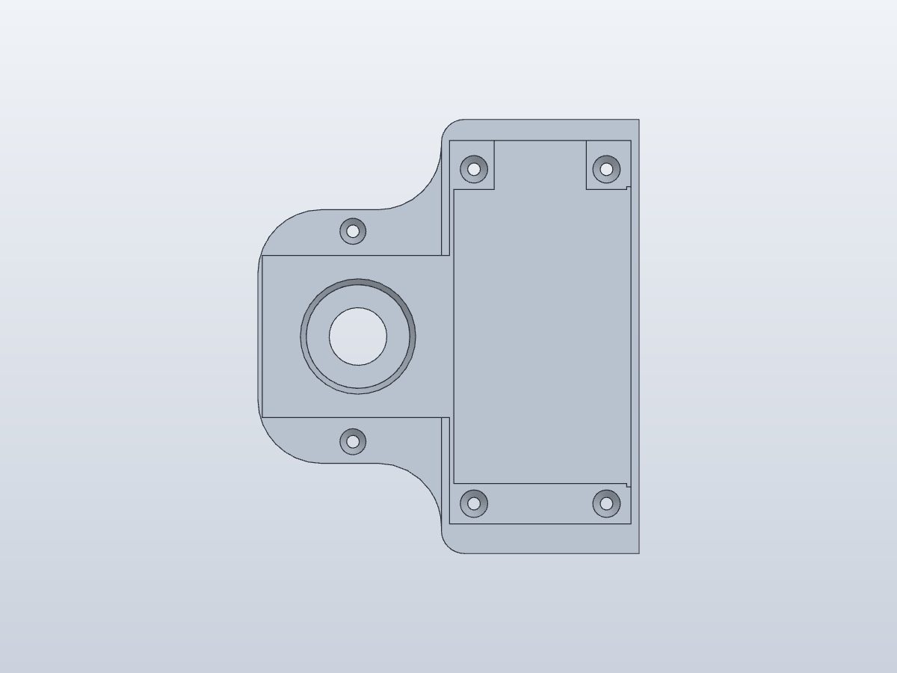

# RPiSpeaker v17 body — incomplete editable reconstruction

**Reconstruction from STEP measurements, not the original part.** This is a
native, editable SolidCraft model, not an imported STEP or a faithful copy of
every original surface. The original remains read-only at
`/home/james/onedrive/Projects/Voice_Assistant/RPiSpeaker/models/Fusion360/RPiSpeaker_v17.step`.
Its SHA-256 is `fa617a4d0e4afdb1c00c804519718ba6cefeaf8b7c07af65e7c43177ccb66991`.
The [bay inventory](../../../docs/notes/2026-11-15-rpispeaker-v17-bay-inventory.md)
is the source of the corrected speaker-side geometry; the
[component reference](../../components/rpispeaker-v17/README.md) includes
older measurements and superseded claims. Measurements refer to the CAD file,
not a physical specimen. **Neither this reconstruction nor its fit has been
printed or tested.** Do not use it as proof of screw, lid or component fit.

The [editable source](rpispeaker-v17-body.sc) and its
[build history](build-script.json) contain named parameters and features. X
is across the bays, Z along the case, and +Y toward the open face; units are
millimetres. The speaker-side lower footprint X 17.15–48.25, Z ±14.0625 is a
*bounded comparison region*: it joins the Pi bay at −X and has no continuous
wall there. It is not a separate enclosed rectangular pocket.



*Headless SolidCraft CLI render of the `.sc` only. The Pi cavity is simplified;
threads, several ribs, and the end port are missing.*



*View from +Y. The two speaker pilots are plain cores with countersinks, not
modelled threads. The original also has Pi-side features omitted here.*

## What is reproduced and what is not

The outer frame, the locally measured R4 and R11 outline arcs, side connector
windows, the central speaker-side recess and its joining divider, three stages
of the central opening, and the two speaker-side cores and countersinks are
represented. The four rear Pi pilot cores and their floor countersinks are
also represented. The Pi side has an approximate rectangular upper opening and
an intentionally incomplete Y 0 lower recess. These are a **simplified
construction**, not a claim that the original Pi cavity is rectangular; their
additional and missing surfaces must not be used for a fit check. In particular,
the original has portions at Z −33.25 and a Z −32.50 edge associated with an
end opening, not one continuous Z −32.50 cavity wall.

### Not reproduced

- **Modelled helical threads** on either speaker-side pilot or the Pi pilots;
  the plain Ø2.1755 cores do not reproduce the original Ø2.68 major diameter,
  approximately 0.45 pitch or thread termination at Y 7.28775. `THREAD_END_Y`
  is a reference parameter only and does not cut geometry. The original's
  thread hand/profile and fastener fit are not established. A core with the
  right end-to-end clearance does not establish screw engagement.
- The full original Pi-bay profile, changing levels, corner buttresses/bosses,
  and the two upper Pi-side threaded holes/countersinks at X −11.5. The four
  lower pilot locations and countersinks are present, but their surrounding
  material and thread details are not equivalent to the STEP.
- The 12.5 mm wide rounded end-wall opening at Z −37.65 and its local internal
  ledges; other small ribs, steps, non-planar or exporter-tolerance details not
  explicitly verified here. The simplified Pi opening adds artificial straight
  walls and leaves material where the real cavity differs.
- A **four-screw square speaker mount**. It is absent because the supplied STEP
  has no such pattern, not because this is a decision about an unexported lid
  or another revision. No speaker, lid, screws or wiring are modelled.

## Measured comparison

The table compares the original STEP and the saved reconstruction on 2026-11-15
using the **same headless `solidcraft-cli`**: `eval` for bounding boxes and
volume, `model.faces` for planes and cylindrical axes, and `model.edges` plus
`select.set`/`selection.get` for circular boundaries and conical surfaces.
Values are rounded as shown; Δ means reconstruction minus STEP. A zero in the
table means agreement at the shown precision, not equality of complete faces.
The STEP import warns that three edges deviate from their surfaces by up to
0.01014 mm. Source levels from the linked inventory were cross-checked against
the CLI; the STEP was never sent to an application window.

| Feature | STEP measured | Reconstruction measured | Δ / qualification |
| --- | --- | --- | --- |
| Envelope X | −17.15 to 49.00 | −17.15 to 49.00 | 0.000 mm each |
| Envelope Y | −0.60 to 15.50 | −0.60 to 15.50 | <0.00001 mm each |
| Envelope Z | −37.65 to 37.65 | −37.65 to 37.65 | 0.000 mm each |
| Pi-side outer R4 axes | (13.15, ±33.65), R4 | (13.15, ±33.65), R4 | 0.000 mm in centres and radius |
| Pi bay X reference | −15.75 to 15.75 | −15.75 to 15.75 | 0.000 mm; original walls are not uniformly rectangular |
| Pi bay Z reference | −32.50 to 34.00 | −32.50 to 34.00 | 0.000 mm at reference edges; **not** a match of whole wall outlines |
| Pi lower central floor | Y 0.00 | Y 0.00 | 0.000 mm locally; floor outlines differ |
| Speaker lower footprint | X 17.15–48.25; Z ±14.0625; 31.10 × 28.125 | same | 0.000 mm at these bounding references; −X is open |
| Speaker floor / raised | Y 2.50 / 8.50 | Y 2.50 / 8.50 | 0.000 mm each; raised-face area differs by +0.182 mm² (498.257 vs 498.075) |
| Speaker outer wall | X 49.00 outside, 48.25 inside | X 49.00, 48.25 | 0.000 mm; local thickness 0.75 |
| Speaker end walls | Z −14.0625, +14.0625 | Z −14.0625, +14.0625 | 0.000 mm each |
| Concave R11 axes | (28.15, ±33.00), R11 | (28.15, ±33.00), R11 | 0.000 mm in centres and radius |
| Convex R11 axes | (38.00, ±11.00), R11 | (38.00, ±11.00), R11 | 0.000 mm in centres and radius |
| Central opening axis | (31.625, 0), parallel Y | (31.625, 0), parallel Y | 0.000 mm |
| Central back bore | Ø10.00, Y −0.60–0.00 | Ø10.00, Y −0.60–0.00 | 0.000 mm in diameter and endpoints |
| Central counterbore | Ø18.00, Y 0.00–1.50 | Ø18.00, Y 0.00–1.50 | 0.000 mm in diameter and endpoints |
| Central flare | Ø18.00 at Y 1.50 → Ø20.00 at Y 2.50, 90° included | same | 0.000 mm; angle Δ <0.00001° |
| Speaker pilot − axis | (32.50, −18.25), parallel Y | (32.50, −18.25), parallel Y | 0.000 mm |
| Speaker pilot + axis | (32.50, +18.25), parallel Y | (32.50, +18.25), parallel Y | 0.000 mm; spacing 36.50 in both |
| Both speaker open cores | Ø2.1755 minor core; open Y −0.60–7.33775 | Ø2.1755 plain cylinder, Y −0.60–7.33775 | 0.000 mm at core and end levels; original has threads |
| Both pilot countersinks | Ø2.1755 at Y 7.33775 → Ø4.50 at Y 8.50; 90° | same | 0.000 mm at circular edges; angle Δ <0.00001° |
| Speaker threads | Ø2.1755–2.68, end Y 7.28775, pitch ~0.45 | absent | **Not reproduced**; no termination or major-diameter comparison |
| Rear Pi pilots | (±11.50, ±29.00), Ø2.1755 minor; Ø4.75 at Y 2.50 | same axes, core and floor countersinks | 0.000 mm at listed axes and diameters; threads and surrounding bosses differ |
| Side-window Z intervals | −26.10–−14.10; 4.75–13.75; 17.00–26.00 | same | 0.000 mm at listed edges |
| Side-window Y intervals | 3.50–8.50; 3.50–7.50; 3.50–7.50 | same | 0.000 mm at listed edges |
| End-wall rounded port | 12.5 wide, Z −37.65 | absent | **Not reproduced** |

The reconstructed solid is **15,915.391522650403 mm³**; the original STEP is
**15,282.410497647837 mm³**. They differ by **+632.981025002566 mm³**
(reconstruction +4.1419%). They are different solids; matching selected feature
coordinates or even a similar volume would not prove identical geometry. The
large missing/extra Pi-side shapes and omitted threads also preclude any claim
of equivalent strength, fit or printability.

## Parameters and limited change test

The build script names the measured envelope, Pi references, speaker footprint,
arc centres through derived expressions, floors, port positions, and bore
diameters. All feature positions and sizes use those parameters or derived
expressions. They describe this reconstruction, not independently measured
manufacturing tolerances. `PILOT_CS_Y` is derived from the 90° countersink;
`THREAD_END_Y` is informational only. The reconstruction has no sketches.

A non-saving CLI test changed `PILOT_Z` from 18.25 to 18 and `SPEAKER_IN_X`
from 48.25 to 48. The model rebuilt with one body and no errors; `model.faces`
reported both Ø2.1755 pilot axes at (32.5, ±18) and the inner wall at X 48.
Its trial volume was 15,957.579022753049 mm³. This checks only those two
changes; it does not establish validity for arbitrary parameter values.

## Rebuild and inspect

These commands run headlessly from the repository root. The `--in` STEP command
reads the original without modifying it; no SolidCraft window or MCP is used.

```sh
solidcraft-cli run models/parts/rpispeaker-v17-body/build-script.json --save models/parts/rpispeaker-v17-body/rpispeaker-v17-body.sc --quiet
solidcraft-cli eval --in models/parts/rpispeaker-v17-body/rpispeaker-v17-body.sc
solidcraft-cli eval --in /home/james/onedrive/Projects/Voice_Assistant/RPiSpeaker/models/Fusion360/RPiSpeaker_v17.step
solidcraft-cli snapshot --in models/parts/rpispeaker-v17-body/rpispeaker-v17-body.sc --out models/parts/rpispeaker-v17-body/assets/iso.png --camera '{"target":[15,6,0],"yaw":2.4,"pitch":0.35,"distance":150}' --width 1200 --height 900 --no-grid --no-axes
solidcraft-cli snapshot --in models/parts/rpispeaker-v17-body/rpispeaker-v17-body.sc --out models/parts/rpispeaker-v17-body/assets/front.png --view back --width 1200 --height 900 --no-grid --no-axes
```

To list the actual measured faces and edges of either file without saving a
temporary script, replace `path` and `body` as needed in this Linux command:

```sh
python3 -B - <<'PY'
import json, os, subprocess
path = 'models/parts/rpispeaker-v17-body/rpispeaker-v17-body.sc'
body = 'Body'  # STEP body name: 'RPiSpeaker v17'
steps = [{'command': command, 'params': {'body': body}}
         for command in ('model.faces', 'model.edges')]
fd = os.memfd_create('body-audit', 0)
os.write(fd, json.dumps(steps).encode())
subprocess.run(['solidcraft-cli', 'run', f'/proc/self/fd/{fd}',
                '--in', path, '--results'], pass_fds=(fd,), check=True)
PY
```

For cone angle and circular edge centres, pass indices from those results to
`select.set` then `selection.get` with `detail: true`, as done for the table.
The CLI evaluation output and required checks from this work are recorded below.

## Verification output (2026-11-15)

The following is the verbatim combined output of the requested commands; all three exited 0. `git diff --check` reports no output on success and does not inspect untracked files.

<details>
<summary><code>solidcraft-cli eval --in models/parts/rpispeaker-v17-body/rpispeaker-v17-body.sc</code> — exit 0</summary>

```text
{
  "bodies": [
    {
      "area_mm2": 14831.369422644213,
      "bbox": {
        "max": [
          49.0,
          15.500000000000002,
          37.65
        ],
        "min": [
          -17.15,
          -0.6000000000000001,
          -37.65
        ]
      },
      "center_of_mass": [
        12.983371129895492,
        4.591425670073586,
        -1.9098071278636857
      ],
      "closed": true,
      "density_g_cm3": 1.29,
      "edges": 189,
      "face_types": {
        "cone": 7,
        "cylinder": 14,
        "plane": 45
      },
      "faces": 66,
      "kernel": {
        "edges": 192,
        "faces": 67,
        "shells": 1,
        "vertices": 128
      },
      "mass_g": 20.530855064219022,
      "material": "Default",
      "measured_by": "smlib",
      "name": "Body",
      "notes": [],
      "vertices": 126,
      "volume_mm3": 15915.391522650403
    }
  ],
  "body_count": 1,
  "params": [
    {
      "comment": "",
      "error": null,
      "expression": "-17.15 mm",
      "model": false,
      "name": "X_LEFT",
      "unit": "mm",
      "value": -17.15
    },
    {
      "comment": "",
      "error": null,
      "expression": "17.15 mm",
      "model": false,
      "name": "DIVIDER_OUT",
      "unit": "mm",
      "value": 17.15
    },
    {
      "comment": "",
      "error": null,
      "expression": "15.75 mm",
      "model": false,
      "name": "PI_IN_X",
      "unit": "mm",
      "value": 15.75
    },
    {
      "comment": "",
      "error": null,
      "expression": "-32.50 mm",
      "model": false,
      "name": "PI_Z_MIN",
      "unit": "mm",
      "value": -32.5
    },
    {
      "comment": "",
      "error": null,
      "expression": "34.00 mm",
      "model": false,
      "name": "PI_Z_MAX",
      "unit": "mm",
      "value": 34.0
    },
    {
      "comment": "",
      "error": null,
      "expression": "37.65 mm",
      "model": false,
      "name": "OUTER_Z",
      "unit": "mm",
      "value": 37.65
    },
    {
      "comment": "",
      "error": null,
      "expression": "4 mm",
      "model": false,
      "name": "PI_ROUND",
      "unit": "mm",
      "value": 4.0
    },
    {
      "comment": "",
      "error": null,
      "expression": "-0.60 mm",
      "model": false,
      "name": "BACK_Y",
      "unit": "mm",
      "value": -0.6
    },
    {
      "comment": "",
      "error": null,
      "expression": "2.50 mm",
      "model": false,
      "name": "FLOOR_Y",
      "unit": "mm",
      "value": 2.5
    },
    {
      "comment": "",
      "error": null,
      "expression": "8.50 mm",
      "model": false,
      "name": "RAISED_Y",
      "unit": "mm",
      "value": 8.5
    },
    {
      "comment": "",
      "error": null,
      "expression": "15.50 mm",
      "model": false,
      "name": "FRONT_Y",
      "unit": "mm",
      "value": 15.5
    },
    {
      "comment": "",
      "error": null,
      "expression": "49 mm",
      "model": false,
      "name": "SPEAKER_X_MAX",
      "unit": "mm",
      "value": 49.0
    },
    {
      "comment": "",
      "error": null,
      "expression": "48.25 mm",
      "model": false,
      "name": "SPEAKER_IN_X",
      "unit": "mm",
      "value": 48.25
    },
    {
      "comment": "",
      "error": null,
      "expression": "14.0625 mm",
      "model": false,
      "name": "SPEAKER_END_Z",
      "unit": "mm",
      "value": 14.0625
    },
    {
      "comment": "",
      "error": null,
      "expression": "11 mm",
      "model": false,
      "name": "SPEAKER_ROUND",
      "unit": "mm",
      "value": 11.0
    },
    {
      "comment": "",
      "error": null,
      "expression": "33 mm",
      "model": false,
      "name": "TRANSITION_Z",
      "unit": "mm",
      "value": 33.0
    },
    {
      "comment": "",
      "error": null,
      "expression": "11 mm",
      "model": false,
      "name": "NOSE_Z",
      "unit": "mm",
      "value": 11.0
    },
    {
      "comment": "",
      "error": null,
      "expression": "32.5 mm",
      "model": false,
      "name": "PILOT_X",
      "unit": "mm",
      "value": 32.5
    },
    {
      "comment": "",
      "error": null,
      "expression": "18.25 mm",
      "model": false,
      "name": "PILOT_Z",
      "unit": "mm",
      "value": 18.25
    },
    {
      "comment": "",
      "error": null,
      "expression": "2.1755 mm",
      "model": false,
      "name": "PILOT_D",
      "unit": "mm",
      "value": 2.1755
    },
    {
      "comment": "",
      "error": null,
      "expression": "4.5 mm",
      "model": false,
      "name": "PILOT_CS_D",
      "unit": "mm",
      "value": 4.5
    },
    {
      "comment": "",
      "error": null,
      "expression": "RAISED_Y - (PILOT_CS_D - PILOT_D)/2",
      "model": false,
      "name": "PILOT_CS_Y",
      "unit": "mm",
      "value": 7.33775
    },
    {
      "comment": "",
      "error": null,
      "expression": "31.625 mm",
      "model": false,
      "name": "CENTRE_X",
      "unit": "mm",
      "value": 31.625
    },
    {
      "comment": "",
      "error": null,
      "expression": "10 mm",
      "model": false,
      "name": "CENTRE_SMALL_D",
      "unit": "mm",
      "value": 10.0
    },
    {
      "comment": "",
      "error": null,
      "expression": "18 mm",
      "model": false,
      "name": "CENTRE_MID_D",
      "unit": "mm",
      "value": 18.0
    },
    {
      "comment": "",
      "error": null,
      "expression": "20 mm",
      "model": false,
      "name": "CENTRE_TOP_D",
      "unit": "mm",
      "value": 20.0
    },
    {
      "comment": "",
      "error": null,
      "expression": "0 mm",
      "model": false,
      "name": "CENTRE_SHOULDER_Y",
      "unit": "mm",
      "value": 0.0
    },
    {
      "comment": "",
      "error": null,
      "expression": "1.5 mm",
      "model": false,
      "name": "CENTRE_FLARE_Y",
      "unit": "mm",
      "value": 1.5
    },
    {
      "comment": "",
      "error": null,
      "expression": "11.5 mm",
      "model": false,
      "name": "PI_PILOT_X",
      "unit": "mm",
      "value": 11.5
    },
    {
      "comment": "",
      "error": null,
      "expression": "29 mm",
      "model": false,
      "name": "PI_PILOT_Z",
      "unit": "mm",
      "value": 29.0
    },
    {
      "comment": "",
      "error": null,
      "expression": "4.75 mm",
      "model": false,
      "name": "PI_CS_D",
      "unit": "mm",
      "value": 4.75
    },
    {
      "comment": "",
      "error": null,
      "expression": "FLOOR_Y - (PI_CS_D - PILOT_D)/2",
      "model": false,
      "name": "PI_CS_Y",
      "unit": "mm",
      "value": 1.21275
    },
    {
      "comment": "Measured central Pi recess floor",
      "error": null,
      "expression": "0 mm",
      "model": false,
      "name": "PI_BASE_Y",
      "unit": "mm",
      "value": 0.0
    },
    {
      "comment": "",
      "error": null,
      "expression": "15 mm",
      "model": false,
      "name": "PI_RECESS_X",
      "unit": "mm",
      "value": 15.0
    },
    {
      "comment": "",
      "error": null,
      "expression": "25.5 mm",
      "model": false,
      "name": "PI_RECESS_Z",
      "unit": "mm",
      "value": 25.5
    },
    {
      "comment": "",
      "error": null,
      "expression": "8 mm",
      "model": false,
      "name": "PI_RECESS_END_X",
      "unit": "mm",
      "value": 8.0
    },
    {
      "comment": "",
      "error": null,
      "expression": "3.5 mm",
      "model": false,
      "name": "PORT_Y",
      "unit": "mm",
      "value": 3.5
    },
    {
      "comment": "",
      "error": null,
      "expression": "-26.1 mm",
      "model": false,
      "name": "PORT_WIDE_Z",
      "unit": "mm",
      "value": -26.1
    },
    {
      "comment": "",
      "error": null,
      "expression": "5 mm",
      "model": false,
      "name": "PORT_WIDE_HEIGHT",
      "unit": "mm",
      "value": 5.0
    },
    {
      "comment": "",
      "error": null,
      "expression": "12 mm",
      "model": false,
      "name": "PORT_WIDE_LENGTH",
      "unit": "mm",
      "value": 12.0
    },
    {
      "comment": "",
      "error": null,
      "expression": "4 mm",
      "model": false,
      "name": "PORT_NARROW_HEIGHT",
      "unit": "mm",
      "value": 4.0
    },
    {
      "comment": "",
      "error": null,
      "expression": "9 mm",
      "model": false,
      "name": "PORT_NARROW_LENGTH",
      "unit": "mm",
      "value": 9.0
    },
    {
      "comment": "",
      "error": null,
      "expression": "4.75 mm",
      "model": false,
      "name": "PORT_MID_Z",
      "unit": "mm",
      "value": 4.75
    },
    {
      "comment": "",
      "error": null,
      "expression": "17 mm",
      "model": false,
      "name": "PORT_POS_Z",
      "unit": "mm",
      "value": 17.0
    },
    {
      "comment": "Reference only: thread is not modelled",
      "error": null,
      "expression": "7.28775 mm",
      "model": false,
      "name": "THREAD_END_Y",
      "unit": "mm",
      "value": 7.28775
    }
  ],
  "sketches": [],
  "timeline": [
    {
      "error": null,
      "id": 1,
      "ms": 1.834659,
      "name": "Pi side main stock",
      "rolled_back": false,
      "suppressed": false,
      "type": "BoxFeature",
      "warning": null
    },
    {
      "error": null,
      "id": 2,
      "ms": 4.970234,
      "name": "Pi side outer band",
      "rolled_back": false,
      "suppressed": false,
      "type": "BoxFeature",
      "warning": null
    },
    {
      "error": null,
      "id": 3,
      "ms": 17.921382,
      "name": "Pi outer round negative",
      "rolled_back": false,
      "suppressed": false,
      "type": "CylinderFeature",
      "warning": null
    },
    {
      "error": null,
      "id": 4,
      "ms": 16.542891,
      "name": "Pi outer round positive",
      "rolled_back": false,
      "suppressed": false,
      "type": "CylinderFeature",
      "warning": null
    },
    {
      "error": null,
      "id": 5,
      "ms": 6.374845,
      "name": "Speaker transition stock",
      "rolled_back": false,
      "suppressed": false,
      "type": "BoxFeature",
      "warning": null
    },
    {
      "error": null,
      "id": 6,
      "ms": 7.747134,
      "name": "Speaker middle stock",
      "rolled_back": false,
      "suppressed": false,
      "type": "BoxFeature",
      "warning": null
    },
    {
      "error": null,
      "id": 7,
      "ms": 19.538643,
      "name": "Speaker concave transition negative",
      "rolled_back": false,
      "suppressed": false,
      "type": "CylinderFeature",
      "warning": null
    },
    {
      "error": null,
      "id": 8,
      "ms": 18.876799,
      "name": "Speaker concave transition positive",
      "rolled_back": false,
      "suppressed": false,
      "type": "CylinderFeature",
      "warning": null
    },
    {
      "error": null,
      "id": 9,
      "ms": 10.907166,
      "name": "Speaker outer band",
      "rolled_back": false,
      "suppressed": false,
      "type": "BoxFeature",
      "warning": null
    },
    {
      "error": null,
      "id": 10,
      "ms": 25.731535,
      "name": "Speaker convex round negative",
      "rolled_back": false,
      "suppressed": false,
      "type": "CylinderFeature",
      "warning": null
    },
    {
      "error": null,
      "id": 11,
      "ms": 23.459234,
      "name": "Speaker convex round positive",
      "rolled_back": false,
      "suppressed": false,
      "type": "CylinderFeature",
      "warning": null
    },
    {
      "error": null,
      "id": 12,
      "ms": 14.859156,
      "name": "Simplified Pi bay",
      "rolled_back": false,
      "suppressed": false,
      "type": "BoxFeature",
      "warning": null
    },
    {
      "error": null,
      "id": 13,
      "ms": 13.787901,
      "name": "Pi lower central floor",
      "rolled_back": false,
      "suppressed": false,
      "type": "BoxFeature",
      "warning": null
    },
    {
      "error": null,
      "id": 14,
      "ms": 15.225795,
      "name": "Pi lower positive end",
      "rolled_back": false,
      "suppressed": false,
      "type": "BoxFeature",
      "warning": null
    },
    {
      "error": null,
      "id": 15,
      "ms": 18.236545,
      "name": "Pi lower connector edge",
      "rolled_back": false,
      "suppressed": false,
      "type": "BoxFeature",
      "warning": null
    },
    {
      "error": null,
      "id": 16,
      "ms": 17.293952,
      "name": "Open divider over central recess",
      "rolled_back": false,
      "suppressed": false,
      "type": "BoxFeature",
      "warning": null
    },
    {
      "error": null,
      "id": 17,
      "ms": 20.637348,
      "name": "Speaker lower recess",
      "rolled_back": false,
      "suppressed": false,
      "type": "BoxFeature",
      "warning": null
    },
    {
      "error": null,
      "id": 18,
      "ms": 22.848756,
      "name": "Centre back bore",
      "rolled_back": false,
      "suppressed": false,
      "type": "CylinderFeature",
      "warning": null
    },
    {
      "error": null,
      "id": 19,
      "ms": 23.656555,
      "name": "Centre counterbore",
      "rolled_back": false,
      "suppressed": false,
      "type": "CylinderFeature",
      "warning": null
    },
    {
      "error": null,
      "id": 20,
      "ms": 36.919478999999995,
      "name": "Centre flare",
      "rolled_back": false,
      "suppressed": false,
      "type": "ConeFeature",
      "warning": null
    },
    {
      "error": null,
      "id": 21,
      "ms": 25.285868,
      "name": "Speaker pilot negative core",
      "rolled_back": false,
      "suppressed": false,
      "type": "CylinderFeature",
      "warning": null
    },
    {
      "error": null,
      "id": 22,
      "ms": 36.89345,
      "name": "Speaker pilot negative countersink",
      "rolled_back": false,
      "suppressed": false,
      "type": "ConeFeature",
      "warning": null
    },
    {
      "error": null,
      "id": 23,
      "ms": 29.599978,
      "name": "Speaker pilot positive core",
      "rolled_back": false,
      "suppressed": false,
      "type": "CylinderFeature",
      "warning": null
    },
    {
      "error": null,
      "id": 24,
      "ms": 42.058681,
      "name": "Speaker pilot positive countersink",
      "rolled_back": false,
      "suppressed": false,
      "type": "ConeFeature",
      "warning": null
    },
    {
      "error": null,
      "id": 25,
      "ms": 34.36147,
      "name": "Pi pilot left negative core",
      "rolled_back": false,
      "suppressed": false,
      "type": "CylinderFeature",
      "warning": null
    },
    {
      "error": null,
      "id": 26,
      "ms": 47.484651,
      "name": "Pi pilot left negative countersink",
      "rolled_back": false,
      "suppressed": false,
      "type": "ConeFeature",
      "warning": null
    },
    {
      "error": null,
      "id": 27,
      "ms": 31.430940999999997,
      "name": "Pi pilot right negative core",
      "rolled_back": false,
      "suppressed": false,
      "type": "CylinderFeature",
      "warning": null
    },
    {
      "error": null,
      "id": 28,
      "ms": 45.033694,
      "name": "Pi pilot right negative countersink",
      "rolled_back": false,
      "suppressed": false,
      "type": "ConeFeature",
      "warning": null
    },
    {
      "error": null,
      "id": 29,
      "ms": 34.708442999999995,
      "name": "Pi pilot left positive core",
      "rolled_back": false,
      "suppressed": false,
      "type": "CylinderFeature",
      "warning": null
    },
    {
      "error": null,
      "id": 30,
      "ms": 47.68066,
      "name": "Pi pilot left positive countersink",
      "rolled_back": false,
      "suppressed": false,
      "type": "ConeFeature",
      "warning": null
    },
    {
      "error": null,
      "id": 31,
      "ms": 34.968762,
      "name": "Pi pilot right positive core",
      "rolled_back": false,
      "suppressed": false,
      "type": "CylinderFeature",
      "warning": null
    },
    {
      "error": null,
      "id": 32,
      "ms": 49.130576000000005,
      "name": "Pi pilot right positive countersink",
      "rolled_back": false,
      "suppressed": false,
      "type": "ConeFeature",
      "warning": null
    },
    {
      "error": null,
      "id": 33,
      "ms": 36.424738999999995,
      "name": "Side port negative",
      "rolled_back": false,
      "suppressed": false,
      "type": "BoxFeature",
      "warning": null
    },
    {
      "error": null,
      "id": 34,
      "ms": 36.562368,
      "name": "Side port middle",
      "rolled_back": false,
      "suppressed": false,
      "type": "BoxFeature",
      "warning": null
    },
    {
      "error": null,
      "id": 35,
      "ms": 36.445207,
      "name": "Side port positive",
      "rolled_back": false,
      "suppressed": false,
      "type": "BoxFeature",
      "warning": null
    }
  ],
  "total": {
    "area_mm2": 14831.369422644213,
    "edges": 189,
    "faces": 66,
    "mass_g": 20.530855064219022,
    "open_bodies_skipped": 0,
    "vertices": 126,
    "volume_mm3": 15915.391522650403
  }
}
```

</details>

<details>
<summary><code>python3 -B -m unittest tests.test_docs -v</code> — exit 0</summary>

```text
test_committed_images_are_referenced (tests.test_docs.AssetTests.test_committed_images_are_referenced)
No orphan renders: an asset folder is for pictures a page shows. ... ok
test_every_referenced_image_exists (tests.test_docs.AssetTests.test_every_referenced_image_exists) ... ok
test_model_folder_links_resolve (tests.test_docs.AssetTests.test_model_folder_links_resolve) ... ok
test_entrypoint_links_and_heading_fragments_resolve (tests.test_docs.FrontDoorTests.test_entrypoint_links_and_heading_fragments_resolve) ... ok
test_historical_readme_section_is_preserved (tests.test_docs.FrontDoorTests.test_historical_readme_section_is_preserved) ... ok
test_readme_routes_to_getting_started_and_preserved_history (tests.test_docs.FrontDoorTests.test_readme_routes_to_getting_started_and_preserved_history) ... ok
test_local_markdown_links_resolve (tests.test_docs.RelativeLinkTests.test_local_markdown_links_resolve) ... ok
test_every_cited_key_is_defined (tests.test_docs.SourceRegisterTests.test_every_cited_key_is_defined) ... ok
test_every_register_entry_has_a_url_and_a_date (tests.test_docs.SourceRegisterTests.test_every_register_entry_has_a_url_and_a_date) ... ok
test_register_keys_are_unique (tests.test_docs.SourceRegisterTests.test_register_keys_are_unique) ... ok
test_sources_page_exists_and_has_rows (tests.test_docs.SourceRegisterTests.test_sources_page_exists_and_has_rows) ... ok

----------------------------------------------------------------------
Ran 11 tests in 0.040s

OK
```

</details>

<details>
<summary><code>git diff --check</code> — exit 0</summary>

```text
```

</details>
