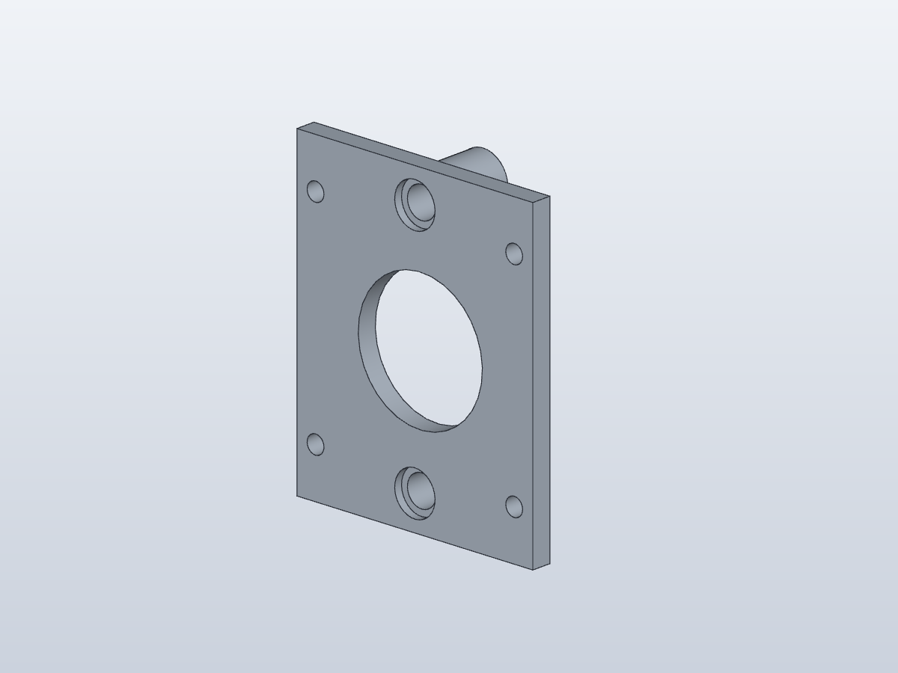
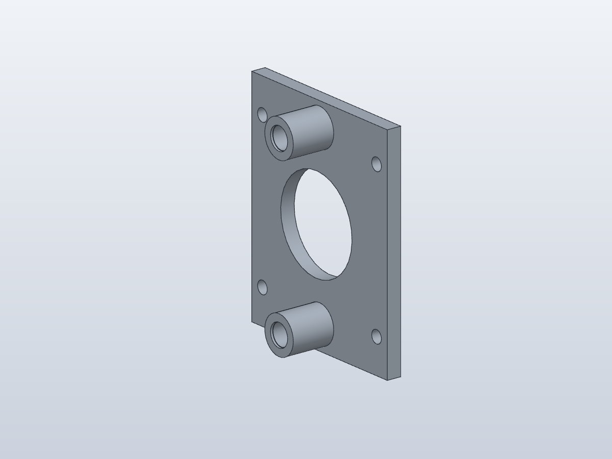

# RPiSpeaker v17 speaker cover — unreviewed bridge concept

**This is a design, not a print. Nothing has been sliced, printed or fit-tested.**
It is a tentative cover for the [editable v17 body](../rpispeaker-v17-body/README.md),
not a reconstruction of a known original cover. A particular speaker has not
been identified or measured. Confirm its mounting and height before printing.



*Headless `solidcraft-cli snapshot` of [rpispeaker-v17-cover.sc](rpispeaker-v17-cover.sc):
3 mm assumed bridge plate, single Ø20 opening, two body-anchor holes and four
assumed 32 mm pitch speaker holes. No body, speaker, fasteners or grille shown.*



*Headless `solidcraft-cli snapshot` of the same source: two Ø8 feet with
underside reliefs. The assumed speaker height sets their 9 mm length; the
actual support, speaker frame and fit are not shown or proven.*

## Geometry and intended assembly

Coordinates use the body's frame: X across the bays, Z along the case, +Y out
from its front. Measurements are from the original STEP geometry, **not physical
measurements**, and were checked against the simplified body reconstruction;
see the [bay inventory](../../../docs/notes/2026-11-15-rpispeaker-v17-bay-inventory.md)
and [body measurements](../rpispeaker-v17-body/README.md#measured-comparison).

The two body pilot axes are (32.5, ±18.25) in X,Z. Their **36.5 mm pitch is
measured from the STEP** and is reproduced in the body; it is not the square
speaker pattern. The two feet rest at Y 8.5, aligned with those axes. The bridge
rises over the bay, with its underside at Y 17.5 at the default setting. A
speaker whose rear fits on the Y 2.5 shelf and whose frame reaches that plane
could be clamped between shelf and bridge when the anchors are tightened. The
four additional holes are intended to accept screws into a compatible speaker
frame or its hardware, not to cut new holes into the case. No speaker or screw
is modelled; actual contact and fastener access have **not** been established.

A flat bridge at Y 8.5 would put the assumed square pattern across the taller
Pi-side divider. The raised bridge avoids that in the model, but may obstruct
the Pi, HAT, topper or other components: none were checked. The chosen 15 mm
speaker shelf-to-frame height is an assumption, not a dimension of the actual
speaker. A larger frame can only work if its smaller rear body clears the
28.125 mm shelf length and the rest of the assembly; a 32 mm square mounting
pattern does not itself prove this. Feet define the final bridge height: a
shorter speaker would be loose, a taller one would prevent the feet seating,
and clamping force and acoustic sealing are **not proven**.

**Known assembly constraint:** at the assumed default 32 mm pitch, the two
speaker holes at X 16.5, Z ±16 lie above the tall Pi-side divider, whose modeled
top is Y 15.5. Only **2 mm** separates it from the Y 17.5 underside. Ø2.7 mm
probe cylinders extending 4 mm below the bridge each intersected the divider
by 7.199989 mm³. Thus a sufficiently long speaker fastener or a flange/nut
below that level can collide even though the cover alone clears the body. The
actual speaker attachment, access, usable engagement length, and any revised
height or positioning need checking; do not infer that all four screws fit.
The [handoff](../../../docs/notes/2026-11-15-v17-cover-design.md) includes the
probe procedure. A different `SQ_PITCH` or `SPEAKER_H` changes this constraint.

| Parameter | Default | Meaning and status |
| --- | ---: | --- |
| `COVER_T` | 3 mm | Assumed bridge thickness; a starting compromise between stiffness and bulk, not a strength calculation. |
| `SPEAKER_H` | 15 mm | **Assumed**, from shelf to speaker's contact frame. `PLATE_Y = SHELF_Y + SPEAKER_H`; verify actual speaker, contact surfaces and clearance. |
| `SQ_PITCH` | 32 mm | **Assumed**, not measured from the speaker or STEP. The user must confirm both square pitch and actual hole locations/center. |
| `SQ_SCREW_D` | 2.7 mm | Assumed clearance through the bridge for the four speaker screws. The holes are unthreaded; confirm speaker threads/nuts and tool access. |
| `MOUNT_X`, `MOUNT_Z` | 32.5, 18.25 mm | STEP-derived two-pilot axes (X, Z = ±18.25); 36.5 mm apart. |
| `ANCHOR_D` | 4.6 mm | Requested through-clearance along each 12 mm default-height foot/bridge stack, not a designation for the body screw. |
| `CONE_RELIEF_D`, `CONE_RELIEF_DEPTH` | 4.8, 0.5 mm | Underside counterbore gives clearance around the body's **Ø4.5** cone mouth; the body cone is not a head seat in the cover. |
| `HEAD_D`, `HEAD_DEPTH` | 6.5, 1.2 mm | Assumed top counterbore for a screw head or washer; not derived from an identified fastener. |
| `ACOUSTIC_X`, `ACOUSTIC_D` | 31.625, 20 mm | One open circular aperture, concentric with the body's flare. Simple open aperture leaves space for a separate grille/cloth, neither of which is included; no acoustic or finger protection is provided. |

The body pilot core is approximately Ø2.1755 in the STEP and reconstructed as
a plain hole, while the 4.6 mm cover bore is much larger. A screw sized for the
body may have a head small enough to pass through the cover: select a suitable
washer or head that bridges the bore and fits the counterbore, and verify its
engagement in the actual body. The STEP's threads are not reproduced. No screw
diameter, head, length, washer, torque or assembly order has been validated.
The land supports most, but not all, of each modelled foot: a 0.01 mm-thick
annular probe immediately below each foot intersects the reconstruction by
0.31703 mm³ (about 31.70 mm² projected), versus about 32.17 mm² for a full
Ø8/Ø4.8 annulus. This is geometric contact evidence only, not strength evidence.

`SQ_PITCH` drives the four X/Z coordinates and plate width. Pitch 30 and 32 mm
were rebuilt below; arbitrary pitch/height/thickness values are not validated.
For example, lowering the bridge below Y 15.5 risks the Pi-side divider, while
increasing pitch can bring the Z holes to the plate ends. Repeat interference
and fit checks after **every** meaningful parameter change.

## Rebuild, measure and reproduce checks

From the repository root; all commands use the headless CLI, not the open app.
The first command **overwrites only this cover's `.sc`** from the tracked build
script; do not point it at the body file.

```sh
solidcraft-cli run models/parts/rpispeaker-v17-cover/build-script.json --save models/parts/rpispeaker-v17-cover/rpispeaker-v17-cover.sc --quiet --param-check strict
solidcraft-cli eval --in models/parts/rpispeaker-v17-cover/rpispeaker-v17-cover.sc
solidcraft-cli snapshot --in models/parts/rpispeaker-v17-cover/rpispeaker-v17-cover.sc --out models/parts/rpispeaker-v17-cover/assets/iso.png --camera '{"target":[32.5,14.5,0],"yaw":2.4,"pitch":0.35,"distance":100}' --width 1200 --height 900 --no-grid --no-axes
solidcraft-cli snapshot --in models/parts/rpispeaker-v17-cover/rpispeaker-v17-cover.sc --out models/parts/rpispeaker-v17-cover/assets/underside.png --camera '{"target":[32.5,14.5,0],"yaw":-0.9,"pitch":0.35,"distance":100}' --width 1200 --height 900 --no-grid --no-axes
```

Default `eval`: **one closed body**, 4,754.507391 mm³; bounding box X
13.5–51.5, Y 8.5–20.5, Z −23.25–23.25 mm. No sketches are used.

The following Linux command builds the cover on a temporary in-memory copy of
the reconstruction and runs the exact Boolean interference check. It does not
save or alter either model. Check `unchecked` and `truncated`, not only `count`.

```sh
python3 -B - <<'PY'
import json, os, subprocess
script = 'models/parts/rpispeaker-v17-cover/build-script.json'
body = 'models/parts/rpispeaker-v17-body/rpispeaker-v17-body.sc'
with open(script) as f:
    steps = json.load(f)['commands']
steps.append({'command': 'inspect.interference',
              'params': {'bodies': ['Body', 'Cover']}})
fd = os.memfd_create('cover-interference', 0)
os.write(fd, json.dumps(steps).encode())
r = subprocess.run(['solidcraft-cli', 'run', f'/proc/self/fd/{fd}',
                    '--in', body, '--results'], pass_fds=(fd,),
                   check=True, text=True, capture_output=True)
print(json.dumps(json.loads(r.stdout)[-1], indent=2))
PY
```

On 2026-11-15: **0 overlapping pairs, 0 mm³ intersection**, two bodies checked,
one pair Boolean-intersected, no unchecked pairs, not truncated. This result
uses the reconstructed body, not the original STEP, speaker, or a physical fit.

This separate non-saving check changes pitch 32 → 30 → 32 mm and reads the
actual Ø2.7 cylindrical face axes and body volume after each rebuild:

```sh
python3 -B - <<'PY'
import json, os, subprocess
path = 'models/parts/rpispeaker-v17-cover/rpispeaker-v17-cover.sc'
steps = []
for pitch in (32, 30, 32):
    steps += [{'command': 'parameters.change',
               'params': {'name': 'SQ_PITCH', 'expression': f'{pitch} mm'}},
              {'command': 'model.faces', 'params': {'body': 'Cover'}},
              {'command': 'inspect.measure', 'params': {'bodies': ['Cover']}}]
fd = os.memfd_create('pitch-check', 0)
os.write(fd, json.dumps(steps).encode())
r = subprocess.run(['solidcraft-cli', 'run', f'/proc/self/fd/{fd}',
                    '--in', path, '--results'], pass_fds=(fd,),
                   check=True, text=True, capture_output=True)
results = json.loads(r.stdout)
for i, pitch in enumerate((32, 30, 32)):
    change, faces, measure = results[3*i:3*i+3]
    axes = sorted((round(c['origin'][0], 4), round(c['origin'][2], 4))
                  for f in faces['faces'] if (c := f.get('cylinder'))
                  and abs(c['radius'] - 1.35) < 1e-6)
    print('pitch', pitch, 'recomputed', change['recomputed'],
          'restored', change['restored'], 'axes X,Z', axes,
          'volume', measure['bodies'][0]['volume_mm3'],
          'closed', measure['bodies'][0]['closed'])
PY
```

At 32 mm the axes are X 16.5/48.5, Z ±16; at 30 mm they are X 17.5/47.5,
Z ±15. The trial volume was 4,475.507391 mm³ and 14 features recomputed; the
return to 32 restored all 14 cached features and the original volume. The saved
file remains at 32 mm. See the [design handoff](../../../docs/notes/2026-11-15-v17-cover-design.md)
for sources, limits and verification details.
