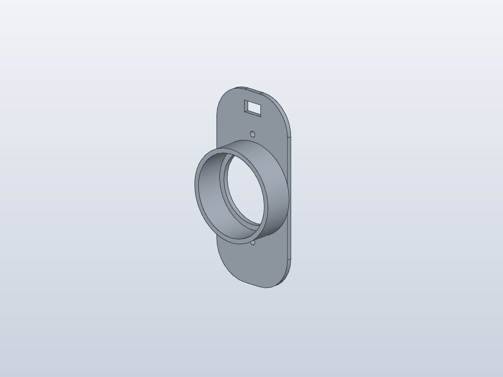
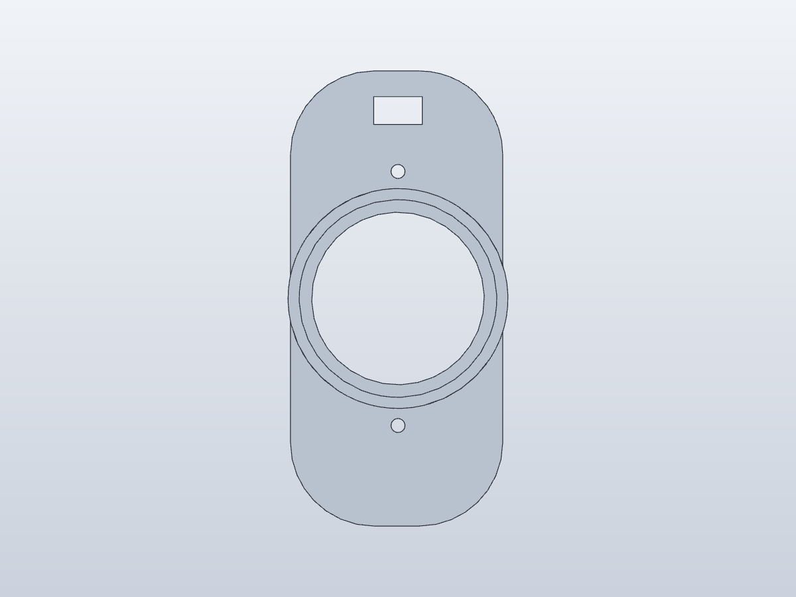

# RPiSpeaker v17 second-bay lid — provisional bare-driver concept

**This is the single front panel for the v17 second bay.** The separate
[cover](../rpispeaker-v17-cover/README.md) that used to sit over the same bay is
retired: the two parts intersected, and one bay has one front plate. See
[the one-front-panel note](../../../docs/notes/2026-11-15-v17-one-front-panel.md).
That decision did not change this geometry, and it did not validate it — the
speaker mounting below is still an assumption.

**CAD-only; not a complete, verified enclosure.** The supplied v17 holes are
threaded through holes with front countersinks, the selected speaker is a
hypothetical bare driver, and the fit checked so far is **against the
reconstruction only**: it does not interfere with the
[reconstructed body](../../assemblies/rpispeaker-v17-body-lid/README.md), which
is a geometric result about two CAD models, not a printed fit to the original.
The design therefore needs further engineering before printing, mounting, or
modifying the original body. It is not a reconstruction of an established
original lid.

The [bay inventory](../../../docs/notes/2026-11-15-rpispeaker-v17-bay-inventory.md)
supersedes the earlier 31.10 × 66 × 7 rectangular-pocket assumption used by
this concept: the lower speaker-side footprint is 31.10 × 28.125 mm, with its
central floor at Y 2.50 and raised surfaces at Y 8.50. The dimensions below
describe the existing lid design and its original assumptions, not verified fit.

The editable source is [`rpispeaker-v17-lid.sc`](rpispeaker-v17-lid.sc); the
replayable parameter and feature history is [`build-script.json`](build-script.json).
Coordinates use the [v17 reference](../../components/rpispeaker-v17/README.md):
X across the bays, Z along them, and +Y toward the front.



*SolidCraft CLI render of this lid only. The round sleeve and its 10 mm height
are assumptions; no speaker, screws, original body or wiring are modelled.*



*View from +Y. The sleeve is open and does not protect a speaker cone. The
connector slot is an assumed size and location, not a verified cable route.*

## Arrangement and fit

- The inset plate nominally spans X **17.45–47.95**, Z **−32.70–32.70** and
  Y **13.90–15.50**. Its front is flush with the reported Y 15.50 body plane.
  The two rear screw pads extend to the Y 8.50 raised surfaces. The
  sleeve and an assumed 10 mm-deep bare driver sit entirely in front of the
  body, protruding **10 mm** to Y 25.50. The sleeve projects from X 16.70 to
  48.30 and so covers the Pi-side divider's front edge by 0.45 mm in X. That
  was flagged here as needing a collision check and has now been measured: it
  is an **adjacency at Y 15.50, not an overlap** — the body ends at Y 15.50 and
  the sleeve starts there — and the lid and body intersect by **0 mm³** at the
  default parameters. See the
  [assembly check](../../assemblies/rpispeaker-v17-body-lid/README.md#fit-measured-and-the-check-is-sensitive).
  Any attached Pi-bay component is still unchecked, because no Pi, HAT or
  header is modelled. No Pi-bay front opening is assumed.
- The second-bay endpoints X 17.15–48.25 give **31.10 mm**, which the
  [correction note](../../../docs/notes/2026-11-15-rpispeaker-v17-second-bay-corrections.md)
  confirms is the X span; the earlier 31.85 counted the outer wall. The 30.50 mm inset uses the narrower
  endpoints and supplies **0.30 mm per side** relative to them. The lid also
  ends 0.30 mm inside Z −33–33, but those are outer-outline coordinates, not
  pocket boundaries. This does not verify lid fit: the lower footprint is only
  28.125 mm along Z. The lid's R12 corners are assumed, not established by the
  body's reported outer R11 rounds. Actual clearance is **unverified**.
- DWEII 671's reported 44 × 28 × 15 mm housing cannot fit wholly inside the
  lower speaker-side footprint. This design instead assumes a circular **Ø28 × 10 mm bare driver**,
  seated on a 1.6 mm radial land with its front toward +Y. No exact driver,
  flange, terminal geometry or retention method is known. The sleeve has
  0.2 mm radial clearance, so it does **not** retain a driver by itself; a
  safe, serviceable retainer must be designed after measuring the actual part.
  [What to measure](measure-request.md) lists the five numbers and what each one
  changes.
  This is not a carrier for a DWEII module and does not claim to seal one.
- The front opening is one unobstructed Ø28.4 mm aperture, rather than a
  protective grille. Open area is π × 14.2² = **633.47 mm²**, or
  **633.47 / 633.47 = 100%** of the aperture. This is a geometric open-area
  calculation, not an acoustic measurement; the actual exposed driver cone area
  is unknown. The Ø24.8 rear opening is a separate feature and could interfere
  with an actual driver's terminals or vents.
- The assumed **7 × 4 mm** connector slot passes through the lid at Z 27. It
  is only a potential JST-PH plug passage, not proof of plug, bend, strain
  relief or a connection into the already-closed Pi bay. The original central
  Ø10 hole is at X 31.625, while the sleeve centre is X 32.5. Routing through
  that hole and around the driver and existing body remains unverified.
- Plate and sleeve walls are 1.6 mm by design; screw-pad sides around their
  Ø2 pilots are 2 mm. This is a nominal feature calculation, not a global
  wall-thickness or print-strength analysis.

## Fastening remains conditional on fit

The two lid pilots are centred at the **existing** body pilot coordinates
`(X, Z) = (32.5, ±18.25)`. They are not a new four-screw pattern. The reported
body holes span Y −0.60 to 8.50 and are open at both ends. The threads end at
Y 7.29; an open 0.05 mm core leads to a 90° countersink from Ø2.1755 at
Y 7.33775 to Ø4.50 at Y 8.50. The earlier 1.21 mm web was an arithmetic
misinterpretation: the countersink already removes that material. A front screw
can reach the existing thread without modifying the body, but the lid's Ø2 mm
pilots would need suitable clearance for a screw intended to thread into the
body. A rear screw can also pass through the existing opening to the lid, but
may bind in the body thread instead of clamping the lid; making the body path
clearance would permanently modify it. Neither method has been fit-tested or
authorized by this model. The pads assume a flat floor at both positions and
need checking against the actual raised surfaces and countersinks.

Candidate fasteners only: **2 × M2.5 × 16 mm screws**, with heads appropriate
to the measured back face. If the screw head bears at Y −0.60, the tip would
nominally reach Y 15.40, with 6.9 mm in a lid pad starting at Y 8.50. The
actual screw seating surface, Ø2 mm printed pilot, thread engagement and
safe length are unverified. Do not drill or assemble on the basis of this
estimate. Driver retention hardware is not yet specified.

The modelled thread limits Ø2.1755–2.68 at ~0.45 mm pitch are consistent with
M2.5, not proof of it. A screw head larger than Ø4.50 cannot seat in the body's
countersink. Engagement behind it depends on screw length; ~4.1 mm is a possible
nominal example, not a measurement of this lid's fit. The local wall and boss
material has not been checked against a real screw.

## Parameters

Source: the task's supplied v17 measurements, also recorded in the
[v17 component reference](../../components/rpispeaker-v17/README.md).
**ASSUMED** means a design choice, not a physical measurement. All dimensions
are mm. Derived rows depend on both supplied dimensions and assumptions.

| Parameter | Default | Source or status |
| --- | ---: | --- |
| `BAY_X_MIN`, `BAY_X_MAX` | 17.15, 48.25 | Supplied coordinates; the 31.10 mm span is the bay width, corrected from an earlier 31.85 |
| `BAY_Z_MIN`, `BAY_Z_MAX` | −33, 33 | Supplied coordinates |
| `FRONT_Y` | 15.50 | Supplied front plane |
| `BAY_FLOOR_Y` | 8.50 | Raised surfaces at screw pads; their contact with the pads is **ASSUMED**, central floor is Y 2.50 |
| `MOUNT_X`, `MOUNT_Z` | 32.5, 18.25 | Supplied two pilot positions; sleeve shares their X **ASSUMED** |
| `CLEAR` | 0.3 | **ASSUMED** per side interpretation of requested clearance |
| `LID_R` | 12 | **ASSUMED** inset corner radius; inner pocket radius unknown |
| `PLATE` | 1.6 | **ASSUMED**, task minimum |
| `DRIVER_D` | 28 | **ASSUMED** bare driver diameter; no actual part selected |
| `DRIVER_DEPTH` | 10 | **ASSUMED** bare driver depth and sleeve protrusion |
| `DRIVER_CLEAR` | 0.2 | **ASSUMED** radial driver clearance |
| `SLEEVE_WALL` | 1.6 | **ASSUMED**, task minimum |
| `BACK_OPEN_D` | 24.8 | **ASSUMED** rear opening, leaves 1.6 radial land for Ø28 driver |
| `PAD_SIZE` | 6 | **ASSUMED** square screw pads |
| `PAD_DEPTH` | 5.4 | Derived: `FRONT_Y - PLATE - BAY_FLOOR_Y`; no raised obstruction **ASSUMED** |
| `LID_PILOT_D` | 2 | **ASSUMED** printed-lid screw pilot |
| `CABLE_X`, `CABLE_Z` | 7, 4 | **ASSUMED** JST-PH connector slot; plug not measured |
| `CABLE_AT_Z` | 27 | **ASSUMED** connector-slot centre |
| `LID_W`, `LID_L` | 30.5, 65.4 | Derived bay spans less twice `CLEAR` |
| `LID_X`, `LID_Z` | 32.7, 0 | Derived bay midpoints |
| `POCKET_D`, `SLEEVE_D` | 28.4, 31.6 | Derived driver plus clearance and sleeve wall |

## CAD checks

CLI build and evaluation on 2026-11-15 produced **one closed body**,
**4,028.8431 mm³**, bbox minimum **(16.70, 8.50, −32.70)** and maximum
**(48.30, 25.50, 32.70)**. The expected bounding box was identical to within
0.1 mm. The independent expected volume was **4,028.8431 mm³**, relative
difference less than 0.000001%, within 2%. In mm and mm², it is:

```
A = 30.5*65.4 - (4 - pi)*12^2
V = A*1.6 + 2*6^2*5.4 + pi*(15.8^2 - 14.2^2)*10
    - pi*12.4^2*1.6 - 2*pi*1^2*7 - 7*4*1.6
```

The CAD kernel's `model.faces` reported the two Ø2 lid pilot cylinder axes at
X 32.5, Z ±18.25, Y 8.5, parallel to +Y. This checks the lid's holes, not the
original body. A non-saving parameter trial changed `CLEAR` to 0.4,
`DRIVER_D` to 27.5 and `DRIVER_DEPTH` to 9; it rebuilt without timeline errors
as one closed body, volume 3,824.8032 mm³, bbox (16.95, 8.50, −32.60) to
(48.05, 24.50, 32.60). This is a limited change test, not proof that arbitrary
parameter combinations are valid. Recheck wall thickness and attachment when
changing parameters; for example, `BACK_OPEN_D` does not automatically follow
`DRIVER_D`.

## Print and unresolved checks

Proposed orientation: place the pad ends at Y 8.50 on the build plate, with
the sleeve pointing upward (+Y). The flat plate then bridges 5.4 mm above
the bed and will likely need support. This is only a proposed orientation;
no slicing, printability, strength, speaker retention, fit, wiring, acoustic
performance or physical testing has been done. Nor is it known whether the
original ever had this lid. There is no evidence that this concept completes
the original enclosure as-is. Review the original body and a measured driver,
including all vents and terminals, before choosing a retainer or body change.

## Rebuild and inspect

Run from the repository root; these commands use the CLI and do not connect to
the open SolidCraft application:

```sh
solidcraft-cli run models/parts/rpispeaker-v17-lid/build-script.json --save models/parts/rpispeaker-v17-lid/rpispeaker-v17-lid.sc --results
solidcraft-cli eval --in models/parts/rpispeaker-v17-lid/rpispeaker-v17-lid.sc
solidcraft-cli snapshot --in models/parts/rpispeaker-v17-lid/rpispeaker-v17-lid.sc --out models/parts/rpispeaker-v17-lid/assets/iso.png --camera '{"target":[32.5,16,0],"yaw":2.4,"pitch":0.35,"distance":150}' --width 1200 --height 900 --no-grid --no-axes
solidcraft-cli snapshot --in models/parts/rpispeaker-v17-lid/rpispeaker-v17-lid.sc --out models/parts/rpispeaker-v17-lid/assets/front.png --view back --width 1200 --height 900 --no-grid --no-axes
```

CLI `back` looks from +Y and is the installed lid's front; CLI `front` looks
from −Y. The requested `models/parts/dweii-671-case/build-script.json` was not
present in this checkout; the existing 671 README and
`models/parts/dweii-462-case/build-script.json` provided the available conventions.
