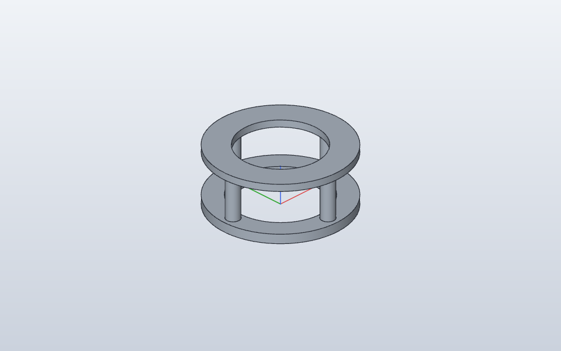

# v17 40 mm driver frame — baffle and retainer

**CAD-only concept. Nothing here has been printed, fitted or measured.** The
driver's dimensions are vendor-published, not taken from a driver in hand, and
this part does not yet integrate with the
[v17 lid](../rpispeaker-v17-lid/README.md): it is the frame that the lid would
carry, built on its own so its geometry can be checked before it is cut into the
lid's face.

Editable source: [`v17-40mm-driver-frame.sc`](v17-40mm-driver-frame.sc).
Coordinates are local: Z up, the driver axis on the origin, the **front** face of
the baffle at Z 0.

*Headless SolidCraft render of the `.sc` only. The baffle is the lower disc; the
retainer ring sits above it on four bosses with the driver's space between them.
No driver, screws or lid are modelled.*

## Why a frame and not screws into the body

Two facts from the repository decide the shape:

- The only 40 mm driver in the
  [candidate envelopes](../../components/speaker-candidates/README.md) is the
  Adafruit 3968, **Ø40 × 21 mm, with no fastener holes at all**. It cannot be
  screwed down; it has to be clamped.
- The v17 body's speaker-side footprint is **31.10 × 28.125 mm**
  ([bay inventory](../../../docs/notes/2026-11-15-rpispeaker-v17-bay-inventory.md)).
  A Ø40 driver is 40 mm across: it is larger than that footprint in *both* axes,
  so it cannot sit in the body's bay at all. Enlarging the body's Ø10 central
  opening would not make room for it — the bay itself is too small, so "modify
  the body" means rebuilding the body around a bigger bay, not widening a hole.

That is what makes the lid the right place, which is what James expected: the
driver faces out through the lid, the lid carries the frame, and the body's Ø10
opening is left as the original part has it.

## The two parts

| Part | Volume | Bounding box | What it does |
| --- | --- | --- | --- |
| Baffle frame | 5461 mm³ | Ø58 × 4 mm | Front plate with a Ø36 acoustic opening, a Ø41 × 3 mm seat that locates the driver, and four Ø3.2 clearance holes on a Ø49 circle |
| Driver retainer | 6517 mm³ | Ø58 × 21 mm (Z 4.2–25) | Ring behind the driver with four Ø6 bosses and Ø2.5 self-tapping pilots |

The retainer sits 0.2 mm clear of the baffle (print clearance, not an
adjustment) and its ring touches the driver's back face. Four M3 screws enter
from the **front** of the baffle, cross the gap and thread into the retainer
bosses, so tightening them pulls the retainer forward and clamps the driver
against its seat. A driver with no holes of its own needs exactly this.

## Parameters

| Name | Value | Source |
| --- | --- | --- |
| `DRIVER_D` | 40 mm | Vendor, Adafruit 3968 — **not measured** |
| `DRIVER_H` | 21 mm | Vendor — **not measured** |
| `CUTOUT_D` | 36 mm | The opening a 40 mm driver needs (James) |
| `SEAT_D` | 41 mm | `DRIVER_D` + 1 mm, to locate the rim with 0.5 mm a side |
| `SEAT_T` | 3 mm | Leaves a 1 mm front lip on a 4 mm plate |
| `PLATE_T` | 4 mm | Chosen; a printed plate thinner than this is fragile around the seat |
| `FRAME_OD` | 58 mm | Chosen; must clear the v17 bay's 62.0–66.0 Z span |
| `SCREW_D` | 3.2 mm | M3 clearance |
| `SCREW_BCD` | 49 mm | Keeps 4 mm of wall to the seat and 4.5 mm to the outside |
| `RET_ID` | = `CUTOUT_D` | Clamps the 36–40 mm rim and clears the cone |
| `BOSS_D` | 6 mm | Clears the Ø40 driver by 1.5 mm at its widest |
| `PILOT_D` | 2.5 mm | Self-tapping pilot in printed plastic — a printer-and-material assumption, not a specification |

## What was checked

| Claim | How |
| --- | --- |
| Both volumes match a hand calculation | 5461 mm³ measured against 5460 calculated; 6517 against 6536 |
| The two parts are separate bodies | `measure` reports two closed bodies, and the retainer starts at Z 4.2, clear of the plate |
| The driver clears the retainer bosses | Bosses span radius 21.5–27.5 mm; the driver's radius is 20 mm, giving 1.5 mm |
| The driver is clamped, not floating | The seat's Ø41 bore locates it and the retainer's ring meets its back face at Z 22 |

Not checked: any real driver, the driver's cone and rim thickness (unknown, and
they set how much of the rim the retainer actually grips), screw length, the
lid's own face, interference with the v17 body, printability at the chosen wall,
or whether 4 mm of plate survives tightening. **No print, no fit test.**

## What it still needs

1. The actual driver. A 40 mm driver with a square four-screw flange would need
   a different mounting pattern entirely, and the v17 STEP's two holes 36.5 mm
   apart are not that pattern either.
2. A lid face to carry it: the [current lid](../rpispeaker-v17-lid/README.md) has
   a sleeve for a 28 mm driver, so its face has to become the Ø58 frame opening.
3. The acoustic volume behind the driver, which this frame does not provide.
