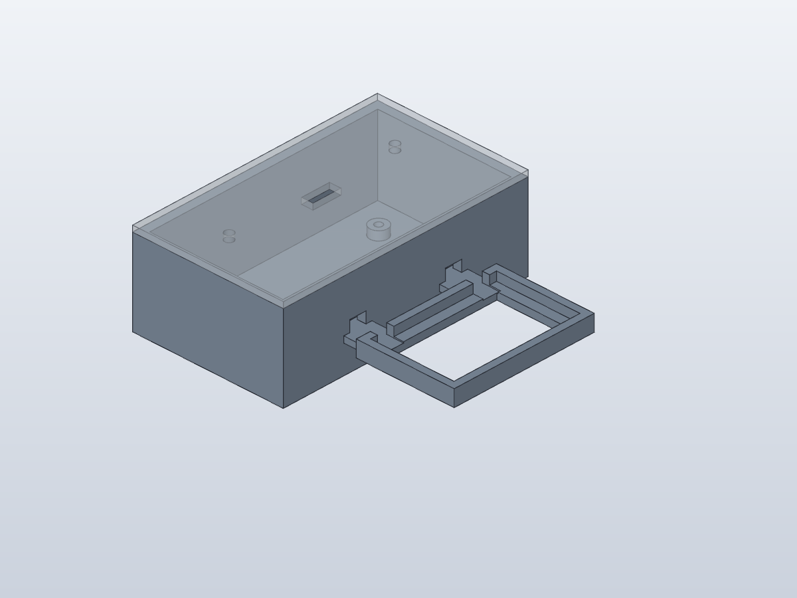
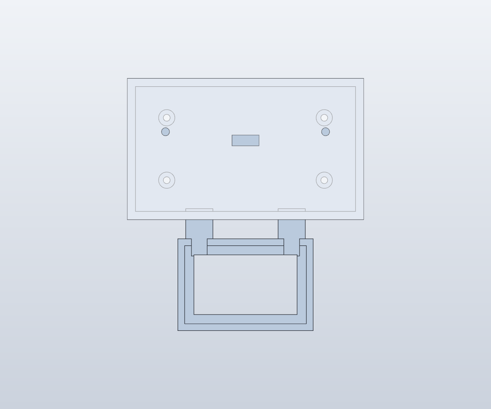

# Pi Zero + DWEII 671: early bay and lid demo

**Unreviewed CAD-only concept. Nothing has been sliced, printed, assembled or
fit-tested.** This is a new layout, not a reconstruction or a compatible
attachment for the original v17 body. On 2026-11-15 James identified his three
speakers as those in the archived README: the [DWEII modules](../../components/dweii-speakers/README.md).
The chosen **701715519671** is a rectangular housed module, not a square bare
driver; its envelope is a seller claim, not a measurement. Its mounting tabs
are known to exist but their dimensions and positions are unknown; the two
concept arms are not claimed to be its actual tabs.
Authored 2026-11-15 by an OpenCode subagent, model
`openrouter/openai/gpt-6.1-terra`, variant unknown; awaiting independent review.

The [editable SolidCraft source](zero-square-demo.sc) contains two separate
bodies: `Case` (electronics tub, two bridges, and external open speaker tray)
and `Lid` (over the electronics tub). The [build script](build-script.json)
replays both. The speaker tray is deliberately open at the front (+Z), so the
lid does not cover the speaker. See the [loaded assembly](../../assemblies/zero-square-demo/README.md)
for the Pi, HAT, speaker and two arms shown together.



*Headless SolidCraft CLI render of this source. The electronics lid is drawn
translucent to show the bays. The assembly's speaker follows the seller-based
envelope; its exact shape is not established.*



*Top view of the same source. The lid has through-openings for the two microphones
and the LED row. The speaker tray remains open; no retention is represented.*


*The 38 × 22 mm rear opening leaves an assumed 3 mm bearing strip around the
module footprint. This does not prove that unknown vents on the strip are clear.*

## Coordinates and named bays

Units mm. The Pi's nominal PCB lower-left is (0, 0); X runs along its 65 mm
edge, Y across its 30 mm edge, +Y toward the HAT header, and +Z toward both
microphones and the exposed speaker face. HAT component XY positions use the
HAT envelope's lower-left board frame, aligned to the nominal Pi frame. These
are design positions, not a claim about the original v17 coordinate frame.

| Named space | Placed envelope and bay | Clearances and justification |
| --- | --- | --- |
| **Pi Zero board** | Sourced 65 × 30 outline; assumed 1.6 thickness. PCB X 0–65, Y 0–30, Z 5.5–7.1. Electronics void X −8–73, Y −8–38, Z 2.5–29: 81 × 46 × 26.5. | 8 mm to each void wall is an **assumed design allowance** for approximate connectors, not a verified plug or service path. Four Ø6 × 3 standoffs at (3.5, 3.5), (61.5, 3.5), (3.5, 26.5), (61.5, 26.5); 3 mm below PCB is **assumed**, pattern comes from the [Pi envelope](../../components/pi-zero-family/README.md). Ø2.5 through-pilots are provisional, not selected fasteners. |
| **ReSpeaker HAT + header** | HAT outline 65.02 × 29.97, thickness assumed 1.6; HAT PCB Z 18.1–19.7 on an **assumed** 11 mm top-Pi-to-bottom-HAT gap. Same 81 × 46 void, no separate ledge. | Approximately 8 mm to side walls relative to the nominal board frame; tallest approximate 6.5 mm Grove component reaches Z 26.2, leaving **2.8 mm** under the lid at Z 29. This is a design allowance, not a measured stack or connector fit. Header/socket are represented in the assembly; they mate by an intentionally overlapping simplified block. HAT is not independently restrained. |
| **DWEII 701715519671 module** | The larger seller claim **44 × 28 × 15**, X 10.5–54.5, Y −49–−21, Z 12–27. Low locating bay X 10.1–54.9, Y −49.4–−20.6, Z 12–15: **44.8 × 28.8 × 3**, open at +Z and at the rear through a **38 × 22** aperture. | **0.4 mm per XY side** is an untested fit allowance. The 3 mm-high locator rim and 3 mm bearing land are **design choices**, not module dimensions. The rear aperture and exposed front aim to avoid sealing the module, but the land may cover unknown vents. |
| **Two concept arms** | **Guessed**, each 5 × 21 × 3, centres X 15.5 and 49.5; Y −24–−3 and Z 12–15. Each reaches through the electronics wall and the low speaker rim. | Each cut is **5.8 × 16.8 × 3.8** (X × Y × Z), X 12.6–18.4 and 46.6–52.4; Y −24.4–−7.6, Z 11.6–15.4. **0.4 mm on each width/height side** is an untested insertion allowance, not a fastening; in the low rim the cut opens through its top. The arms overlap the module envelope by 3 mm as a conceptual connection, not verified tab geometry. |

The electronics tub has 3 mm walls and 2.5 mm floor by design. Bridges support
the open speaker tray; their positions and strength are not tested. The bay is
open upward for insertion. The lid rests on the rim but has **no modeled latch,
locating lip, screws, seal or other means of retention**. The arm slots do not
clamp the arms. No four-screw speaker pattern is invented: the
[broader v17 search](../../../docs/notes/2026-11-15-v17-square-pattern-search.md)
did not establish one, but its outcome is **inconclusive**, not proof that
James's mount is absent.

The 671 source also gives a conflicting **31 × 28 × 15** seller dimension: a
31 mm housing would have 13.8 mm total spare X in this 44.8 mm locator, so it
would not be located securely. The 664's 44 × 28 × 15 figure is inherited
from the family, not an individually sourced measurement; it is not asserted
to fit. The 462's seller-listed **100 × 45 × 21** is substantially larger and
needs a separate carrier/case, not this bay. None of the three has been measured.

**Carry, do not seal** is the working assumption for these housed modules, not
a verified acoustic specification. The source says their real front and rear
openings and whether each housing is already a sealed chamber are unconfirmed.
The carrier has an open back and no speaker-covering lid, and its low rim leaves
most side surfaces exposed. Because the actual vent, terminal and tab locations
are unknown, even the remaining bearing strips and rim may obstruct them. Confirm
the housing before designing the real contact surfaces or sealing treatment.

## Microphone and LED openings

The [HAT reference](../../components/respeaker-2mic-hat/README.md) records XY
from Seeed's V1 Eagle layout, used provisionally for V2 based on Seeed's
"basically the same" layout statement. Real V2 port positions still need
confirmation; component heights are assumed. Coordinates below are also the
world XY used in this concept, in the aligned nominal board frame.

| Opening | Source positions in board XY | Actual lid opening at Z 29–31 | Reason |
| --- | --- | --- | --- |
| MIC1 | Port (3.05, 21.34), Ø0.325 top-port marker | Ø3 through, centred (3.05, 21.34) | Direct vertical opening, with 1.3375 mm radial margin to the nominal marker; hole diameter is a **design assumption**, not an acoustic result. |
| MIC2 | Port (61.98, 21.34), Ø0.325 top-port marker | Ø3 through, centred (61.98, 21.34) | Same reasoning. |
| Three LEDs | (29.34, 18.16), (32.51, 18.16), (35.69, 18.16) | **10 × 4** through-window, X 27.51–37.51, Y 16.16–20.16 | Window centred on the middle LED. It covers all three nominal 2.2 × 1.9 packages with about 0.72 mm margin at the narrowest X edge and 1.05 mm at either Y edge. Window size is a **design choice**. |

The openings have open air between HAT and lid, not individually sealed
microphone tubes. Neither audibility nor speaker leakage has been tested.
`MIC1_X`, `MIC2_X`, `MIC_Y`, `MIC_D`, `LED_X`, `LED_Y`, `LED_SLOT_X` and
`LED_SLOT_Y` are editable. A positive-control probe and five vertical probes
check the model's unobstructed paths; see the assembly README for their limits.

## Adjustable assumptions

| Parameter | Default | Source/status |
| --- | ---: | --- |
| `PI_L`, `PI_W` | 65, 30 | Sourced Pi outline; HAT outline slightly different as above. |
| `SIDE_GAP`, `WALL`, `FLOOR`, `CASE_H`, `LID_T` | 8, 3, 2.5, 29, 2 | Design choices; no real plug, thermal or print-fit measurements. |
| `STAND_H`, `STAND_D`, `PILOT_D` | 3, 6, 2.5 | Design choices, screw fit not established. |
| `SP_X`, `SP_Y`, `SP_Z` | 44, 28, 15 | DWEII 671 larger seller-claimed envelope; 31 mm length is a conflicting claim, no physical measurements. |
| `SP_CLEAR`, `SP_WALL`, `SP_GAP`, `SP_BASE` | 0.4, 2.5, 10, 12 | Design choices for per-side recess clearance, tray wall/floor, separation from case, and speaker underside height. |
| `SP_LAND`, `SP_RIM_H` | 3, 3 | Design choices: rear bearing strip and height of the low locating rim. Whether these obstruct a real vent is unknown. |
| `ARM_W`, `ARM_L`, `ARM_T`, `ARM_INSET`, `ARM_ENGAGE` | 5, 21, 3, 5, 3 | Independent guessed width, length, thickness, centre inset from speaker edge and connection overlap. `ARM_L` affects the assembly reference arms; it does not lengthen the case's slots. Measure all before using. |
| `SLOT_CLEAR` | 0.4 | Design choice, per arm-slot side. |
| `MIC1_X`, `MIC2_X`, `MIC_Y`, `MIC_D` | 3.05, 61.98, 21.34, 3 | XY from the HAT envelope; hole diameter a design choice. |
| `LED_X`, `LED_Y`, `LED_SLOT_X`, `LED_SLOT_Y` | 32.51, 18.16, 10, 4 | Middle LED XY sourced; window dimensions design choices. |

These parameters make selected changes possible, **not** all combinations
valid. In particular changes to speaker dimensions, arm lengths/positions or
tray wall must be rechecked together for bridge contact and slot reach. The
assembly contains its own self-contained copy of these features and parameters:
changes to this part are **not automatically propagated** to that file.

## CAD measurement and limits

`inspect.measure` on the saved source using SolidCraft CLI 0.42.0, 2026-11-15:

| Body | Volume mm³ | Bounding box min → max mm |
| --- | ---: | --- |
| Case | 36,078.695758826245 | (−11, −51.9, 0) → (76, 41, 29) |
| Lid | 8,939.725666112252 | (−11, −11, 29) → (76, 41, 31) |
| Two-body sum | 45,018.4214249385 | combined (−11, −51.9, 0) → (76, 41, 31) |

The measured lid agrees with `87 × 52 × 2 − 2π × 1.5² × 2 − 10 × 4 × 2`
= 8,939.725666 mm³. Full per-body output is in [inspection.json](inspection.json).
Script and saved-source evaluations are [eval-script.json](eval-script.json)
and [eval-sc.json](eval-sc.json). These are measurements of simplified CAD, not
mass, printability or physical fit claims.

## Missing before use

- Measure the actual 671 housing, its mounting-tab geometry, any four screw locations, arm geometry,
  terminal/lead routes and rear/side clearances; redesign the tray and retention.
- Measure the actual Pi/HAT stack, under-board parts, mics, LEDs, connectors
  and plug/bend space. No external power, USB, SD-card, jack or cable access
  openings are provided. The covered button has no access. The speaker lead has
  no dedicated route; arm slots are not a verified cable path.
- No screws, arm attachment, lid attachment, speaker grille, stand/wall mount,
  sealing, cooling, strain relief or wiring are represented. The bearing land
  may block an unknown rear vent. No strength, heat or acoustics
  were evaluated. Do not print based on this demonstration.

## Rebuild and inspect

From repository root, headless only:

```sh
solidcraft-cli run models/parts/zero-square-demo/build-script.json --save models/parts/zero-square-demo/zero-square-demo.sc --param-check strict --quiet
solidcraft-cli eval models/parts/zero-square-demo/build-script.json --json-out models/parts/zero-square-demo/eval-script.json
solidcraft-cli eval --in models/parts/zero-square-demo/zero-square-demo.sc --json-out models/parts/zero-square-demo/eval-sc.json
solidcraft-cli snapshot --in models/parts/zero-square-demo/zero-square-demo.sc --out models/parts/zero-square-demo/assets/iso.png --camera '{"target":[32,-9,12],"yaw":0.8,"pitch":0.55,"distance":185}' --width 1200 --height 900 --no-grid --no-axes --body 'Case:color=#8796a8' --body 'Lid:opacity=0.35,color=#d0d8df'
solidcraft-cli snapshot --in models/parts/zero-square-demo/zero-square-demo.sc --out models/parts/zero-square-demo/assets/top.png --view top --width 1200 --height 1000 --no-grid --no-axes --body 'Case:color=#8796a8' --body 'Lid:opacity=0.35,color=#d0d8df'
solidcraft-cli snapshot --in models/parts/zero-square-demo/zero-square-demo.sc --out models/parts/zero-square-demo/assets/bottom.png --view bottom --width 1200 --height 1000 --no-grid --no-axes --body 'Case:color=#8796a8' --body 'Lid:opacity=0.35,color=#d0d8df'
```
