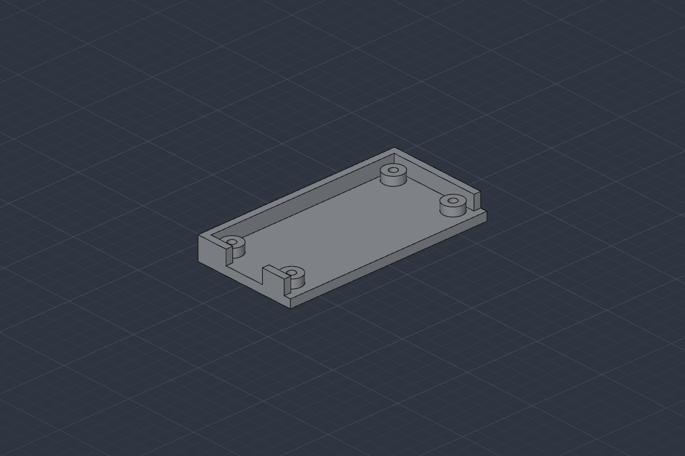
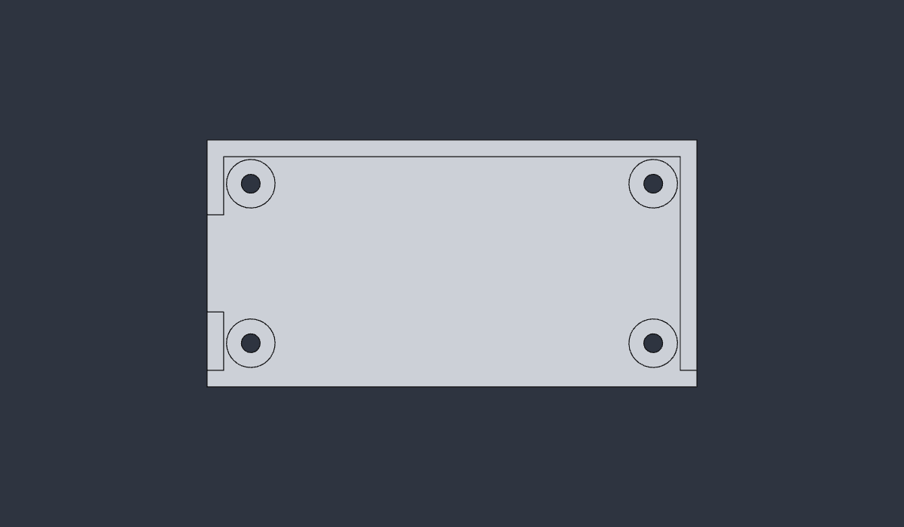

# Pi Zero 2 W + ReSpeaker HAT tray

**First printable part in this repository. Not printed, not fit-tested.** The
geometry follows the reference stack and the Pi HAT form factor; the board
clearance and the standoff height are design choices, not measurements.

Editable SolidCraft source: [`zero2w-hat-tray.sc`](zero2w-hat-tray.sc).

A base plate with a locating lip and four screw standoffs: the Pi Zero 2 W screws
down from underneath, the ReSpeaker HAT stays on the 40-pin header where it
belongs, and the microSD edge and the cable edge are open so nothing has to be
unplugged to get at them.

## What it looks like



*Isometric. The near edge is fully open — that is the cable edge, where the two
micro-USB sockets and the mini-HDMI come out. The gap in the left lip is the
microSD finger notch. The four cylinders are the standoffs; the holes go right
through the plate so M2.5 screws come up from underneath.*



*Top. Plate 70.6 × 35.6 mm, lip 2.4 mm wide and 5 mm high, standoffs on the Pi's
own 58 × 23 mm hole pattern. The notch is centred on the microSD.*

## How it goes together

| Layer | Z (mm) | What |
| --- | --- | --- |
| Plate | 0 – 3 | base, sits on the table |
| Standoffs | 3 – 6 | 3 mm clearance under the board |
| Pi Zero 2 W PCB | 6 – 7.6 | screwed down through the plate |
| Header + socket | 7.6 – 17.6 | the 2 × 20 pair, as in the reference stack |
| HAT PCB | 17.6 – 19.2 | held by the header, not by the tray |
| Top of the HAT | 26.2 | jack and button |

The 11 mm board-to-board gap is inherited from the stack assembly and is the
weakest number in the whole part. Measure it on the real stack before printing
anything that has to enclose the HAT.

## Parameters

| Parameter | Value | Status |
| --- | --- | --- |
| `BOARD_L`, `BOARD_W` | 65 × 30 mm | Pi HAT form factor |
| `CLEAR` | 0.4 mm per side | **design choice** — a snug drop-in fit |
| `LIP_W` | 2.4 mm | 6 perimeters at a 0.4 mm nozzle |
| `LIP_H` | 5 mm | **design choice**; clears the board top by 0.4 mm |
| `PLATE_L`, `PLATE_W` | `BOARD + 2·CLEAR + 2·LIP_W` = 70.6 × 35.6 mm | derived |
| `PLATE_T` | 3 mm | **design choice** |
| `STANDOFF_D`, `STANDOFF_H` | Ø7 × 3 mm | **design choice**; 2.15 mm wall around the screw |
| `SCREW_D` | 2.7 mm | M2.5 clearance |
| `HOLE_SPAN_X`, `HOLE_SPAN_Y` | 58 × 23 mm | dimension-sourced, the Pi's hole pattern |
| `SD_NOTCH_W` | 14 mm | **design choice** for a 12 mm socket |

Overall model bounding box: **70.6 × 35.6 × 8 mm** (X × Y × Z).

Volume check: 9283 mm³ measured, and 9283 mm³ by hand (plate 7540 + lip ring 2434
− cable gap 847 − SD notch 168 + standoffs 462 − screw holes 137).

## Printing

- No supports and no overhangs: every wall is vertical, every hole is round and
  vertical. Print it flat, lip up.
- Suggested starting point: 0.2 mm layers, 3 walls, 15 % infill, no brim. The
  plate is 3 mm, so 15 layers.
- Four M2.5 × 6 mm screws from underneath, into the Pi's own mounting holes. The
  screws are the only fastener; there is no lid yet.

## Known gaps

- **Not printed.** Nothing here has been sliced or extruded, and the 0.4 mm
  clearance is a guess that may be loose or tight depending on the printer.
- The standoff height (3 mm) is not checked against what actually hangs under a
  Zero 2 W: the microSD socket does, and 3 mm is believed to clear it.
- No lid, no speaker chamber, no grille, no cable strain relief. The speaker is
  not part of this part at all — it is still an envelope in
  [the stack assembly](../../assemblies/zero2w-respeaker-stack/README.md).
- No ventilation, no mounting holes for a wall or a foot.
- The HAT's jack and the two microphones need openings in whatever goes on top;
  their X/Y are sourced in [the HAT envelope](../../components/respeaker-2mic-hat/README.md),
  their heights are not.
- No fillets. Sharp edges everywhere, which is fine for a first print and poor
  for handling.

## Regenerate

```
screenshot({ source: "model", grid: true,  axes: false, width: 1200, height: 800,
             camera: { target: [0,0,4], yaw: 0.75, pitch: 0.5, distance: 150 },
             path: ".../assets/iso.png" })
screenshot({ source: "model", grid: false, axes: false, width: 1200, height: 700,
             camera: { target: [0,0,0], yaw: 0, pitch: 1.57, distance: 95 },
             path: ".../assets/top.png" })
```
